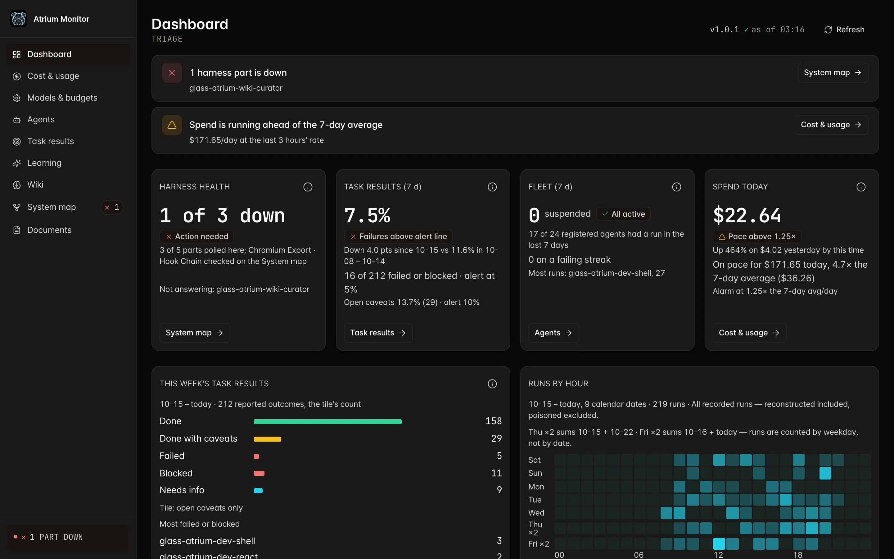
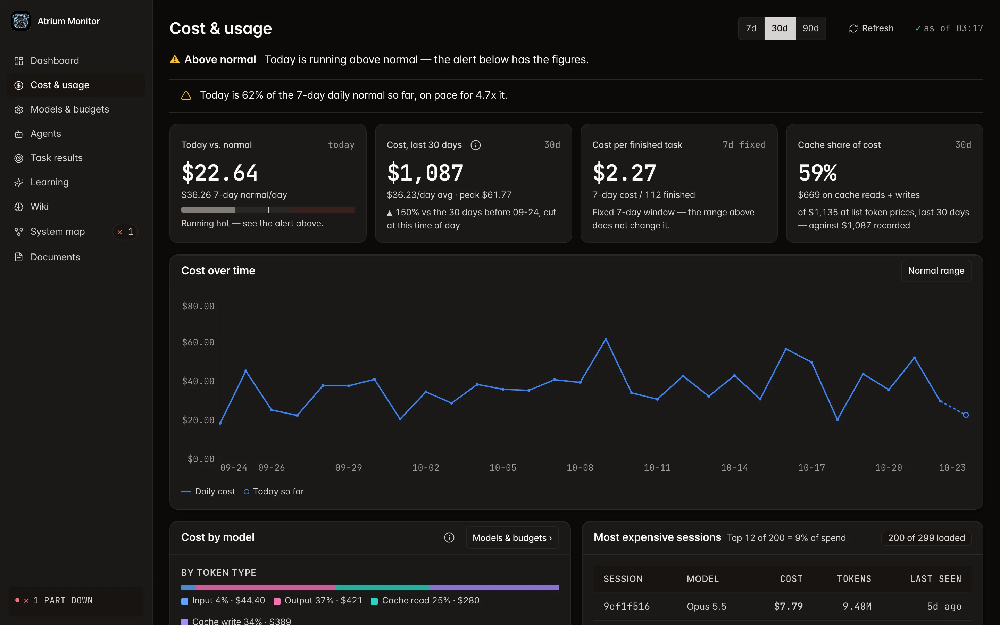
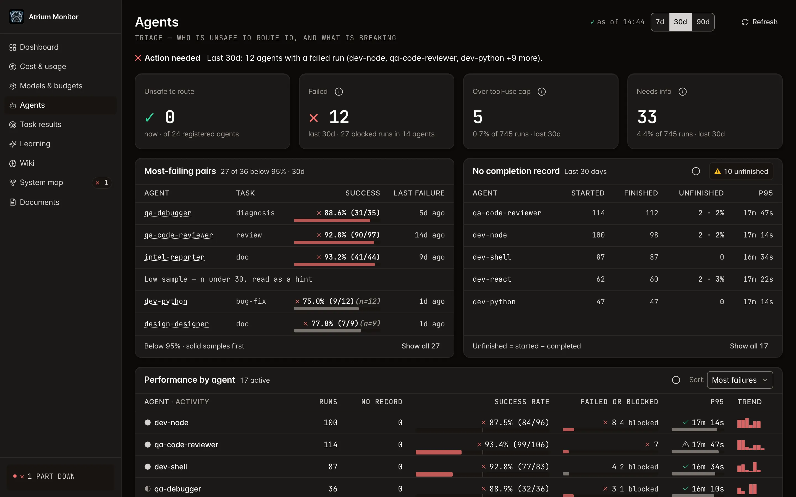
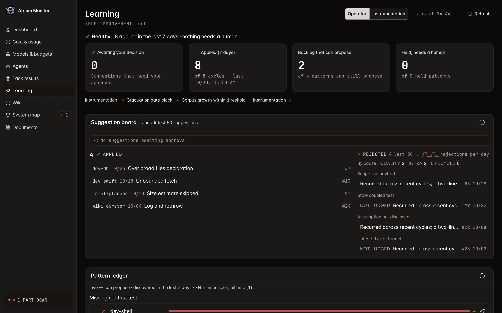
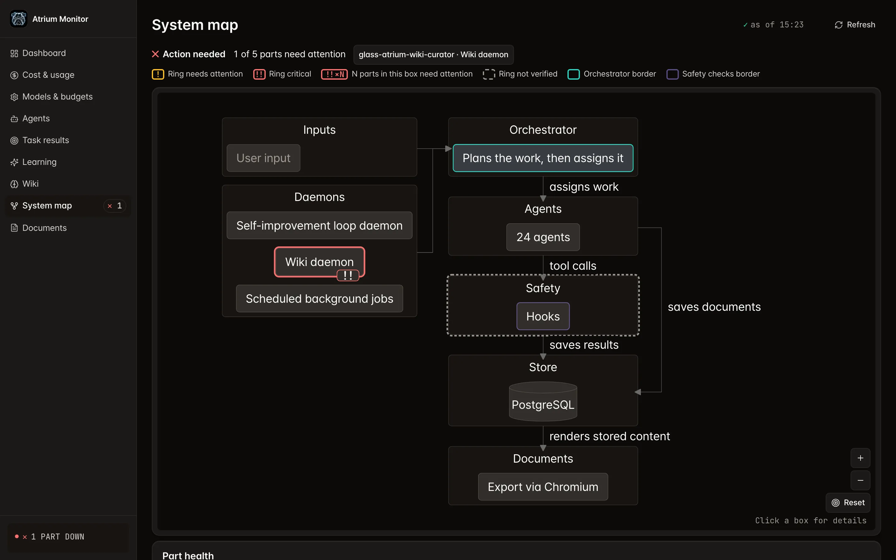

<!-- banner: https://github.com/bettep-dev/glass-atrium/raw/main/docs/assets/banner.webp -->
<p align="center">
  
</p>

**Claude Code のための、中央でオーケストレーションされる自己改善型マルチエージェントハーネス。**

[](LICENSE)
[](.github/workflows/ci.yml)


[English](README.md) · [한국어](README.ko.md) · [中文](README.zh.md) · **日本語**

- 一つのオーケストレーターが専門エージェントの部隊を監視・統制します。
  - エージェント同士が作業をたらい回しして収拾がつかなくなる構造は、決して許しません。
- オーケストレーターが一つのリクエストを受け取り、専門エージェントのチームへ分解・委任し、その結果をまとめ上げます。
- あらゆるコスト・結果・エージェントイベントは、ガラス越しに中をのぞき込むように、リアルタイムのモニターダッシュボードに映し出されます。
- システムは、繰り返す失敗から自らの指示を直していくよう設計されています — プロンプトに手を入れる必要はありません。
  - 自動の指示パッチは試験の関門を通ります: パッチは、変更していない指示と競ったライブ試験で勝った後にのみエージェントへ反映されます([動作の仕組み](#動作の仕組み最初から最後まで)の 8 段階目)。

> [!WARNING]
> - インストールすると、バックグラウンドデーモンが**自動で起動**します。
>   - その一部は毎日自動で Claude を呼び出すため、放置していてもトークン(コスト)を消費します。
> - このハーネスは**トークンを大量に使うシステム**です。
>   - オーケストレーターが一つのリクエストを専門エージェントのチームへ切り分けるため、リクエスト一つが複数のサブエージェント呼び出しへと広がり、トークン消費が単一エージェントの数倍に達することもあります。
> - ただし、このトークンは Anthropic API に直接接続して使用量に応じて課金される方式ではありません。
>   - このハーネスはすでに契約している **Claude Code CLI の上で**動作するため、個別の API キーや従量課金なしに、その契約プランに含まれるトークンをそのまま使う仕組みです。

---

<details>
<summary>目次</summary>

- [何なのか](#何なのか)
- [なぜ作ったのか](#なぜ作ったのか)
- [核心アイデア: ハンドオフ連鎖ではなく一つのオーケストレーター](#核心アイデア-ハンドオフ連鎖ではなく一つのオーケストレーター)
- [動作の仕組み、最初から最後まで](#動作の仕組み最初から最後まで)
- [大きな仕事は慎重に、小さな仕事は素早く](#大きな仕事は慎重に小さな仕事は素早く)
- [内部の構成要素](#内部の構成要素)
- [スキル: 内部の品質レイヤー](#スキル-内部の品質レイヤー)
- [クイックスタート](#クイックスタート)
- [モニター画面](#モニター画面)
- [ライセンス](#ライセンス)

</details>

## 何なのか

- Glass Atrium は、Claude Code CLI を、協調され、観測可能で、自ら改善するよう設計されたマルチエージェントシステムへと変える設定・ツールのレイヤーです。
  - 新しいエージェントフレームワークでは**なく**、Claude Code を置き換えるものでも**ありません**。
  - `~/.claude/` にインストールされ、すでに使っている CLI の上で動きます。
- 「ガラスのアトリウム」という名前は、このシステムを捉えるためのレンズでもあります。
  - AI を賢い一人の人間と見なす代わりに、夜でも中が透けて見えたまま 24 時間動き続ける一棟のガラスの建物として捉えます。
  - その中で大勢の専門家が働きながらも、あらゆる業務が一人の統括者を通る会社です。
  - 隠しごとのないガラス、そしてすべての道が集まる中央の統括者 — この二つが、名前に込めたアイデンティティです。
- そのうえで、デフォルトのインストールだけで一つの一貫したシステムへと束ねられる五つを加えます。
  - 単一の汎用プロンプトですべてをこなす代わりに、**能力を基準にルーティングされる専門エージェントの部隊**(スタック別の開発者に加え、QA・企画・リサーチ・レポート・デザイン・セキュリティ・ウィキ・メタ)
  - どのエージェントがどの規則を読み込むかをマトリクスで定義する**階層化された規則システム**
  - すべてのツール境界で、その規則(シークレット・危険コマンド・予算・成果物)を*機械的に*強制する**ライフサイクルフックパイプライン**
  - あらゆるコスト・結果・エージェントイベントを一箇所に集めて見せる**リアルタイムモニタリングダッシュボード**(Atrium Monitor)
  - 繰り返す失敗をエージェント指示のパッチへと変えるよう設計された**自己改善ループ**
    - 自動の指示パッチは、変更していない指示と競ったライブ試験で勝った後にのみ適用され、危険な変更はユーザーの承認を経て適用されます。

## なぜ作ったのか

- たった一つの `CLAUDE.md` プロンプトでは、規模に耐えられません。
  - 一つのモデルに、React の専門家であると*同時に*データベースの専門家、*同時に*セキュリティレビュアー、*同時に*企画者であれと求めた途端、指示同士がぶつかり合います。
  - 肝心の重要な規則は膨大なテキストに埋もれて薄まり、負荷がかかるとモデルはいつのまにかその規則から外れていきます。
- だからこそ、仕事は分けるべきです。
  - 一人の天才よりも、複数の専門家の協働が勝ります。
  - 分ければ、それぞれがきれいな記憶領域(コンテキスト)を持って自分の仕事に集中できます。
- とはいえ、その次の一手 — エージェント同士に作業を引き渡させること — は、かえって問題を大きくします。
  - エージェント間の**ハンドオフ**システムでは、制御権が A から B へ、B からさらに C へと移ります。
  - 各エージェントは自分の規則を自力で守らねばならず、観測可能性はばらばらに散ります。
  - 一つの誤作動エージェントが歯止めなく波及しても、最後まで責任を負う主体がいません。
- Glass Atrium は、統制を手放さずに専門化の恩恵を得るために作りました — その答えが中央集権です。
  - 成否を分けるのはモデルの才能ではなく、それを取り囲む運用体系、すなわちハーネスだと信じているからです。
  - すべての専門エージェントが中央の常時監督のもとで動くため、一つのフロアのミスが建物全体へ広がることはありません。

## 核心アイデア: ハンドオフ連鎖ではなく一つのオーケストレーター

- 土台は **Manager Pattern(中央集権マネージャーパターン)** です。
- メインの Claude Code セッションであるオーケストレーター一つが、**戦略的制御プレーン**です。
  - ユーザーの意図をサブタスクへ*分解*し、専門エージェントへ*委任*し、結果を*統合*します。
  - 全体の文脈を一人で握ったまま、すべての委任境界で制御権を保ちます。
- 自ら直接手がけるのは、引き渡すコストが作業そのものより大きいごく小さな修正だけで、その前にユーザーへ一行で理由を伝えます。
  - フックが阻むため常に委任される対象: ハーネスのパス · `.env`・認証情報・鍵のような機密ファイル · 新しいドキュメントファイル · 進行中(`implementing`)の計画の対象ファイル
  - 計画一覧を読めなければ、修正を阻みます(fail closed)。
- 対極のモデルである **Handoff Pattern(エージェント同士が制御権を直接やり取りする方式)** は、**あえてサポートしていません** — まさにそこが核心です。
- **委任と復旧**
  - 各サブタスクはキーワード・エイリアスのマッチングではなく能力でルーティングされ、誰が何を担うのかが正確に把握されます。
  - 各エージェントが構造化された完了記録を返すと、オーケストレーターが意図と結果が一致するかを検証します。
  - 失敗したサブエージェントは、失敗復旧ループ(リトライ → フォールバック → デバッガーエスカレーション)で処理されます。
  - 互いに重ならない独立したサブタスクは、ユーザーが頼まなくてもデフォルトで並列に実行されます。
- **上限**
  - エージェント別のターン予算: ハーネスがスポーン時点でハードキャップとして適用します。
  - 並行数の上限: ワークフローエンジンのランタイムが課します。
  - スポーン深度: 方針上の数値ではなく構造で縛られています — どのエージェントのフロントマターも再スポーン用ツール(Agent/Task/Workflow)を与えられておらず、そのツール一覧はスポーン時点で凍結されます。
- **機械的な層と規律の層** — リポジトリの規則ファイル自身も、こう分けて書いています。
  - 機械的な層(実際のコード): PreToolUse フックのパイプライン · インストール版をリリースマニフェストと照合するハーネス整合性の検出(`glass-atrium doctor` — 遮断ではなく検出、復元は `glass-atrium update`) · スポーン時点のツール凍結
  - 規律(honor-system)の層: 委任のリトライ・フォールバック・エスカレーション · `MAX_DEPTH=2` という方針上の数値と深度カウント
- **統制されないハンドオフシステムとの違い**
  - ライフサイクルフックがすべてのツール呼び出しを横取りします — フックに裏打ちされた強制。
  - モニターがすべてのイベントを観測します — 余すところない観測可能性。
  - 結果記録がすべての委任を追跡・監査します。
  - 学習ループは、その記録と是正シグナルを指示パッチへ戻すよう設計されています。記録・集計はいまも回っており、自動の指示パッチはライブ試験で勝った後にのみ適用され、危険な変更はユーザーの承認を経て適用されます。

## 動作の仕組み、最初から最後まで

1. **あなたがオーケストレーター(メインセッション)に**何かを頼みます — バグ修正、機能企画、レポート作成。
2. **オーケストレーターが調査して分解**したうえで、能力レジストリを参照し、専門エージェントのチームと実行順序を組み立てます。
3. **各サブタスクを委任**します — どの委任も、実際に実行する*前に* PreToolUse フック(危険コマンドの遮断・シークレットスキャン・範囲逸脱の表示・計画検証ゲート)を通ります。
4. **専門エージェントが作業を遂行**します — SubagentStart フックが注入した自身の範囲規則の枠内で。
   - ターン予算はスポーン時点でかかるハードキャップであり、ツール予算は警告を出すだけの助言的な計測です。
   - 長い作業が限界に届く前に進捗を書き残し、再開可能な状態で立ち止まるのは、設計された規律であって機械的な保証ではありません。
   - 守られなければ、ハードキャップが作業の途中で断ち切ります。
5. **結果が記録されます。**
   - 各エージェントが `[COMPLETION]` ブロックを出力すると、サブエージェント終了時点のフック(SubagentStop)がこれを結果記録として捕捉します。
6. **オーケストレーターが統合**します — 検証済みの結果を一つの回答へまとめ、失敗が出れば復旧ループを回します。
7. **すべてが観測されます。**
   - あらゆるコスト・結果・エージェントイベントが、PostgreSQL と Atrium Monitor へリアルタイムにストリーミングされます。
8. **システムは自ら改善するよう設計されています。**
   - バックグラウンドデーモンが結果記録と是正シグナルを集め、繰り返す失敗パターンを指示改善の候補として示します。
   - 繰り返すパターンは、インストールに試験できる結果データがたまった後にのみパッチを受けます。安全なパッチはライブ試験として走らせて勝ったときにのみ自動で適用され、危険な変更はユーザー承認の待ち行列へ回ります。

## 大きな仕事は慎重に、小さな仕事は素早く

- このシステムは、**どの段階を経るかを、作業の大きさと複雑さに合わせて自ら決めます。**
  - ユーザーが「慎重に段階を踏め」といちいち指示する必要はありません。
- **大きく複雑な仕事** — 計画を立て → 妥当かを点検し → 作り → 動作を試し → すべて済んだかを確かめて締めくくる、慎重な流れを自ら踏みます。
- **小さな仕事** — この手順を飛ばして手早く片づけます。
  - 計画に結びつかない小さな仕事(`simple-task`)では、範囲・規模の見積もり・チーム構成といった確認表記が任意になり、該当するゲートは黙って通過します。
  - 計画に結びついた仕事は、大きさにかかわらずすべてのゲートをそのまま通ります。
- **ワークフロー** — 上記の段階を実行するやり方です。
  - 「ワークフローで進めて」と指定すれば、人が一つずつ指示する代わりに、自動化エンジンが一度にまとめて処理します。
  - 踏むべき段階はどちらでも同じで、変わるのは実行のやり方だけです。
- **一行でまとめると** — 何を経るかは作業の大きさが自動で決め、どう実行するかだけが選択肢です。

## 内部の構成要素

- **専門エージェントの部隊** — キーワードではなく能力レジストリ(`agent-registry.json`)でルーティングされます(スタック別の開発者に、QA、企画・リサーチ・レポート、デザイン、セキュリティ、ウィキ、メタまで)。
- **階層化された規則システム** — グローバル憲章(`agents/GLASS_ATRIUM_GLOBAL_RULES.md`)、コアの横断規則(`rules/`)、範囲別の規則(`scoped/`)を、明示的なコンプライアンスマトリクスで束ねます。
  - 毎セッション常時ロードされる規則には毎セッション必要な文だけを置き、詳細は必要なときに読む参照ファイルに置きます。
    - 常時ロードセット(グローバル憲章 + `paths:` のない `rules/glass-atrium/*.md`、8 ファイル): 156,912 → 69,405 UTF-16 単位
      - 最も大きな割合を占めるのは常時ロード規則 `rules/glass-atrium/orchestrator-role.md`(66,061 → 775 単位)です — 本文を必要なときに読む `skills/glass-atrium-ops-orchestrator-role.md` へ移し、スタブだけを残しました。
    - メインセッションはこれに加えて、SessionStart フックが入れるオーケストレーターコア(`scoped/orchestrator-core.md`、7,492 単位)を受け取ります。
    - 必要なときに読むオーケストレータースキル(`skills/glass-atrium-ops-orchestrator.md`): 142,358 → 99,449 バイト
  - CI テスト(`scripts/test/startup-budget.bats`)が、常時ロードセットを 145,000 UTF-16 単位未満に保ちます。
- **ライフサイクルフックパイプライン** — すべてのツール境界でシークレット・危険コマンド・予算・結果記録を機械的に強制するフックスクリプト群(`hooks/`)。
- **自己改善ループ** — autoagent デーモン(`autoagent/`)が、たまった結果記録と是正シグナルをエージェント指示のパッチへと変えるよう設計されています。
  - 安全なパッチだけを自動で適用し、適用前に原本を控えておいて、検証に失敗すれば元へ戻します。
  - 危険な変更(削除・外部呼び出し・権限・エージェントのアイデンティティなど)は、ユーザー承認の待ち行列へ回ります。
  - 安全なパッチはライブ試験で勝った後にのみ自動で適用され、結果記録と是正シグナルの集計は回り続けます。
- **Atrium Monitor** — Fastify 5 + Prisma 7 + React 18 ベースの 9 画面リアルタイムダッシュボード(`http://127.0.0.1:16145`)。
  - すべての画面が共通のレイアウト原子を使います: 4px 間隔のはしご · 名前の付いたページヘッダー · 一つの KPI タイル構造 · 共通の表の行の高さ
  - コントロールは共通のサイズ段階(ボタン・セグメント・入力・フィルターチップは 32px、インライン対象は 24px 以上)に従い、状態が変わってもサイズと位置は変わりません。
  - トグルと入力フィールドの既定の枠線は、両テーマとも背景に対して 3:1 以上のコントラストがあるため、選択されていないチップも一つの箱として読めます。
- **モデル・予算の直接割り当て** — モニターの **Models & budgets** 画面で、設定ファイルに触れずに、ドメイン別のモデルと呼び出しごとの USD ハードキャップを割り当てます。
- **ライブアーキテクチャマップ** — モニターの System map 画面が、正式なアーキテクチャマップ(Mermaid ダイアグラム 1 枚)を、ライブのデーモン状態とともに描き出します。
- **ウィキ知識ストア** — 原本をキュレーションされたノートへ加工するパイプラインに、SQLite BM25 全文検索インデックスまで備えた LLM 専用ストア(`wiki/`)。
  - リサーチエージェントの Web 調査結果がここに積み重なります。
  - 新しい調査・分析の前にまず参照して、既存の知識を再利用します。
- **内部エージェントスキル** — エージェントとオーケストレーターが自動で呼び出す、漸進的開示方式の `SKILL.md` パッケージ([スキル](#スキル-内部の品質レイヤー)参照)。
- **ファイル単位のシンボリックリンクファームインストール** — ユーザー所有のファイルと衝突なく共存できるよう、ディレクトリではなくファイル単位で `~/.claude/<rel>` → `~/.glass-atrium/<rel>` のシンボリックリンクを冪等に生成します。
- **5 個のバックグラウンドデーモン** — `com.glass-atrium.*` の launchd ジョブで、すべて `config.toml` に宣言されています。
  - 常駐(keepalive)1 個: monitor
  - スケジュール 4 個: モニターのログローテーション · PG バックアップ · autoagent cycle · wiki compile
  - 夜通し回る暖房・換気のように、誰かがスイッチを握っているのではなく、そもそも止まらないよう設計された建物の設備室です。
- **ゴミ箱の整理コマンド** — `~/.glass-atrium/scripts/ga-trash-purge.sh <項目>` は、ホームのゴミ箱(`~/.Trash`)直下にある名前の付いた項目一つだけを完全に削除し、削除ごとに一行のログを残します。
  - エージェントはファイルを消さずにゴミ箱へ移すため、自分が移した項目を、人がゴミ箱を空にしなくても片づけられます。
  - ゴミ箱フォルダそのもの、それ以外のパス、一段階より深いパスは拒否します。
- **リポジトリにシークレット資料ゼロ** — peer-auth 専用の PostgreSQL(パスワードなし)、シークレットスキャンフック、リリースゲートの PII スキャン。

## スキル: 内部の品質レイヤー

- Glass Atrium のスキルは、ユーザーが呼び出すコマンドでは**なく**、内部の品質・ガバナンスレイヤーです。
- セッション開始時にグローバルへロードされ、Claude が作業に合わせて自動的に有効化します。
- コード・デザインの規約、運用・検証ゲート、ウィキ・Web ツールを扱います。
  - 一部はモニターのシグナル(エージェント削除の結果など)に反応して発動します。
- どのスキルが動いているかを知る必要はありません — ハーネスが自ら選んで呼び出します。

## クイックスタート

- **前提要件**: macOS(Apple Silicon・Intel いずれも対応) · **ログイン済みの Claude サブスクリプションアカウント**
  - Claude Code CLI を含む残りの依存関係は、インストール TUI が同意を取ったうえで検出・インストールします。
  - 二つの段階は、ユーザー自身が踏む必要があります。
    - Xcode Command Line Tools のインストールダイアログの承認
    - `claude` へのログイン(通らなければインストールはここで止まります)
- 一度の同意でインストールされ得るもの: `postgresql@18` · `node@24` · `bun` · FTS5 対応の `sqlite` · `tmux`/`jq`/`git`/`curl`/`lsof`/`rsync` · `claude` CLI · Python ライブラリ(`psycopg`・`psycopg2-binary`・`PyYAML`)
  - すでにあるものは飛ばされます。
  - 初回インストールの所要時間は、その大半が Homebrew のダウンロードとモニターのビルドに左右されます。

```sh
curl -fsSL https://github.com/bettep-dev/glass-atrium/raw/main/install.sh | bash
```

- 対話メニューが開いたら **Install** を選んでください。
  - インストールが終わると、依存関係とデーモンが自動で設定・起動されます。
  - ダッシュボードには `http://127.0.0.1:16145` からアクセスできます。
- インストールは、ヘルスゲートを通過してはじめて終わります。
  - その後も `glass-atrium doctor` またはモニターの **System map** 画面にある **System health** ストリップから、状態を確かめ直せます。
- **インストールされたフォルダはそのままにしてください。**
  - インストーラーはリリースバンドルをダウンロードして `~/.glass-atrium` フォルダへ展開し、**ファイル単位のシンボリックリンクファーム**(先に説明した方式)で Claude の設定ディレクトリと結びつけます。
  - 実体ファイルがここにあるので、フォルダを移動したり削除したりするとリンクが切れます。

### プロファイルブランチ(`CLAUDE_CONFIG_DIR`)

- Atrium は `~/.claude` にだけインストールされます。
- `CLAUDE_CONFIG_DIR` で使う別の設定ディレクトリ(例: `~/.claude-work`)は、`agents`・`rules`・`skills`・`settings.json` を `~/.claude` 側へシンボリックリンクする必要があります。
- ブランチのセッションに Atrium の規則がロードされるかは、`$HOME` の外のディレクトリで開いた Claude セッションで確かめてください — `$HOME` の中では欠落が隠れることがあります。
- `glass-atrium doctor` は実行場所にかかわらず、リンクが抜けたブランチと、そのまま実行できる修正コマンドを知らせます。
  - 検査対象: `~/.claude` の隣にある `~/.claude-*` ディレクトリのうち、一度以上実行された(`.claude.json` がある)ものだけ — ほかのパスにあるブランチはご自身で確かめてください。

### アップデート

- 新しいリリースが出ると、ダッシュボードのツールバーに **Update available** バッジが現れます。
  - バッジを押せば、その場で適用されます。
  - ターミナルからは `glass-atrium update` でも同じことができます。
- 適用は GitHub のリリースバンドルを取得し、二つの規則で進みます。
  - **バンドルがマニフェストに載ったすべてのファイルを置き換えます。**
  - `agents/*.md` は EDITABLE 領域だけをマージして、ユーザーが手を入れた内容を保ちます(文言がぶつかればモデルの調停役が判定します)。
- バンドルは**削除についても権限を持ちます**。
  - マニフェストの `retired` 一覧に載ったファイルは、ゴミ箱へ移されます。
  - ベンダーが配布したことのないハッシュであれば、ユーザーの編集と見なしてそのまま残します。

### アンインストール

- メニューから **Uninstall** を選んでください。
- デーモンを止めたうえで、`~/.claude` 側から次のものを取り除き、GA データベースをドロップします。
  - Atrium が敷いたシンボリックリンクと空のディレクトリの殻
  - `settings.json` のフック結線(原本は `settings.json.ga-backup.<時刻>` として隣に残ります)
  - シェル rc の PATH 行
- ユーザー所有のファイルには手を触れません。
  - 実体ファイルのある `~/.glass-atrium` フォルダも残ります。
- `~/.claude` が完全に空になるわけでは**ありません**。
  - アップデートの基準線(`~/.claude/data/update/baseline-manifest.json`)と base@install のエージェント原本の保管庫(`~/.claude/data/update/base-agents/`)は、デフォルトで残ります。
  - 再インストールしたときに、ユーザーが手を入れたエージェントの編集内容を 3 アンカーのマージで引き継ぐための基準点だからです。
- `--purge-config` を付けると、`config.toml` と基準線のファイルまでゴミ箱へ移します(消すのではなく移します)。
  - `base-agents/` の保管庫は、どのモードでも残ります。
  - メニューのアンインストール後の後片づけの問いは `config.toml` しか扱わないので、基準線まで空にしたい場合はターミナルから `glass-atrium uninstall --purge-config --yes` を実行してください。
- **データベースはバックアップを残してから削除されます**(ダンプは `~/.glass-atrium/backups/postgres/` に保管)。
  - 再インストールすれば、新しく作られます。
  - バックアップが自動で復元されることはないので、以前のデータが必要な場合は `pg_restore` で手動で復元してください。

### Atrium Monitor のドキュメント作成方法

- ドキュメント・レポート・要約・リファレンスの依頼は **glass-atrium-intel-reporter** へ、企画・要件定義・作業分解の依頼は **glass-atrium-intel-planner** へ委任されます。
- どの形式で出力されるかは、**リクエストの文言が決めます**。
  - デフォルトは、モニター上で**隠される「エージェント専用」のトークン最適化記録**です。
    - 内容の形に応じて md・yaml・json・txt から選ぶ、あとで参照するための内部用の記録です。
  - 「**HTML で**」「**Web ドキュメントとして**」「**チーム共有用に**」のように、共有や閲覧の意図をはっきり示すと、人が見て共有できる **HTML ドキュメント**が作られます(ダークテーマ・ダイアグラム・表を備えた単一ファイル)。
- どちらの形式も、Atrium Monitor の **Documents**(ドキュメント)画面に現れます。
  - 進行中／完了の状態を行き来できます。
  - 同じテーマの新しいドキュメントで、以前のドキュメントを置き換えられます。
- ドキュメントをわざわざ依頼しなくても、記録しておく価値があると判断されれば、エージェント専用の記録が残ることがあります。

### 開発エージェントの追加

- 「○○をする開発エージェントを追加して」のように頼むと、オーケストレーターはすぐに新しいエージェントを作らず、まず**既存エージェントを拡張するか、新規に生成するか**を見極めます。
  - **デフォルトは拡張であり、生成はゲートを通過したときだけ**許されます。
- 生成が許されるには、三つの条件が**すべて独立して**満たされる必要があります。
  - **異なる成果物の種類** — 作り出すファイルが構造的に区別されます。
  - **異なる決定ドメイン** — 正しい判断に必要な専門性が重なりません。
  - **移転できない品質判断** — 一方の品質レビューを、もう一方の専門性だけでは代われません。
- 提案されたエージェントのドメインが**既存エージェントと一定比率以上重なると、生成はブロックされます**。
  - 大きく重なるということは、拡張のシグナルであって新規生成のシグナルではないからです。
- 進行中には、**ユーザー承認の一時停止が二度**あります。
  - まずオーケストレーターが判断根拠と推奨案を示し、生成か拡張かを確定します。
  - 続いて、エージェントファイルとレジストリへ実際に書き込む直前に、もう一度確認します。
- 本文(システムプロンプト)は **glass-atrium-meta-prompt-engineer** が書き、登録は専用 CLI が受け持ちます。
- ユーザーは「追加して」と頼むだけでよく、拡張か新規かの判断と承認の要請は、オーケストレーターが引き受けます。

## モニター画面

- 以下の画面は、合成データだけを入れた別のモニターでキャプチャしました(実際のインストールデータなし)。

<p align="center"></p>
<p align="center"><em>ダッシュボード — 停止したハーネス部品と 7 日平均を上回る支出を最上部のバナーで知らせ、ハーネス状態・7 日間のタスク結果・エージェント状況・今日の支出のタイルの下に、今週のタスク結果の棒グラフと時間帯別の実行ヒートマップを表示します。</em></p>

<p align="center"></p>
<p align="center"><em>コスト・使用量 — 「平常より高い」状態行と支出ペースの警告をまず表示し、平常と比べた今日・30 日コスト・完了タスクあたりコスト・キャッシュ比率の KPI、日別コスト推移グラフ、トークン種別・モデル別コスト、コストの大きいセッションの表を、7・30・90 日の期間切り替えとともに表示します。</em></p>

<p align="center"></p>
<p align="center"><em>エージェント — 対応が必要なエージェントを一行で指し示し、ルーティングしてはいけないエージェント・失敗・ツール使用上限超過・情報不足の KPI の下に、最も頻繁に失敗するエージェント・タスクの組み合わせ、完了記録のない実行と P95、エージェント別の性能表を表示します。</em></p>

<p align="center"></p>
<p align="center"><em>学習 — 自己改善ループの状態を示す一行と、承認待ち・直近 7 日の適用・提案可能なバックログ・人の判断が必要な保留パターンのタイル、計測状態の行を表示します。自動のパッチ生成・適用が閉じていたキャプチャ当時のインストールと同じく、直近 7 日の適用は 0 件で、提案ボードには閉じる前の適用履歴と原因別の却下、判定なしで閉じた(generation closed until live trials)提案が残り、その後にパターン台帳が続きます。</em></p>

<p align="center"></p>
<p align="center"><em>System map — 注意が必要な部品と状態リングの凡例を最上部に置き、入力・デーモン・オーケストレーター・エージェント・安全フック・PostgreSQL ストア・Chromium によるドキュメントエクスポートへと続く構成図に部品ごとの状態リングを重ね、その下の部品状態リストへと続きます。</em></p>

## ライセンス

[MIT](LICENSE) © 2026 Bettep
