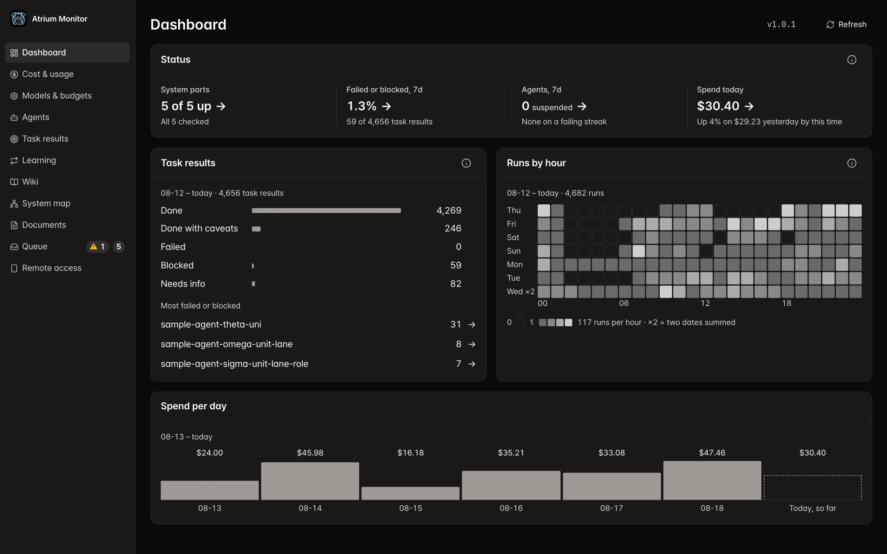
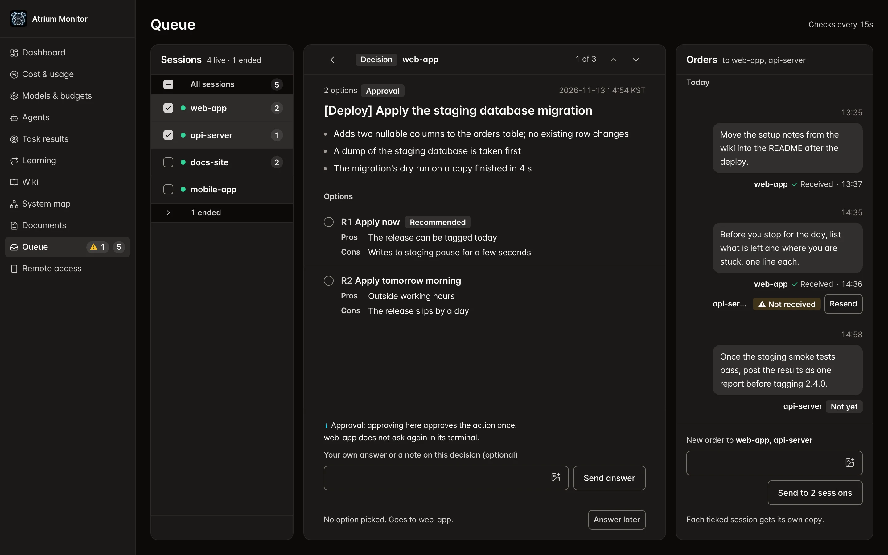
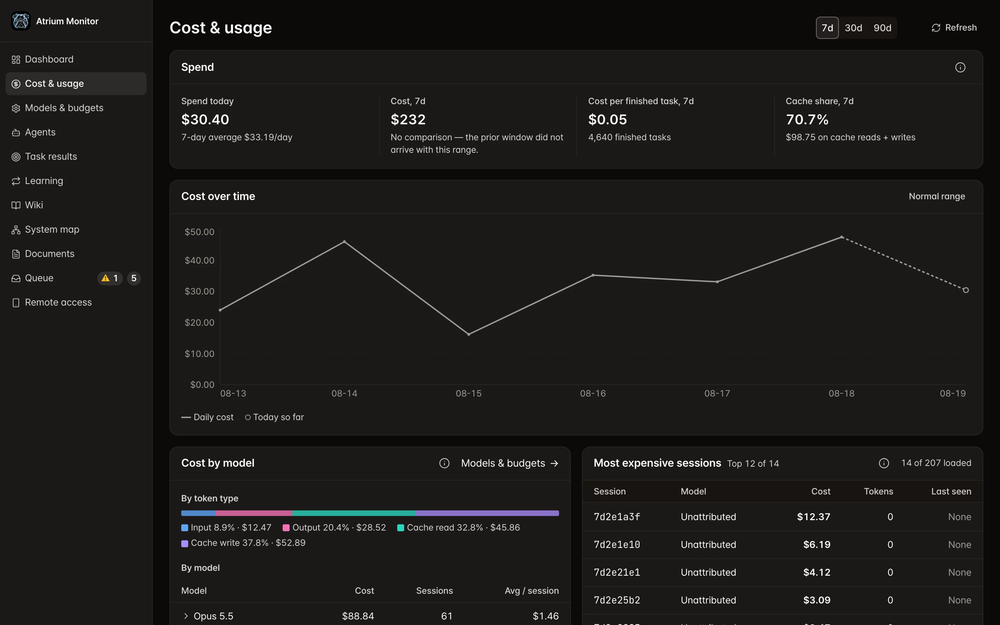
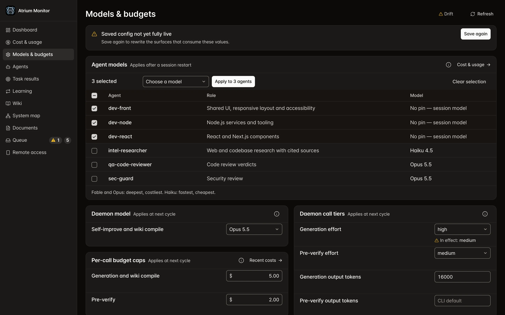
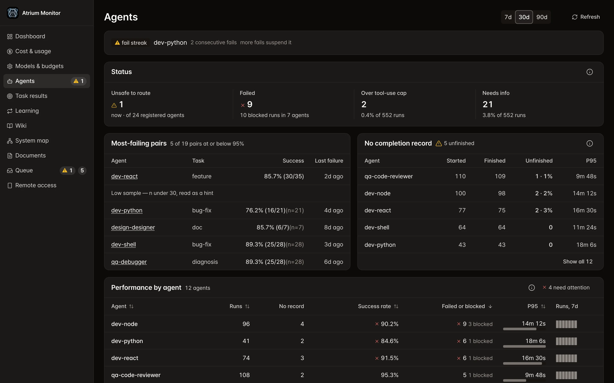
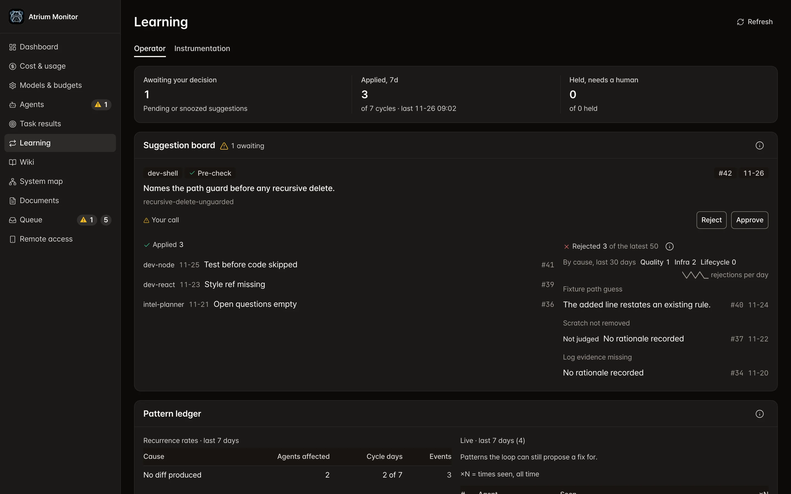
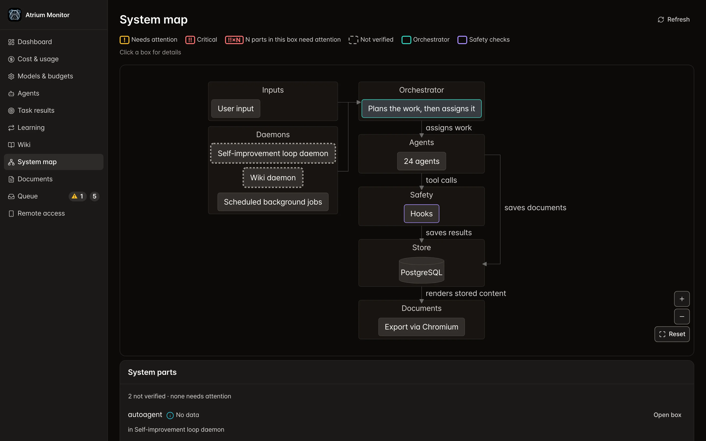
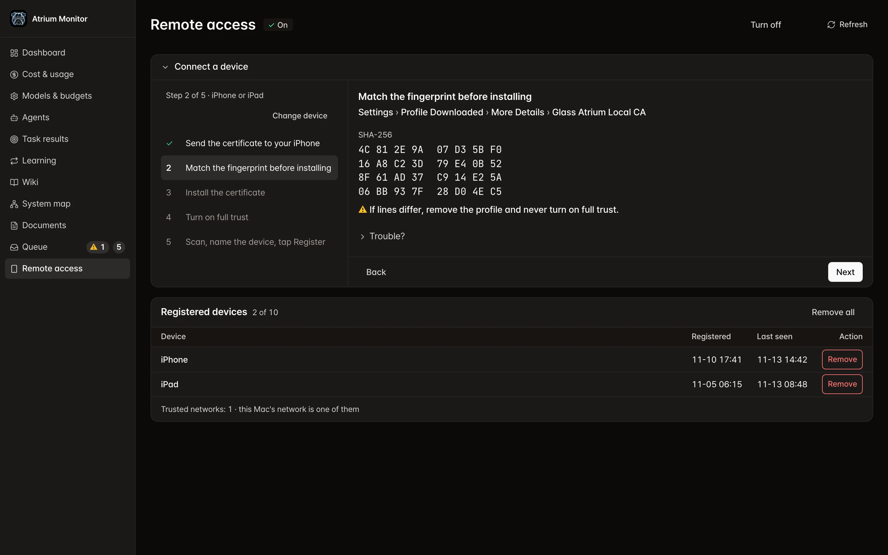

<!-- banner: https://github.com/bettep-dev/glass-atrium/raw/main/docs/assets/banner.webp -->
<p align="center">
  
</p>

**Claude Code のための、中央でオーケストレーションされる自己改善型マルチエージェントハーネス。**

[](LICENSE)
[](.github/workflows/ci.yml)


[English](README.md) · [한국어](README.ko.md) · [中文](README.zh.md) · **日本語**

- 一つのオーケストレーターが専門エージェントの部隊を監視・統制します。
  - エージェント同士が作業をたらい回しして収拾がつかなくなる構造は、決して許しません。
- オーケストレーターが一つのリクエストを受け取り、専門エージェントのチームへ分解・委任し、その結果をまとめ上げます。
- あらゆるコスト・結果・エージェントイベントは、ガラス越しに中をのぞき込むように、リアルタイムのモニターダッシュボードに映し出されます。
- システムは、繰り返す失敗から自らの指示を直していくよう設計されています — プロンプトに手を入れる必要はありません。
  - 自動の指示パッチは試験の関門を通ります: パッチは、変更していない指示と競ったライブ試験で勝った後にのみエージェントへ反映されます([動作の仕組み](#動作の仕組み最初から最後まで)の 8 段階目)。

> [!WARNING]
> - インストールすると、バックグラウンドデーモンが**自動で起動**します。
>   - その一部は毎日自動で Claude を呼び出すため、放置していてもトークン(コスト)を消費します。
> - このハーネスは**トークンを大量に使うシステム**です。
>   - オーケストレーターが一つのリクエストを専門エージェントのチームへ切り分けるため、リクエスト一つが複数のサブエージェント呼び出しへと広がり、トークン消費が単一エージェントの数倍に達することもあります。
> - ただし、このトークンは Anthropic API に直接接続して使用量に応じて課金される方式ではありません。
>   - このハーネスはすでに契約している **Claude Code CLI の上で**動作するため、個別の API キーや従量課金なしに、その契約プランに含まれるトークンをそのまま使う仕組みです。

---

<details>
<summary>目次</summary>

- [何なのか](#何なのか)
- [なぜ作ったのか](#なぜ作ったのか)
- [核心アイデア: ハンドオフ連鎖ではなく一つのオーケストレーター](#核心アイデア-ハンドオフ連鎖ではなく一つのオーケストレーター)
- [動作の仕組み、最初から最後まで](#動作の仕組み最初から最後まで)
- [大きな仕事は慎重に、小さな仕事は素早く](#大きな仕事は慎重に小さな仕事は素早く)
- [内部の構成要素](#内部の構成要素)
- [スキル: 内部の品質レイヤー](#スキル-内部の品質レイヤー)
- [クイックスタート](#クイックスタート)
- [モニター画面](#モニター画面)
- [ライセンス](#ライセンス)

</details>

## 何なのか

- Glass Atrium は、Claude Code CLI を、協調され、観測可能で、自ら改善するよう設計されたマルチエージェントシステムへと変える設定・ツールのレイヤーです。
  - 新しいエージェントフレームワークでは**なく**、Claude Code を置き換えるものでも**ありません**。
  - `~/.claude/` にインストールされ、すでに使っている CLI の上で動きます。
- 「ガラスのアトリウム」という名前は、このシステムを捉えるためのレンズでもあります。
  - AI を賢い一人の人間と見なす代わりに、夜でも中が透けて見えたまま 24 時間動き続ける一棟のガラスの建物として捉えます。
  - その中で大勢の専門家が働きながらも、あらゆる業務が一人の統括者を通る会社です。
  - 隠しごとのないガラス、そしてすべての道が集まる中央の統括者 — この二つが、名前に込めたアイデンティティです。
- そのうえで、デフォルトのインストールだけで一つの一貫したシステムへと束ねられる五つを加えます。
  - 単一の汎用プロンプトですべてをこなす代わりに、**能力を基準にルーティングされる専門エージェントの部隊**(スタック別の開発者に加え、QA・企画・リサーチ・レポート・デザイン・セキュリティ・ウィキ・メタ)
  - どのエージェントがどの規則を読み込むかをマトリクスで定義する**階層化された規則システム**
  - すべてのツール境界で、その規則(シークレット・危険コマンド・予算・成果物)を*機械的に*強制する**ライフサイクルフックパイプライン**
  - あらゆるコスト・結果・エージェントイベントを一箇所に集めて見せる**リアルタイムモニタリングダッシュボード**(Atrium Monitor)
  - 繰り返す失敗をエージェント指示のパッチへと変えるよう設計された**自己改善ループ**
    - 自動の指示パッチは、変更していない指示と競ったライブ試験で勝った後にのみ適用され、危険な変更はユーザーの承認を経て適用されます。

## なぜ作ったのか

- たった一つの `CLAUDE.md` プロンプトでは、規模に耐えられません。
  - 一つのモデルに、React の専門家であると*同時に*データベースの専門家、*同時に*セキュリティレビュアー、*同時に*企画者であれと求めた途端、指示同士がぶつかり合います。
  - 肝心の重要な規則は膨大なテキストに埋もれて薄まり、負荷がかかるとモデルはいつのまにかその規則から外れていきます。
- だからこそ、仕事は分けるべきです。
  - 一人の天才よりも、複数の専門家の協働が勝ります。
  - 分ければ、それぞれがきれいな記憶領域(コンテキスト)を持って自分の仕事に集中できます。
- とはいえ、その次の一手 — エージェント同士に作業を引き渡させること — は、かえって問題を大きくします。
  - エージェント間の**ハンドオフ**システムでは、制御権が A から B へ、B からさらに C へと移ります。
  - 各エージェントは自分の規則を自力で守らねばならず、観測可能性はばらばらに散ります。
  - 一つの誤作動エージェントが歯止めなく波及しても、最後まで責任を負う主体がいません。
- Glass Atrium は、統制を手放さずに専門化の恩恵を得るために作りました — その答えが中央集権です。
  - 成否を分けるのはモデルの才能ではなく、それを取り囲む運用体系、すなわちハーネスだと信じているからです。
  - すべての専門エージェントが中央の常時監督のもとで動くため、一つのフロアのミスが建物全体へ広がることはありません。

## 核心アイデア: ハンドオフ連鎖ではなく一つのオーケストレーター

- 土台は **Manager Pattern(中央集権マネージャーパターン)** です。
- メインの Claude Code セッションであるオーケストレーター一つが、**戦略的制御プレーン**です。
  - ユーザーの意図をサブタスクへ*分解*し、専門エージェントへ*委任*し、結果を*統合*します。
  - 全体の文脈を一人で握ったまま、すべての委任境界で制御権を保ちます。
- 自ら直接手がけるのは、引き渡すコストが作業そのものより大きいごく小さな修正だけで、その前にユーザーへ一行で理由を伝えます。
  - フックが阻むため常に委任される対象: ハーネスのパス · `.env`・認証情報・鍵のような機密ファイル · 新しいドキュメントファイル · 進行中(`implementing`)の計画の対象ファイル
  - 計画一覧を読めなければ、修正を阻みます(fail closed)。
- 対極のモデルである **Handoff Pattern(エージェント同士が制御権を直接やり取りする方式)** は、**あえてサポートしていません** — まさにそこが核心です。
- **委任と復旧**
  - 各サブタスクはキーワード・エイリアスのマッチングではなく能力でルーティングされ、誰が何を担うのかが正確に把握されます。
  - 各エージェントが構造化された完了記録を返すと、オーケストレーターが意図と結果が一致するかを検証します。
  - 失敗したサブエージェントは、失敗復旧ループ(リトライ → フォールバック → デバッガーエスカレーション)で処理されます。
  - 互いに重ならない独立したサブタスクは、ユーザーが頼まなくてもデフォルトで並列に実行されます。
- **上限**
  - エージェント別のターン予算: ハーネスがスポーン時点でハードキャップとして適用します。
  - 並行数の上限: ワークフローエンジンのランタイムが課します。
  - スポーン深度: 方針上の数値ではなく構造で縛られています — どのエージェントのフロントマターも再スポーン用ツール(Agent/Task/Workflow)を与えられておらず、そのツール一覧はスポーン時点で凍結されます。
- **機械的な層と規律の層** — リポジトリの規則ファイル自身も、こう分けて書いています。
  - 機械的な層(実際のコード): PreToolUse フックのパイプライン · インストール版をリリースマニフェストと照合するハーネス整合性の検出(`glass-atrium doctor` — 遮断ではなく検出、復元は `glass-atrium update`) · スポーン時点のツール凍結
  - 規律(honor-system)の層: 委任のリトライ・フォールバック・エスカレーション · `MAX_DEPTH=2` という方針上の数値と深度カウント
- **統制されないハンドオフシステムとの違い**
  - ライフサイクルフックがすべてのツール呼び出しを横取りします — フックに裏打ちされた強制。
  - モニターがすべてのイベントを観測します — 余すところない観測可能性。
  - 結果記録がすべての委任を追跡・監査します。
  - 学習ループは、その記録と是正シグナルを指示パッチへ戻すよう設計されています。記録・集計はいまも回っており、自動の指示パッチはライブ試験で勝った後にのみ適用され、危険な変更はユーザーの承認を経て適用されます。

## 動作の仕組み、最初から最後まで

1. **あなたがオーケストレーター(メインセッション)に**何かを頼みます — バグ修正、機能企画、レポート作成。
2. **オーケストレーターが調査して分解**したうえで、能力レジストリを参照し、専門エージェントのチームと実行順序を組み立てます。
3. **各サブタスクを委任**します — どの委任も、実際に実行する*前に* PreToolUse フック(危険コマンドの遮断・シークレットスキャン・範囲逸脱の表示・計画検証ゲート)を通ります。
4. **専門エージェントが作業を遂行**します — SubagentStart フックが注入した自身の範囲規則の枠内で。
   - ターン予算はスポーン時点でかかるハードキャップであり、ツール予算は警告を出すだけの助言的な計測です。
   - 長い作業が限界に届く前に進捗を書き残し、再開可能な状態で立ち止まるのは、設計された規律であって機械的な保証ではありません。
   - 守られなければ、ハードキャップが作業の途中で断ち切ります。
5. **結果が記録されます。**
   - 各エージェントが `[COMPLETION]` ブロックを出力すると、サブエージェント終了時点のフック(SubagentStop)がこれを結果記録として捕捉します。
6. **オーケストレーターが統合**します — 検証済みの結果を一つの回答へまとめ、失敗が出れば復旧ループを回します。
7. **すべてが観測されます。**
   - あらゆるコスト・結果・エージェントイベントが、PostgreSQL と Atrium Monitor へリアルタイムにストリーミングされます。
8. **システムは自ら改善するよう設計されています。**
   - バックグラウンドデーモンが結果記録と是正シグナルを集め、繰り返す失敗パターンを指示改善の候補として示します。
   - 繰り返すパターンは、インストールに試験できる結果データがたまった後にのみパッチを受けます。安全なパッチはライブ試験として走らせて勝ったときにのみ自動で適用され、危険な変更はユーザー承認の待ち行列へ回ります。

## 大きな仕事は慎重に、小さな仕事は素早く

- このシステムは、**どの段階を経るかを、作業の大きさと複雑さに合わせて自ら決めます。**
  - ユーザーが「慎重に段階を踏め」といちいち指示する必要はありません。
- **大きく複雑な仕事** — 計画を立て → 妥当かを点検し → 作り → 動作を試し → すべて済んだかを確かめて締めくくる、慎重な流れを自ら踏みます。
- **小さな仕事** — この手順を飛ばして手早く片づけます。
  - 計画に結びつかない小さな仕事(`simple-task`)では、範囲・規模の見積もり・チーム構成といった確認表記が任意になり、該当するゲートは黙って通過します。
  - 計画に結びついた仕事は、大きさにかかわらずすべてのゲートをそのまま通ります。
- **ワークフロー** — 上記の段階を実行するやり方です。
  - 「ワークフローで進めて」と指定すれば、人が一つずつ指示する代わりに、自動化エンジンが一度にまとめて処理します。
  - 踏むべき段階はどちらでも同じで、変わるのは実行のやり方だけです。
- **一行でまとめると** — 何を経るかは作業の大きさが自動で決め、どう実行するかだけが選択肢です。

## 内部の構成要素

- **専門エージェントの部隊** — キーワードではなく能力レジストリ(`agent-registry.json`)でルーティングされます(スタック別の開発者に、QA、企画・リサーチ・レポート、デザイン、セキュリティ、ウィキ、メタまで)。
- **階層化された規則システム** — グローバル憲章(`agents/GLASS_ATRIUM_GLOBAL_RULES.md`)、コアの横断規則(`rules/`)、範囲別の規則(`scoped/`)を、明示的なコンプライアンスマトリクスで束ねます。
  - 毎セッション常時ロードされる規則には毎セッション必要な文だけを置き、詳細は必要なときに読む参照ファイルに置きます。
    - 常時ロードセット(グローバル憲章 + `paths:` のない `rules/glass-atrium/*.md`、8 ファイル): 156,912 → 69,405 UTF-16 単位
      - 最も大きな割合を占めるのは常時ロード規則 `rules/glass-atrium/orchestrator-role.md`(66,061 → 775 単位)です — 本文を必要なときに読む `skills/glass-atrium-ops-orchestrator-role.md` へ移し、スタブだけを残しました。
    - メインセッションはこれに加えて、SessionStart フックが入れるオーケストレーターコア(`scoped/orchestrator-core.md`、7,492 単位)を受け取ります。
    - 必要なときに読むオーケストレータースキル(`skills/glass-atrium-ops-orchestrator.md`): 142,358 → 99,449 バイト
  - CI テスト(`scripts/test/startup-budget.bats`)が、常時ロードセットを 145,000 UTF-16 単位未満に保ちます。
- **ライフサイクルフックパイプライン** — すべてのツール境界でシークレット・危険コマンド・予算・結果記録を機械的に強制するフックスクリプト群(`hooks/`)。
- **自己改善ループ** — autoagent デーモン(`autoagent/`)が、たまった結果記録と是正シグナルをエージェント指示のパッチへと変えるよう設計されています。
  - 安全なパッチだけを自動で適用し、適用前に原本を控えておいて、検証に失敗すれば元へ戻します。
  - 危険な変更(削除・外部呼び出し・権限・エージェントのアイデンティティなど)は、ユーザー承認の待ち行列へ回ります。
  - パッチ生成は、通過した A/A 試験(指示を変えないまま二つの群を比べ、計測と設計の効果を測る試験)があってはじめて開きます。
    - 通過した A/A の結果がなければ検出力の確認を通れず、パッチは一つも生成されません。
    - 新規インストールの最初の A/A は、最初の書き込みサイクル(`--dry-run` ではないサイクル)で自動的に開きます。
    - A/A が閉じた後は、失敗で閉じた場合も含め、`daemon_cycle.py --aa-start` を自分で実行してはじめて次の A/A が開きます。
      - チェックアウトではなくインストール版(`~/.glass-atrium/autoagent/daemon_cycle.py`)を、定期サイクルが使う Python インタープリター(`autoagent/daemon-cycle.sh` の `AUTOAGENT_PYTHON_BIN`)で一度実行します。
      - このコマンドは、実行場所がインストール版かどうかを確認しません。
      - 拒否されると、理由を示し、何も記録しないまま 0 以外のコードで終わります。
    - 開いている A/A は、デプロイでインストールのフィンガープリントが変わると次の書き込みサイクルで計測窓を自分でやり直すため、別途やることはありません。
  - 安全なパッチはライブ試験で勝った後にのみ自動で適用され、結果記録と是正シグナルの集計は回り続けます。
- **Atrium Monitor** — Fastify 5 + Prisma 7 + React 18 ベースの 11 画面リアルタイムダッシュボード(`http://127.0.0.1:16145`)。
  - サイドバーの画面
    - **Dashboard** — いま人が見るべきものだけに絞った最初の画面: アラート一覧、ハーネス状態・タスク結果・エージェント状況・今日の支出のタイル、今週のパネル
    - **Cost & usage** — 日別・モデル別・セッション別のコストと支出ペースの警告
    - **Models & budgets** — モデルのピンと、デーモン呼び出しのモデル・予算の設定
    - **Agents** — エージェント別の性能、失敗、ルーティング不可の状態
    - **Task results** — タスク結果の分析と結果の探索表
    - **Learning** — 自己改善ループの提案・試験・パターンの状態
    - **Wiki** — ウィキのコンパイル周期と状態
    - **System map** — アーキテクチャダイアグラム 7 枚とライブの部品状態
    - **Documents** — エージェントが作ったドキュメントの閲覧、進行中/完了の切り替え、置き換え
    - **Queue** — オーナーキュー(下記)
    - **Remote access** — リモートアクセスの設定と端末の登録(Mac でのみ開き、登録済み端末のサイドバーにはありません)
  - すべての画面が共通のレイアウト原子を使います: 4px 間隔のはしご · 名前の付いたページヘッダー · 一つの KPI タイル構造 · 共通の表の行の高さ
  - コントロールは共通のサイズ段階(ボタン・セグメント・入力・フィルターチップは 32px、インライン対象は 24px 以上)に従い、状態が変わってもサイズと位置は変わりません。
  - トグルと入力フィールドの既定の枠線は背景に対して 3:1 以上のコントラストがあるため、選択されていないチップも一つの箱として読めます。
- **モデル・予算の直接割り当て** — モニターの **Models & budgets** 画面で、設定ファイルに触れずに、モデルと呼び出しごとの USD ハードキャップを割り当てます。
  - エージェントのモデル: エージェントファイル(`~/.glass-atrium/agents/*.md`)の model 行(ピン)を、複数のエージェントに一度に変更します。
    - すぐファイルに保存され、すでに動いているセッションには再起動後に確実に反映されます。アップデートはこの行を保ちます。
    - スポーンがモデルを直接指定すればそれが優先され、ピンがなければ会話を始めたセッションのモデルを使います。
  - デーモンカード: 自己改善・ウィキコンパイル呼び出しのモデル · 呼び出しごとの予算キャップ · 生成・事前検証の段階別の effort と出力トークン上限
    - 予算は月の請求上限ではなく、呼び出し一つの暴走を止める、呼び出しごとのハードキャップです。
    - デーモンはサイクルごとに `daemon-config.json` を一度読んで反映し、保存した値と実際に適用された値が異なると drift 警告が出ます。
- **オーナーキュー** — モニターの **Queue** 画面で、セッションが上げた決定・報告に答え、セッションへ作業コマンドを送ります。
  - 画面は PC の一画面を使う机で、三つの欄は動きません: 左のセッション一覧 · 中央の項目一覧 · 右の **Orders**。
    - 一覧で選んだ決定・報告は、中央の欄で一覧の代わりに一枚のレポートとして開き、シート下の入力欄で答えます。
    - 開いたレポートから `←` ボタン(Esc)で一覧に戻り、`J` / `K` で前後の項目へ移ります。
  - セッションごとにチェックボックスが一つあり、チェックしたセッションが、一覧とコマンド会話欄の範囲であり、コマンドを受け取るセッションです。
    - **Orders** は常に開いていて、チェックしたセッションへコマンドをすぐ送ります。入力欄の上に受け取るセッション名が表示され、何もチェックしていなければ送りません。
    - 会話欄にはオーナーが送ったコマンドだけが見え、受け取るセッションごとの受信状況(`Received` · `Not yet` · `Next turn` · `Not reachable` · `Not received`)だけが表示されます。
  - 中央の一覧は決定 · 報告 · 配信中の項目の順にまとまり、セッションがほかのセッションへ送った**リレー**も、同じ一覧に読み取り専用で現れます。
    - リレーはオーナーの承認なしに届きますが、受け取るセッションにとっては仲間のセッションが渡した情報にすぎず、オーナーの指示でも承認でもありません。
    - すべてのリレーと拒否の記録が残り、オーナーは `Redact text` で、保存されたリレー本文を元に戻せない形で消せます。
  - 高リスクの作業(削除・マージ・デプロイなど)は、セッションが **Approval** タグの付いた承認の決定として上げ、承認の選択肢を選んだ答えだけが、その作業一つを一度だけ承認します。
    - 自由記述だけの答えは承認ではなく、上げた後に事実が変われば承認は無効なので、セッションが新しい承認の決定を上げます。
    - ホストの権限確認ダイアログやブロックされたコマンドはキューで答えられず、そのセッションのターミナルに残ります。
  - コマンドとレポートへの返信に、画像を最大 8 枚(1 枚あたり 10 MB)まで添付できます(ボタン · ドラッグ&ドロップ · 貼り付け)。
    - 画像はモニターのデータフォルダに保存され、受け取るセッションは `scripts/atrium-queue.sh get` が項目の後に出力するローカルファイルのパスで読みます。
  - 画面は自分で定期的に読み直し、新しく届いた項目を再読み込みなしで表示します。
  - ログインや事前設定なしに、ほかの画面と同じようにすぐ開きます。
  - ほかの Web サイトから来たリクエストは拒否されます。
  - モニターを通った答えとコマンドは、いつ・どの経路で入ってきたかが記録され、モニターが記録しなかった(モニターの外で書かれた)答えは画面に現れます。
  - 同じコンピューターのプロセスがモニターの経路で送った答えは、画面から送った答えと区別できません。
  - 実行中のセッションには、モニターは何も押し込みません。
    - セッションがバックグラウンドで動かしておく待機コマンド(`scripts/atrium-queue.sh wait`)が、自分宛ての答えとコマンドを取りに行きます。
    - そのため、受け取るセッション側でコマンドを承認する場面はありません。
    - 待機中のセッションはセッション一覧に表示され、待機していないセッションに送った答えには、そのセッションで実行するコマンドが添えられます。
    - ハーネスのリスナー(`hooks/queue-listener.sh`)が付いた対話型セッションは、`wait` の代わりにターンを終えて待ちます。答えが届くと、リスナーが休んでいるセッションを一行で起こし、取りに行くのはセッションが行います。
  - 終了したセッションに送った答えとコマンドは、そのセッションを自動で再開して届けます。
  - セッションが使うツールは、メインセッションの `atrium-queue` MCP ツール(`post` · `claim` · `record` · `sessions` · `relay`)か、インストールされた CLI `~/.glass-atrium/scripts/atrium-queue.sh` です(`help` がコマンド一覧を示します)。
    - サブエージェントはキューを直接使わず、上げる内容を親セッションへ返します。
    - ツールを使ったターンは `record` で終わり、そのターンが上げた項目が記録されます。
    - 作業を終えた報告、オーナーが決める事柄、止まった・失敗した作業、高リスクの作業の承認依頼は、バックグラウンドの作業セッションが必ず上げます。
- **ライブアーキテクチャマップ** — モニターの System map 画面が、正式なアーキテクチャダイアグラム 7 枚(Mermaid)を、ライブのデーモン状態とともに描き出します。
- **ウィキ知識ストア** — 原本をキュレーションされたノートへ加工するパイプラインに、SQLite BM25 全文検索インデックスまで備えた LLM 専用ストア(`wiki/`)。
  - リサーチエージェントの Web 調査結果がここに積み重なります。
  - 新しい調査・分析の前にまず参照して、既存の知識を再利用します。
- **内部エージェントスキル** — エージェントとオーケストレーターが自動で呼び出す、漸進的開示方式の `SKILL.md` パッケージ([スキル](#スキル-内部の品質レイヤー)参照)。
- **ファイル単位のシンボリックリンクファームインストール** — ユーザー所有のファイルと衝突なく共存できるよう、ディレクトリではなくファイル単位で `~/.claude/<rel>` → `~/.glass-atrium/<rel>` のシンボリックリンクを冪等に生成します。
- **5 個のバックグラウンドデーモン** — `com.glass-atrium.*` の launchd ジョブで、すべて `config.toml` に宣言されています。
  - 常駐(keepalive)1 個: monitor
  - スケジュール 4 個: モニターのログローテーション · PG バックアップ · autoagent cycle · wiki compile
  - 夜通し回る暖房・換気のように、誰かがスイッチを握っているのではなく、そもそも止まらないよう設計された建物の設備室です。
- **ゴミ箱の整理コマンド** — `~/.glass-atrium/scripts/ga-trash-purge.sh <項目>` は、ホームのゴミ箱(`~/.Trash`)直下にある名前の付いた項目一つだけを完全に削除し、削除ごとに一行のログを残します。
  - エージェントはファイルを消さずにゴミ箱へ移すため、自分が移した項目を、人がゴミ箱を空にしなくても片づけられます。
  - ゴミ箱フォルダそのもの、それ以外のパス、一段階より深いパスは拒否します。
- **ワークツリーの整理コマンド** — `~/.glass-atrium/scripts/prune-worktrees.sh [--apply] [--deployed <sha>] <ワークツリー>...` は、終わった委任の作業フォルダ(git ワークツリー)を片づけます。
  - 既定は点検だけを行うドライランで、`--apply` を付けてはじめて削除します。`--list-all` は、リポジトリのすべての接続済みワークツリーを列挙するだけです。
  - 四つがすべて通ってはじめて削除します: ブランチが main(または `--deployed` のコミット)に含まれている · コミットしていない変更や追跡されていないファイルがない · 書き込みロックがない · フォルダ内で動いているプロセスがない
    - 持ち主のいないプロセスは終了シグナル(TERM)で片づけ、ほかのセッションのプロセスがあれば、そのワークツリーはそのまま残します。
  - 強制削除は使わず、ブランチは消しません。git が拒否すれば、それが結論です。
- **リポジトリにシークレット資料ゼロ** — peer-auth 専用の PostgreSQL(パスワードなし)、シークレットスキャンフック、リリースゲートの PII スキャン。
  - シークレットスキャンフックが書き込みを止めれば、そのまま止まって終わります。
    - 例外は一つです。汎用の認証情報代入ルール(`SEC-013`)にだけ引っかかった書き込みは、オーナーが Queue 画面で、まさにその行に限って一度だけ承認できます。
      - フックが止めた行をモニターにリクエストとして登録すると、セッションは行の内容なしにリクエスト番号だけを承認の決定として上げます。
      - オーナーは Queue 画面のカードで行を見て、承認または拒否します。本物のパスワードやキーがあれば拒否するようにという警告も一緒に表示されます。
      - 承認後 10 分以内に同じ書き込みをもう一度試みると通り、行が一つでも違えば通りません。行はモニターのメモリにだけあり、再起動すると消えます。
      - トークン・キー・接続文字列の形に引っかかった書き込みは、承認できません。
    - この承認はルールを守るエージェントのための経路であり、オーナー本人の証明ではありません。キューにはログインがないため、同じ Mac のプロセスが答えを作り出せます。

## スキル: 内部の品質レイヤー

- Glass Atrium のスキルは、ユーザーが呼び出すコマンドでは**なく**、内部の品質・ガバナンスレイヤーです。
- セッション開始時にグローバルへロードされ、Claude が作業に合わせて自動的に有効化します。
- コード・デザインの規約、運用・検証ゲート、ウィキ・Web ツールを扱います。
  - 一部はモニターのシグナル(エージェント削除の結果など)に反応して発動します。
- どのスキルが動いているかを知る必要はありません — ハーネスが自ら選んで呼び出します。

## クイックスタート

- **前提要件**: macOS(Apple Silicon・Intel いずれも対応) · **ログイン済みの Claude サブスクリプションアカウント**
  - Claude Code CLI を含む残りの依存関係は、インストール TUI が同意を取ったうえで検出・インストールします。
  - 二つの段階は、ユーザー自身が踏む必要があります。
    - Xcode Command Line Tools のインストールダイアログの承認
    - `claude` へのログイン(通らなければインストールはここで止まります)
- 一度の同意でインストールされ得るもの: `postgresql@18` · `node@24` · `bun` · FTS5 対応の `sqlite` · `tmux`/`jq`/`git`/`curl`/`lsof`/`rsync` · `claude` CLI · Python ライブラリ(`psycopg`・`psycopg2-binary`・`PyYAML`)
  - すでにあるものは飛ばされます。
  - 初回インストールの所要時間は、その大半が Homebrew のダウンロードとモニターのビルドに左右されます。

```sh
curl -fsSL https://github.com/bettep-dev/glass-atrium/raw/main/install.sh | bash
```

- 対話メニューが開いたら **Install** を選んでください。
  - メニューの項目は Install · Token Setup(デーモンが使うヘッドレス OAuth トークンだけを発行) · Monitor(ブラウザでダッシュボードを開く) · Uninstall · Quit です。
  - インストールが終わると、依存関係とデーモンが自動で設定・起動されます。
  - ダッシュボードには `http://127.0.0.1:16145` からアクセスできます。
- インストールは、ヘルスゲートを通過してはじめて終わります。
  - その後も `glass-atrium doctor` またはモニターの **System map** 画面にある **System health** ストリップから、状態を確かめ直せます。
- **インストールされたフォルダはそのままにしてください。**
  - インストーラーはリリースバンドルをダウンロードして `~/.glass-atrium` フォルダへ展開し、**ファイル単位のシンボリックリンクファーム**(先に説明した方式)で Claude の設定ディレクトリと結びつけます。
  - 実体ファイルがここにあるので、フォルダを移動したり削除したりするとリンクが切れます。

### プロファイルブランチ(`CLAUDE_CONFIG_DIR`)

- Atrium は `~/.claude` にだけインストールされます。
- `CLAUDE_CONFIG_DIR` で使う別の設定ディレクトリ(例: `~/.claude-work`)は、`agents`・`rules`・`skills`・`settings.json` を `~/.claude` 側へシンボリックリンクする必要があります。
- ブランチのセッションに Atrium の規則がロードされるかは、`$HOME` の外のディレクトリで開いた Claude セッションで確かめてください — `$HOME` の中では欠落が隠れることがあります。
- `glass-atrium doctor` は実行場所にかかわらず、リンクが抜けたブランチと、そのまま実行できる修正コマンドを知らせます。
  - 検査対象: `~/.claude` の隣にある `~/.claude-*` ディレクトリのうち、一度以上実行された(`.claude.json` がある)ものだけ — ほかのパスにあるブランチはご自身で確かめてください。

### アップデート

- 新しいリリースが出ると、ダッシュボードのツールバーに **Update available** バッジが現れます。
  - バッジを押せば、その場で適用されます。
  - ターミナルからは `glass-atrium update` でも同じことができます。
- 適用は GitHub のリリースバンドルを取得し、二つの規則で進みます。
  - **バンドルがマニフェストに載ったすべてのファイルを置き換えます。**
  - `agents/*.md` は EDITABLE 領域だけをマージして、ユーザーが手を入れた内容を保ちます(文言がぶつかればモデルの調停役が判定します)。
- バンドルは**削除についても権限を持ちます**。
  - マニフェストの `retired` 一覧に載ったファイルは、ゴミ箱へ移されます。
  - ベンダーが配布したことのないハッシュであれば、ユーザーの編集と見なしてそのまま残します。
- バンドルを適用する前に、このインストールが最近使ったモデルやモデル設定にあるモデルがリリースの価格表(`hooks/pricing.json`)になければ、何も適用せずに止まります。
- 適用した後は、フックの結線を新しいリリースに合わせ、溜まっていた DB マイグレーションを適用します。
  - マイグレーションが失敗すると、名前の付いた終了コードで止まり、`glass-atrium db-setup` を案内します。
  - ダッシュボードのバッジで適用すると、モニターを再ビルド・再起動し、デーモンジョブも更新します。ターミナルの `glass-atrium update` は、リリースがモニターを変更したときにモニターを再ビルドし、再起動はしません。デーモンジョブを再レンダリングして読み込み直すには `glass-atrium reload-launchd` を使います(アップデートの実行中は拒否されます)。
  - アップデートの前と後に、ハーネス整合性の点検結果をログに残します(検出するだけで遮断はせず、現在の状態は `glass-atrium doctor`)。
- モニターの `package-lock.json` や `package.json` が変わったリリースは、**npm レジストリから依存関係をインストール**し、Prisma クライアントを作り直してからビルドします。
  - Prisma スキーマ(`schema.prisma`)や `prisma.config.ts` だけが変わったリリースは、レジストリには触れず Prisma クライアントだけを作り直します。
  - オフラインならこの段階で名前の付いた終了コードで止まり、復旧の手順(`glass-atrium db-setup` → モニターの `npm run build` → 再起動)を知らせます。
  - ビルドが失敗しても 0 以外の終了コードで止まり、型エラーのときは以前のビルド結果をそのまま残します。

### リモートアクセス(同じ Wi-Fi の登録済み端末)

- 自宅の Wi-Fi のような信頼したネットワークで、一度登録したスマートフォン・タブレットのブラウザから、モニターの機能を Mac とまったく同じように使います。
  - モバイル専用の画面はなく、端末でも PC の画面がそのまま見えます。Queue で答えることも、セッションへコマンドを送ることもできます。
  - ただし **Remote access** 画面は Mac でのみ開き、登録済み端末には現れません。
  - Mac 自体では、これまでどおりログインなしで使います。
- **デフォルトはオフ**です。
  - インストール時に一度だけ尋ねます(デフォルトは「いいえ」)。ターミナルなしで実行したインストールは、ループバック専用のままです。
  - アップデートはこの設定をオンにも、変更もしません。
- オンにすると、Mac にローカルの認証局(CA)とサーバー証明書を作り、いまの Wi-Fi を信頼ネットワークとして登録するかを尋ねます。
  - 信頼ネットワークは、ルーターのアドレスとハードウェアアドレスで見分けます。別の Wi-Fi では、リモートリスナーは開きません。
  - ポートは `config.toml` の `[remote_access].port` に従います。
- 端末ごとに一度だけ行い、Mac のモニターの **Remote access** 画面が端末の種類(**iPhone or iPad** · **Galaxy phone**)を選ばせ、順に案内します。
  - 画面は、リモートアクセスのオン・オフ、いまの Wi-Fi の信頼登録、登録済み端末の一覧(端末ごとの `Remove` · 全体の `Remove all devices`)も受け持ちます。
  - iPhone・iPad: Mac の CA 証明書(鍵ファイルは絶対に含みません)を AirDrop で送り、インストール前に画面の SHA-256 フィンガープリントと端末に表示されたフィンガープリントが同じか確かめてからインストールし、フルトラストをオンにします。
    - 次に Mac の画面の QR コードをスキャンし(できなければアドレスとコードを手入力)、端末名を付けて登録します。
  - Galaxy フォン: 証明書をスマートフォンへ送り、インストール画面で CA 証明書としてインストールし、インストール直後にフィンガープリントを比べてから、Samsung Internet にアドレスを入力してコードを入れます。
    - この案内は Galaxy 端末 1 台で確認しました(CA 証明書のインストール、画面のメニュー名、フィンガープリントの比較、同じ画面の削除ボタン)。One UI のバージョンと DeX モードは報告されていないため、ほかの Android バージョン・モードは未検証です。
  - 登録コードは、Mac の画面で開いたときにだけ作られ、5 分後に失効します。
  - その後は、端末を切り離すまで二度と尋ねません。
- ターミナルコマンド(`glass-atrium remote …`)
  - `on` · `off` — オン・オフ
  - `list` — 登録済み端末の一覧
  - `revoke <id>` · `revoke-all` — 端末一つ・全体の切り離し
  - `trust` — いまの Wi-Fi を信頼ネットワークに追加
  - `reissue` — サーバー証明書をいま再発行
    - 普段は、モニターとアップデートが、失効の 30 日前や Wi-Fi のアドレス・Mac の名前が変わったときに自動で再発行します。端末は CA を信頼しているため、改めて尋ねません。
  - 端末の登録はターミナルからはできず、Mac のモニターのページでのみ行います。
- `glass-atrium doctor` が、鍵の権限、Time Machine からの除外、証明書のホスト名・アドレス・失効間近、リスナーがバインドされたアドレスと信頼ネットワーク、ファイアウォールの状態(読み取りのみ)を点検します。
- 残るリスク(オーナーが引き受けると決めたもの)
  - 登録済み端末を紛失・奪取・感染させた場合、切り離すまでその端末ですべての機能を使えます — 権限確認なしで動くセッションへの指示、設定変更、自己アップデート、すべてのドキュメント・セッションの閲覧まで。この場合は防ぐよう設計していません。
  - キューの答えが承認として扱われる流れでは、そのような端末でデプロイ・マージ・削除を承認できてしまいます。キューの記録には、答えがスマートフォンから来たかどうかはまだ残らず、リモートの監査記録にだけ残ります。
  - コピーされたセッションクッキーは、端末を切り離すまでオーナーと同じです。
  - この Mac でオーナー権限で動くプロセスは、ページのオリジンヘッダーを偽造して登録を開き、コードを読んで端末を登録できます。端末一覧と監査記録で見えるだけで、防げはしません。
  - 登録ページは、信頼した Wi-Fi にいる誰でも開けます。
  - CA の名前制約を無視する端末であれば、CA の鍵を持つ側が、その端末に対してほかのプライベートネットワークのサイトを偽装できます。CA の鍵はこの Mac の外へは出ません。
  - 詳しくは [SECURITY.md](SECURITY.md#remote-access-opt-in) を参照してください。

### アンインストール

- メニューから **Uninstall** を選んでください。
- デーモンを止めたうえで、`~/.claude` 側から次のものを取り除き、GA データベースをドロップします。
  - Atrium が敷いたシンボリックリンクと空のディレクトリの殻
  - `settings.json` のフック結線(原本は `settings.json.ga-backup.<時刻>` として隣に残ります)
  - シェル rc の PATH 行
  - リモートアクセスの鍵と登録済み端末の記録(各端末で信頼した CA はご自身で削除してください)
- ユーザー所有のファイルには手を触れません。
  - 実体ファイルのある `~/.glass-atrium` フォルダも残ります。
- `~/.claude` が完全に空になるわけでは**ありません**。
  - アップデートの基準線(`~/.claude/data/update/baseline-manifest.json`)と base@install のエージェント原本の保管庫(`~/.claude/data/update/base-agents/`)は、デフォルトで残ります。
  - 再インストールしたときに、ユーザーが手を入れたエージェントの編集内容を 3 アンカーのマージで引き継ぐための基準点だからです。
- `--purge-config` を付けると、`config.toml` と基準線のファイルまでゴミ箱へ移します(消すのではなく移します)。
  - `base-agents/` の保管庫は、どのモードでも残ります。
  - メニューのアンインストール後の後片づけの問いは `config.toml` しか扱わないので、基準線まで空にしたい場合はターミナルから `glass-atrium uninstall --purge-config --yes` を実行してください。
- **データベースはバックアップを残してから削除されます**(ダンプは `~/.glass-atrium/backups/postgres/` に保管)。
  - 再インストールすれば、新しく作られます。
  - バックアップが自動で復元されることはないので、以前のデータが必要な場合は `pg_restore` で手動で復元してください。

### Atrium Monitor のドキュメント作成方法

- ドキュメント・レポート・要約・リファレンスの依頼は **glass-atrium-intel-reporter** へ、企画・要件定義・作業分解の依頼は **glass-atrium-intel-planner** へ委任されます。
- どの形式で出力されるかは、**リクエストの文言が決めます**。
  - デフォルトは、モニター上で**隠される「エージェント専用」のトークン最適化記録**です。
    - 内容の形に応じて md・yaml・json・txt から選ぶ、あとで参照するための内部用の記録です。
  - 「**HTML で**」「**Web ドキュメントとして**」「**チーム共有用に**」のように、共有や閲覧の意図をはっきり示すと、人が見て共有できる **HTML ドキュメント**が作られます(ダークテーマ・ダイアグラム・表を備えた単一ファイル)。
- どちらの形式も、Atrium Monitor の **Documents**(ドキュメント)画面に現れます。
  - 進行中／完了の状態を行き来できます。
  - 同じテーマの新しいドキュメントで、以前のドキュメントを置き換えられます。
- ドキュメントをわざわざ依頼しなくても、記録しておく価値があると判断されれば、エージェント専用の記録が残ることがあります。

### 開発エージェントの追加

- 「○○をする開発エージェントを追加して」のように頼むと、オーケストレーターはすぐに新しいエージェントを作らず、まず**既存エージェントを拡張するか、新規に生成するか**を見極めます。
  - **デフォルトは拡張であり、生成はゲートを通過したときだけ**許されます。
- 生成が許されるには、三つの条件が**すべて独立して**満たされる必要があります。
  - **異なる成果物の種類** — 作り出すファイルが構造的に区別されます。
  - **異なる決定ドメイン** — 正しい判断に必要な専門性が重なりません。
  - **移転できない品質判断** — 一方の品質レビューを、もう一方の専門性だけでは代われません。
- 提案されたエージェントのドメインが**既存エージェントと一定比率以上重なると、生成はブロックされます**。
  - 大きく重なるということは、拡張のシグナルであって新規生成のシグナルではないからです。
- 進行中には、**ユーザー承認の一時停止が二度**あります。
  - まずオーケストレーターが判断根拠と推奨案を示し、生成か拡張かを確定します。
  - 続いて、エージェントファイルとレジストリへ実際に書き込む直前に、もう一度確認します。
- 本文(システムプロンプト)は **glass-atrium-meta-prompt-engineer** が書き、登録は専用 CLI が受け持ちます。
- ユーザーは「追加して」と頼むだけでよく、拡張か新規かの判断と承認の要請は、オーケストレーターが引き受けます。

## モニター画面

- 以下の画面は、合成データだけを入れた別のモニターでキャプチャしました(実際のインストールデータなし)。

<p align="center"></p>
<p align="center"><em>ダッシュボード — ハーネス状態の行(部品 5 つのうち 5 つが正常、7 日間の失敗・遮断の割合、停止中のエージェント数、昨日と比べた今日の支出)と、7 日間のタスク結果、失敗・遮断が多いエージェント、時間帯別の実行ヒートマップ、日別の支出の棒グラフを表示します。停止した部品や 7 日平均を上回る支出があれば最上部のバナーで知らせます。</em></p>

<p align="center"></p>
<p align="center"><em>Queue — 左にセッション一覧(チェックしたセッションが一覧とコマンドの範囲)、中央の列に一つのセッションの承認の決定を開いて選択肢とその長所・短所を示し(開いた項目がなければ、この列は決定・報告・配信中の項目の一覧です)、右の Orders に、チェックしたセッションへ送ったコマンドとセッションごとの受信状況を表示します。</em></p>

<p align="center"></p>
<p align="center"><em>コスト・使用量 — 今日・7 日コスト(比べる前の期間のデータがなければ「比較なし」)・完了タスクあたりコスト・キャッシュ比率の KPI、平常範囲を示した 7 日コスト推移の折れ線グラフ、トークン種別・モデル別コスト、コストの大きいセッションの表を、7・30・90 日の期間切り替えとともに表示します。支出が平常より高いか速いときは、状態行と警告が先に表示されます。</em></p>

<p align="center"></p>
<p align="center"><em>Models & budgets — エージェント別のモデルピンの表と、複数のエージェントを選んで一度に変えるバー、自己改善・ウィキコンパイル呼び出しのデーモンモデル、呼び出しごとの予算キャップ、生成・事前検証の段階別の effort と出力トークン上限を、保存値と実際の適用値の差の表示とともに表示します。</em></p>

<p align="center"></p>
<p align="center"><em>エージェント — 連続失敗中のエージェントを最上部の一行で指し示し、ルーティングしてはいけないエージェント・失敗・ツール使用上限超過・情報不足の KPI の下に、最も頻繁に失敗するエージェント・タスクの組み合わせ、完了記録のない実行と P95、エージェント別の性能表を表示します。</em></p>

<p align="center"></p>
<p align="center"><em>学習 — 承認待ち 1 件・直近 7 日の適用 3 件・人の判断が必要な保留 0 件のタイルの下の提案ボードで、承認待ちの提案を一つ Reject · Approve ボタンとともに開いて示し、適用済みの提案 3 件と、原因別に分けた却下・判定なしで閉じた提案を並べた後、パターン台帳へと続きます。</em></p>

<p align="center"></p>
<p align="center"><em>System map — 状態リングの凡例を最上部に置き、入力・デーモン・オーケストレーター・エージェント・安全フック・PostgreSQL ストア・Chromium によるドキュメントエクスポートへと続く構成図に、まだ検証されていないデーモン二つを点線で示した後、その下の部品状態リストへと続きます。</em></p>

<p align="center"></p>
<p align="center"><em>Remote access — オンになったリモートアクセスの状態と信頼した Wi-Fi、端末の種類を選んで順にたどる接続の案内(証明書の受け渡し · フィンガープリントの比較 · 登録コードと QR コード)、登録済み端末の一覧と切り離しボタンを表示します。</em></p>

## ライセンス

[MIT](LICENSE) © 2026 Bettep
