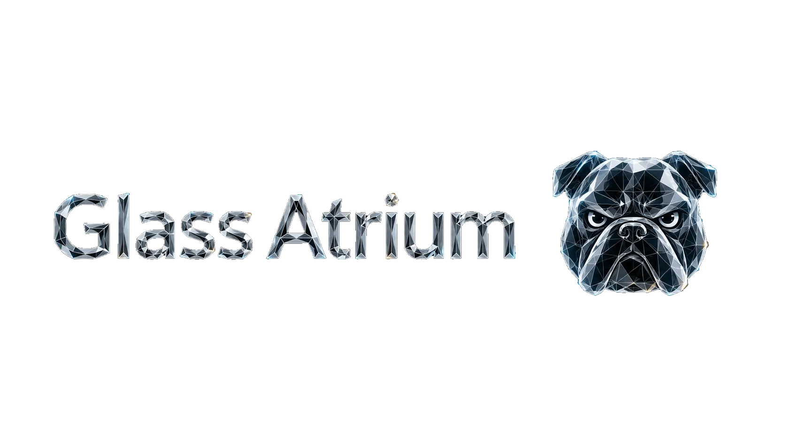
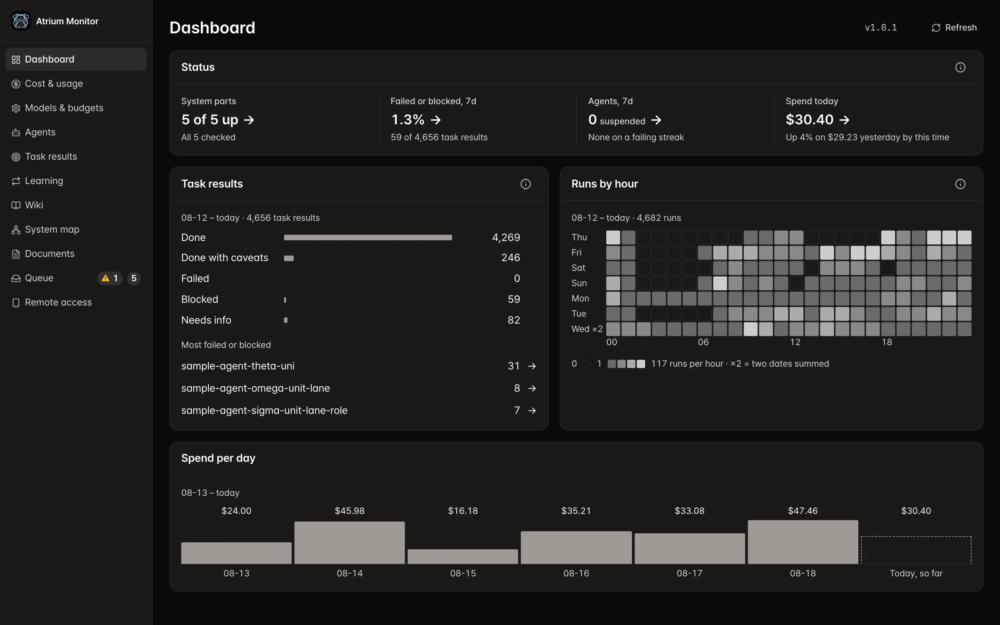
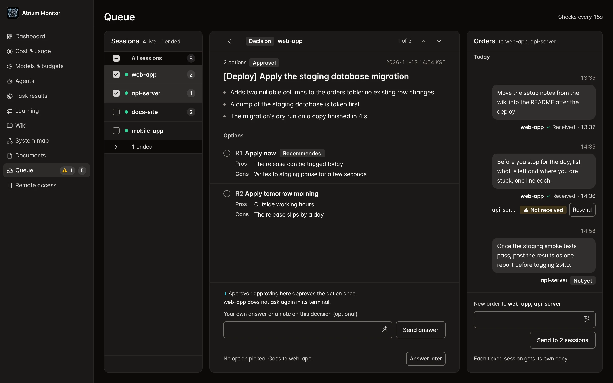
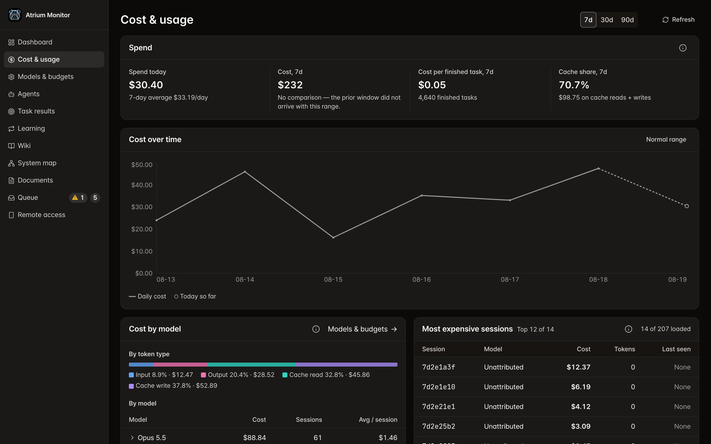
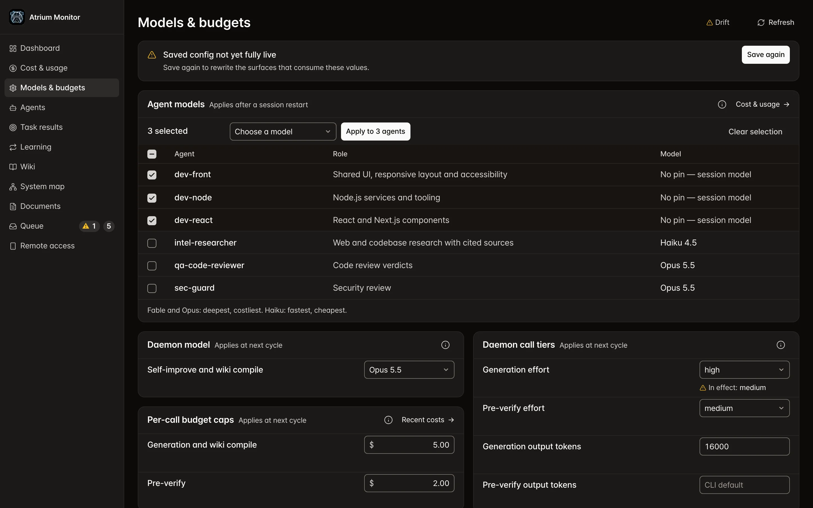
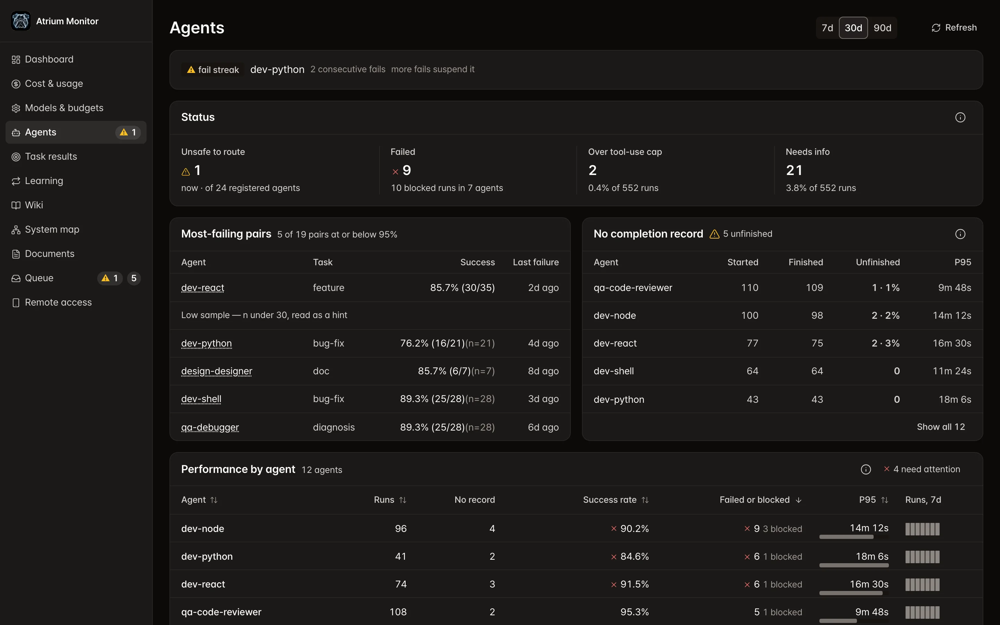
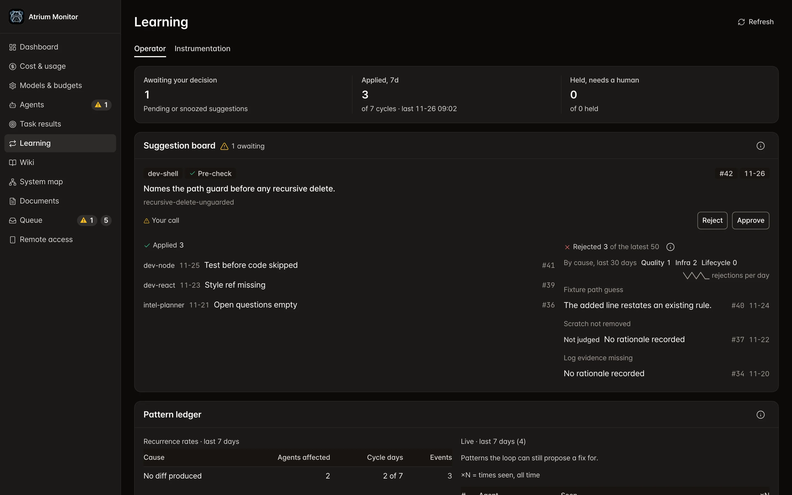
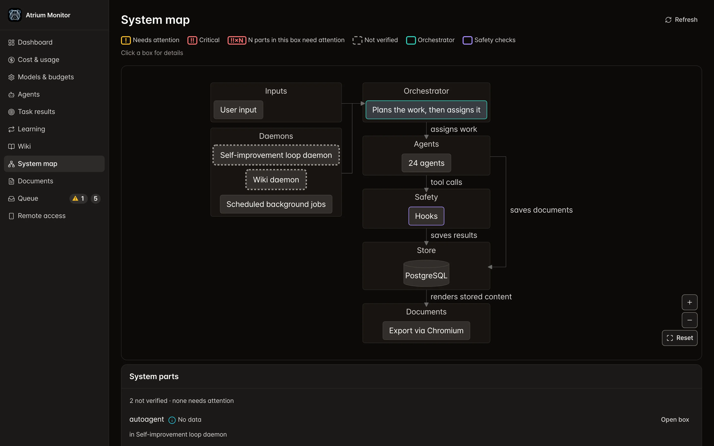
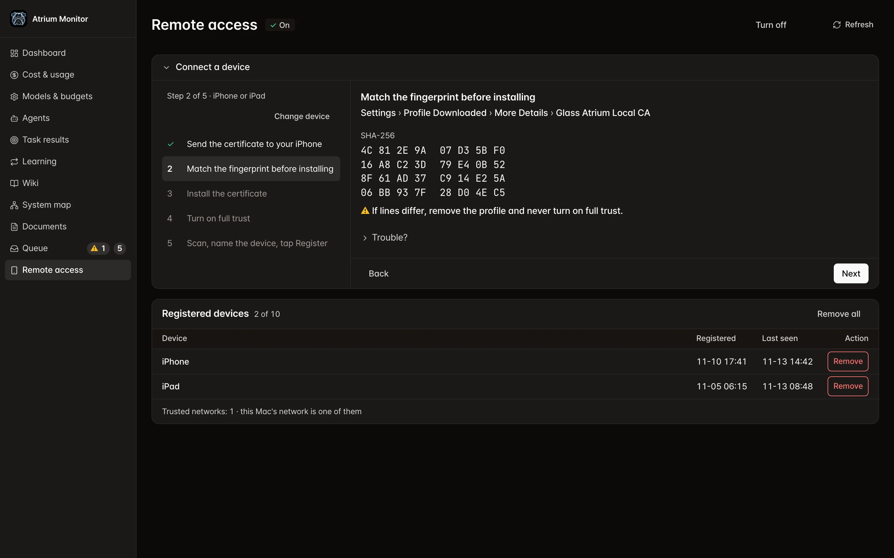

<!-- banner: https://github.com/bettep-dev/glass-atrium/raw/main/docs/assets/banner.webp -->
<p align="center">
  
</p>

**A self-improving, centrally-orchestrated multi-agent harness for Claude Code.**

[](LICENSE)
[](.github/workflows/ci.yml)


**English** · [한국어](README.ko.md) · [中文](README.zh.md) · [日本語](README.ja.md)

- A single orchestrator watches over and reins in a fleet of specialist agents.
  - It never allows a setup where agents pass work back and forth among themselves until it spirals out of control.
- The orchestrator takes a single request, breaks it into pieces for a team of specialist agents, and pulls the results back together.
- Every cost, outcome, and agent event surfaces on the real-time monitor dashboard, laid bare as if you were looking through a glass wall.
- The system is designed to revise its own instructions in response to recurring failures — no prompt tweaking on your part.
  - Automatic instruction patches pass a trial gate: a patch reaches agents only after it wins a live trial against the unchanged instructions (step 8 of [How it works](#how-it-works-end-to-end)).

> [!WARNING]
> - Once installed, background daemons start running **automatically**.
>   - Some of them call Claude on a daily schedule, so tokens (and cost) are spent even if you never touch it.
> - This harness is a **high-token-usage system**.
>   - Because the orchestrator splits a single request across a team of specialist agents, one request fans out into many subagent calls, and token consumption can run to several times that of a single agent.
> - That said, these tokens are not billed per use through a direct Anthropic API connection.
>   - The harness runs **on top of the Claude Code CLI** you already subscribe to, so it draws on the tokens included in that subscription plan — no separate API key, no metered billing.

---

<details>
<summary>Contents</summary>

- [What it is](#what-it-is)
- [Why it was built](#why-it-was-built)
- [The core idea: one orchestrator, not a chain of handoffs](#the-core-idea-one-orchestrator-not-a-chain-of-handoffs)
- [How it works, end to end](#how-it-works-end-to-end)
- [Big tasks carefully, small tasks fast](#big-tasks-carefully-small-tasks-fast)
- [What's inside](#whats-inside)
- [Skills: the internal quality layer](#skills-the-internal-quality-layer)
- [Quickstart](#quickstart)
- [Monitor screens](#monitor-screens)
- [License](#license)

</details>

## What it is

- Glass Atrium is a configuration-and-tooling layer that turns the Claude Code CLI into a multi-agent system designed to be coordinated, observable, and self-improving.
  - It is **not** a new agent framework, and it does **not** replace Claude Code.
  - It installs into `~/.claude/` and runs on top of the CLI you already use.
- The "glass atrium" in the name is also a lens for seeing the system.
  - Rather than treat the AI as one clever individual, picture a single glass building, see-through even in the dead of night, running around the clock.
  - Inside it is a company where many specialists do the work, but every piece of it passes through one supervisor.
  - Transparent glass, and a central supervisor through whom every path runs — those two are the identity the name carries.
- On top of that, a default install alone adds five things that come together as one coherent system.
  - A **capability-routed fleet of specialist agents** in place of a single general-purpose prompt (developers per stack, plus QA, planning, research, reporting, design, security, wiki, and meta)
  - A **layered rule system** that defines, in a matrix, which agent loads which rules
  - A **lifecycle hook pipeline** that enforces those rules (secrets, dangerous commands, budgets, deliverables) *mechanically* at every tool boundary
  - A **real-time monitoring dashboard** (the Atrium Monitor) that gathers every cost, outcome, and agent event in one place
  - A **self-improvement loop** designed to turn recurring failures into agent-instruction patches
    - Automatic instruction patches apply only after they win a live trial against the unchanged instructions, and risky changes apply only after user approval.

## Why it was built

- A single `CLAUDE.md` prompt does not scale.
  - The moment you ask one model to be a React expert *and* a database expert *and* a security reviewer *and* a planner, the instructions start colliding.
  - The rules that actually matter get diluted in a vast wall of text, and under load the model quietly drifts away from them.
- So the work has to be divided.
  - A team of specialists beats a lone genius.
  - Once the work is split, each specialist gets a clean memory (context) of its own and can focus on its job.
- The obvious next step — letting agents hand work off to one another — only makes the problem bigger.
  - In an agent-to-agent **handoff** system, control passes from A to B, then from B on to C.
  - Each agent is left to enforce its own rules, and observability scatters.
  - A single misbehaving agent can propagate unchecked, with no one accountable to the end.
- Glass Atrium was built to reap the benefits of specialization without giving up control — and the answer is centralization.
  - What decides success or failure, in this view, is not the model's talent but the operating system around it: the harness.
  - Because every specialist runs under continuous central supervision, a slip on one floor does not spread through the whole building.

## The core idea: one orchestrator, not a chain of handoffs

- The foundation is the **Manager Pattern** (the centralized manager pattern).
- A single orchestrator, the main Claude Code session, is the **strategic control plane**.
  - It *decomposes* your intent into sub-tasks, *delegates* each one to a specialist, and *synthesizes* the results.
  - It holds the full context alone and keeps control at every delegation boundary.
- The only work it does itself is a tiny fix where handing it off would cost more than the work, and it first tells you why in one line.
  - Targets a hook blocks, so they are always delegated: harness paths · sensitive files such as `.env`, credentials, and keys · new document files · the target files of an in-progress (`implementing`) plan
  - If the plan list cannot be read, the edit is blocked (fail closed).
- The opposite model, the **Handoff Pattern** (agents transferring control directly among themselves), is **deliberately not supported** — and that is precisely the point.
- **Delegation and recovery**
  - Each sub-task is routed by capability rather than by keyword or alias matching, so it is always clear who is doing what.
  - Each agent returns a structured completion record, and the orchestrator verifies that intent and result line up.
  - A failed subagent is handled by the Failure Recovery Loop (retry → fallback → debugger escalation).
  - Independent, non-overlapping sub-tasks run in parallel by default, without your having to ask.
- **Limits**
  - Per-agent turn budget: the harness applies it as a hard cap at spawn time.
  - Concurrency cap: the workflow engine runtime enforces it.
  - Spawn depth: bounded structurally rather than by a policy number — no agent's frontmatter grants a re-spawn tool (Agent/Task/Workflow), and that tool list is frozen at spawn time.
- **Mechanical layer and discipline layer** — the repository's rule files describe themselves the same way.
  - Mechanical layer (real code): the PreToolUse hook pipeline · harness integrity detection that compares the install against the release manifest (`glass-atrium doctor` — it detects rather than blocks; `glass-atrium update` restores) · the spawn-time tool freeze
  - Discipline (honor-system) layer: delegation retry, fallback, and escalation · the `MAX_DEPTH=2` policy number and its depth counting
- **How it differs from an uncontrolled handoff system**
  - Lifecycle hooks intercept every tool call — hook-backed enforcement.
  - The monitor observes every event — full observability.
  - Outcome records keep every delegation traceable and auditable.
  - The learning loop is designed to feed those records and correction signals back into instruction patches. Recording and aggregation run today; automatic instruction patches apply only after they win a live trial, and risky changes apply only after user approval.

## How it works, end to end

1. **You ask the orchestrator** (the main session) for something — fix a bug, plan a feature, write a report.
2. **The orchestrator investigates and decomposes** the request, then consults the capability registry to assemble a team of specialist agents and an execution order.
3. **It delegates each sub-task** — every delegation clears the PreToolUse hooks (dangerous-command blocking, secret scanning, scope-drift flagging, plan-verification gate) *before* the action actually runs.
4. **The specialist agent does the work** — within its own scope rules, injected by the SubagentStart hook.
   - The turn budget is a hard cap applied at spawn time; the tool budget is an advisory meter that only warns.
   - A long task writing down its progress and stopping in a resumable state before it reaches the limit is designed discipline, not a mechanical guarantee.
   - Where the discipline does not hold, the hard cap cuts the work off mid-flight.
5. **Outcomes are recorded.**
   - Each agent emits a `[COMPLETION]` block, and the hook that fires when a subagent ends (SubagentStop) captures it as an Outcome Record.
6. **The orchestrator synthesizes** — folding the verified results into one answer, or running the recovery loop when something fails.
7. **Everything is observable.**
   - Every cost, outcome, and agent event streams into PostgreSQL and the Atrium Monitor in real time.
8. **The system is designed to improve itself.**
   - A background daemon gathers outcome records and correction signals, and flags recurring failure patterns as instruction-improvement candidates.
   - A recurring pattern receives a patch only after the install has accumulated outcome data to test it on. A safe patch auto-applies only when it runs as a live trial and wins; risky changes go to the user-approval queue.

## Big tasks carefully, small tasks fast

- The system **decides for itself which steps to take, matched to the task's size and complexity.**
  - You never have to tell it, step by step, to "proceed carefully."
- **Big, complex tasks** — it walks through a careful flow on its own: plan → check that the plan holds up → build it → test that it works → confirm it is done and wrap up.
- **Small tasks** — it skips that procedure and handles them fast.
  - For a small task not tied to a plan (`simple-task`), the confirmation markers such as scope, size estimate, and team composition become optional, and the matching gates pass silently.
  - A task tied to a plan goes through every gate, whatever its size.
- **Workflow** — the way those steps are executed.
  - If you ask it to "proceed as a workflow," an automation engine bundles the steps and runs them in one pass, instead of a person triggering each one.
  - The steps are the same either way; only how they run changes.
- **In one line** — which steps a task goes through is set automatically by its size; only how they execute is optional.

## What's inside

- **Fleet of specialist agents** — routed by a capability registry (`agent-registry.json`) rather than by keyword (developers per stack, plus QA, planning · research · reporting, design, security, wiki, and meta).
- **Layered rule system** — a global charter (`agents/GLASS_ATRIUM_GLOBAL_RULES.md`), core cross-cutting rules (`rules/`), and per-scope rules (`scoped/`), bound together by an explicit compliance matrix.
  - The rules loaded in every session hold only the sentences every session needs; the detail lives in reference files read on demand.
    - Always-loaded set (the global charter + the `rules/glass-atrium/*.md` files without `paths:`, 8 files): 156,912 → 69,405 UTF-16 units
      - The largest share is the always-loaded rule `rules/glass-atrium/orchestrator-role.md` (66,061 → 775 units) — its body moved to the on-demand `skills/glass-atrium-ops-orchestrator-role.md`, leaving only a stub.
    - The main session additionally receives the orchestrator core (`scoped/orchestrator-core.md`, 7,492 units), added by the SessionStart hook.
    - The on-demand orchestrator skill (`skills/glass-atrium-ops-orchestrator.md`): 142,358 → 99,449 bytes
  - A CI test (`scripts/test/startup-budget.bats`) keeps the always-loaded set under 145,000 UTF-16 units.
- **Lifecycle hook pipeline** — a set of hook scripts (`hooks/`) that mechanically enforce secrets, dangerous commands, budgets, and outcome records at every tool boundary.
- **Self-improvement loop** — the autoagent daemon (`autoagent/`) is designed to turn accumulated outcome records and correction signals into agent-instruction patches.
  - It auto-applies only safe patches, keeps the original before each apply, and restores it if verification fails.
  - Risky changes (deletion, external calls, permissions, agent identity, and the like) go to a user-approval queue.
  - Patch generation opens only once an A/A trial has passed (a trial that compares two arms without changing the instructions, to measure instrumentation and design effects).
    - With no passed A/A result, the power check cannot pass, so no patch is generated.
    - A new install's first A/A opens automatically on its first writing cycle (a cycle that is not `--dry-run`).
    - Once an A/A has closed, failed closes included, the next one opens only when you run `daemon_cycle.py --aa-start` yourself.
      - Run the installed copy (`~/.glass-atrium/autoagent/daemon_cycle.py`), not the checkout, once, with the Python interpreter the scheduled cycle uses (`AUTOAGENT_PYTHON_BIN` in `autoagent/daemon-cycle.sh`).
      - The command does not check that you are running it from the install.
      - If it is refused, it states the reason and exits non-zero without recording anything.
    - An open A/A restarts its measurement window by itself on the next writing cycle after a deploy changes the install fingerprint, so there is nothing for you to do.
  - Safe patches auto-apply only after they win a live trial; outcome-record and correction-signal aggregation keep running.
- **Atrium Monitor** — an 11-screen real-time dashboard built on Fastify 5 + Prisma 7 + React 18 (`http://127.0.0.1:16145`).
  - Sidebar screens
    - **Dashboard** — the first screen, showing only what a person needs to look at now: the alarm list, tiles for harness health, task results, agent fleet, and today's spend, and this week's panels
    - **Cost & usage** — cost by day, model, and session, with spend-rate warnings
    - **Models & budgets** — model pins, and the model and budget settings for daemon calls
    - **Agents** — per-agent performance, failures, and unroutable status
    - **Task results** — task-result analysis and a result-browsing table
    - **Learning** — status of the self-improvement loop's proposals, trials, and patterns
    - **Wiki** — the wiki compile schedule and status
    - **System map** — 7 architecture diagrams with live part status
    - **Documents** — browse the documents agents have written, switch them between in-progress and done, and replace them
    - **Queue** — the owner queue (below)
    - **Remote access** — remote access setup and device registration (opens on the Mac only; it is not in the sidebar of a registered device)
  - Every screen uses the same layout atoms: a 4px spacing ladder · a named page header · a single KPI tile structure · a shared table row height
  - Controls follow a shared size scale (32px for buttons, segments, inputs, and filter chips; 24px or more for inline targets), and their size and position do not change when their state does.
  - The default border of toggles and input fields is at least 3:1 against the background, so even an unselected chip reads as a box.
- **Direct model + budget assignment** — on the monitor's **Models & budgets** screen you assign models and a per-call USD hard cap without editing a config file.
  - Agent models: change the model line (the pin) of the agent files (`~/.glass-atrium/agents/*.md`) for several agents at once.
    - It is saved straight to the file; a session that is already running picks it up reliably after a restart. Updates preserve this line.
    - If a spawn sets its model explicitly, that comes first; with no pin, the model of the session that started the conversation is used.
  - Daemon cards: the model for self-improvement and wiki-compile calls · a per-call budget cap · effort and output-token limits for each generation and pre-verify stage
    - The budget is not a monthly billing limit but a per-call hard cap that stops a single call from running away.
    - The daemon reads `daemon-config.json` once per cycle and applies it; a drift warning appears when the saved value differs from the one actually applied.
- **Owner queue** — on the monitor's **Queue** screen you answer the decisions and reports that sessions post, and send work orders to sessions.
  - The screen is a desk that fills one PC screen, and its three columns stay put: the session list on the left · the item list in the middle · **Orders** on the right.
    - A decision or report picked from the list opens in the middle column as a one-page sheet in place of the list, and you answer in the input below the sheet.
    - From an open report the `←` button (Esc) returns to the list, and `J` / `K` step to the previous or next item.
  - Each session has one checkbox, and the checked sessions set the scope of the list and the order thread, and they are the sessions that receive orders.
    - **Orders** is always open and sends an order straight to the checked sessions. The names of the receiving sessions are shown above the input, and nothing is sent when none is checked.
    - The thread shows only the orders the owner sent, and for each receiving session only whether it received them (`Received` · `Not yet` · `Next turn` · `Not reachable` · `Not received`).
  - The middle list is grouped as decisions · reports · in-delivery items, and **relays** that one session sends to another appear in the same list, read-only.
    - A relay is delivered without owner approval, but to the receiving session it is only information from a peer session — neither an owner instruction nor an approval.
    - Every relay and every refusal is recorded, and the owner can use `Redact text` to erase a stored relay body irreversibly.
  - A high-risk action (deletion, merge, deploy, and the like) is posted by the session as an approval decision carrying an **Approval** tag, and only an answer that picks an approval option approves that one action, once.
    - An answer of free text alone is not an approval, and if the facts change after posting, the approval is void and the session posts a new approval decision.
    - The host's permission prompt or a blocked command cannot be answered through the queue and stays in that session's terminal.
  - You can attach up to 8 images (10 MB each) to an order or a report reply (button · drag and drop · paste).
    - Images are stored in the monitor's data folder, and the receiving session reads them through the local file paths that `scripts/atrium-queue.sh get` prints after the item.
  - The screen re-reads itself periodically, so newly arrived items show without a refresh.
  - It opens like any other screen, with no login or prior setup.
  - Requests from other websites are refused.
  - Answers and orders that pass through the monitor are recorded with when and by which route they arrived, and an answer the monitor did not record (written outside the monitor) is flagged on the screen.
  - An answer sent over the monitor's route by another process on the same computer cannot be told apart from one sent from the screen.
  - The monitor pushes nothing into a running session.
    - A wait command the session runs in the background (`scripts/atrium-queue.sh wait`) fetches its own answers and orders.
    - So there is no command for the receiving session to approve.
    - A waiting session is marked in the session list, and an answer sent to a session that is not waiting comes with the command to run in that session.
    - An interactive session with the harness listener (`hooks/queue-listener.sh`) attached ends its turn and waits instead of using `wait`. When an answer arrives, the listener wakes the idle session with one line, and the session does the fetching.
  - An answer or order sent to a session that has ended resumes that session automatically to deliver it.
  - Sessions use the main session's `atrium-queue` MCP tools (`post` · `claim` · `record` · `sessions` · `relay`) or the installed CLI `~/.glass-atrium/scripts/atrium-queue.sh` (`help` lists its commands).
    - A subagent does not use the queue itself; it returns what it would post to its parent session.
    - A turn that used a tool ends with `record`, which records the items that turn posted.
    - A background work session must always post a finished-work report, anything the owner has to decide, work that stopped or failed, and an approval request for a high-risk action.
- **Live architecture map** — the monitor's System map screen renders the 7 canonical architecture diagrams (Mermaid) alongside live daemon status.
- **Wiki knowledge store** — an LLM-only store (`wiki/`) with a raw-source → curated-notes pipeline and a SQLite BM25 full-text search index.
  - The research agents' web findings accumulate here.
  - It is consulted first, ahead of any new research or analysis, to reuse existing knowledge.
- **Internal agent skills** — progressive-disclosure `SKILL.md` packages that the agents and orchestrator invoke automatically (see [Skills](#skills-the-internal-quality-layer)).
- **Per-file symlink farm install** — idempotently creates `~/.claude/<rel>` → `~/.glass-atrium/<rel>` symlinks at the file level, not the directory level, so they coexist with user-owned files without conflict.
- **5 background daemons** — `com.glass-atrium.*` launchd jobs, all declared in `config.toml`.
  - 1 resident (keepalive): monitor
  - 4 scheduled: monitor log rotation · PG backup · autoagent cycle · wiki compile
  - Like heating and ventilation left running through the night, they are the building's utility room — designed never to stop, with nobody's hand on the switch.
- **Trash purge command** — `~/.glass-atrium/scripts/ga-trash-purge.sh <entry>` permanently deletes only one named entry directly under the home Trash (`~/.Trash`), and writes a one-line log for each deletion.
  - Agents move files to the Trash instead of deleting them, so they can clean up the entries they moved without anyone emptying the Trash.
  - It refuses the Trash folder itself, any other path, and any path deeper than one level.
- **Worktree prune command** — `~/.glass-atrium/scripts/prune-worktrees.sh [--apply] [--deployed <sha>] <worktree>...` cleans up the work folders (git worktrees) of finished delegations.
  - By default it is a check-only dry run, and nothing is deleted without `--apply`. `--list-all` only lists every linked worktree of the repository.
  - A worktree is deleted only when all four checks pass: its branch is contained in main (or the `--deployed` commit) · there are no uncommitted changes or untracked files · there is no write lock · no process is running inside the folder
    - A process with no owner is cleaned up with a termination signal (TERM); if a process belongs to another session, that worktree is left as it is.
  - It never uses a forced delete and never deletes a branch. If git refuses, that is the answer.
- **Zero secret material in the repository** — peer-auth-only PostgreSQL (no passwords), secret-scan hooks, and a release-gate PII scan.
  - When the secret-scan hook blocks a write, it stays blocked.
    - There is one exception. A write caught only by the generic credential-assignment rule (`SEC-013`) can be approved once by the owner on the Queue screen, for exactly those lines.
      - The hook registers the blocked lines with the monitor as a request, and the session posts only the request number, without the line contents, as an approval decision.
      - The owner sees the lines on a card on the Queue screen and approves or declines. A warning to decline if a real password or key is present is shown with them.
      - The identical write must be retried within 10 minutes of approval to pass, and a single differing line fails it. The lines live only in the monitor's memory and vanish on restart.
      - A write caught by a token, key, or connection-string shape cannot be approved.
    - This approval is a path for agents that follow the rules, not proof that the owner is the one answering. The queue has no login, so a process on the same Mac can fabricate an answer.

## Skills: the internal quality layer

- Skills in Glass Atrium are **not** user-invoked commands — they are an internal quality and governance layer.
- They load globally at session start, and Claude activates them on its own to suit the task.
- They cover code and design conventions, ops and verification gates, and wiki and web tooling.
  - Some fire in response to monitor signals (an agent deletion result, and so on).
- You never need to know which skill is running — the harness picks and invokes them for you.

## Quickstart

- **Prerequisites**: macOS (Apple Silicon and Intel alike) · a **logged-in Claude subscription account**
  - Every other dependency, the Claude Code CLI included, is detected and installed by the install TUI with your consent.
  - Two steps are yours to take.
    - Approving the Xcode Command Line Tools install dialog
    - Logging in with `claude` (the install stops here if that does not go through)
- What a single consent can install: `postgresql@18` · `node@24` · `bun` · `sqlite` with FTS5 support · `tmux`/`jq`/`git`/`curl`/`lsof`/`rsync` · the `claude` CLI · Python libraries (`psycopg` · `psycopg2-binary` · `PyYAML`)
  - Anything already present is skipped.
  - Most of a first install's time goes to Homebrew downloads and the monitor build.

```sh
curl -fsSL https://github.com/bettep-dev/glass-atrium/raw/main/install.sh | bash
```

- When the interactive menu opens, choose **Install**.
  - The menu entries are Install · Token Setup (issues only the headless OAuth token the daemons use) · Monitor (opens the dashboard in a browser) · Uninstall · Quit.
  - Once it finishes, the dependencies and daemons are configured and started automatically.
  - The dashboard is reachable at `http://127.0.0.1:16145`.
- The install is not finished until it clears a health gate.
  - Afterwards you can re-check the state with `glass-atrium doctor` or the **System health** strip on the monitor's **System map** screen.
- **Leave the installed folder where it is.**
  - The installer downloads a release bundle, unpacks it into the `~/.glass-atrium` folder, and links it into your Claude config directory through a **per-file symlink farm** (the method described earlier).
  - The real files live here, so moving or deleting the folder breaks the links.

### Profile branches (`CLAUDE_CONFIG_DIR`)

- The Atrium installs into `~/.claude` only.
- Any other config directory you use through `CLAUDE_CONFIG_DIR` (for example `~/.claude-work`) must symlink `agents`, `rules`, `skills`, and `settings.json` to their `~/.claude` counterparts.
- To check that a branch session loads the Atrium rules, open a Claude session from a directory outside `$HOME` — inside `$HOME` a missing link can be masked.
- `glass-atrium doctor`, wherever you run it, reports the branches with missing links and a fix command you can run as-is.
  - What it checks: only the `~/.claude-*` directories next to `~/.claude` that have been run at least once (that have a `.claude.json`) — check branches at other paths yourself.

### Update

- When a new release lands, an **Update available** badge appears in the dashboard toolbar.
  - Clicking the badge applies the update on the spot.
  - `glass-atrium update` does the same from the terminal.
- Applying one pulls the GitHub release bundle and follows two rules.
  - **The bundle replaces every file carried in the manifest.**
  - `agents/*.md` are merged on their EDITABLE regions only, so the edits you made survive (where the wording collides, a model arbiter decides).
- The bundle **holds authority over deletion too**.
  - A file on the manifest's `retired` list is moved to the Trash.
  - A file whose hash the vendor never shipped is read as your own edit and left alone.
- Before the bundle is applied, if a model this install recently used, or one in its model settings, is missing from the release's price list (`hooks/pricing.json`), nothing is applied and the update stops.
- After it is applied, the hook wiring is reconciled to the new release and any pending DB migrations are applied.
  - If a migration fails, the update stops with a named exit code and points you to `glass-atrium db-setup`.
  - Applying through the dashboard badge rebuilds and restarts the monitor and refreshes the daemon jobs. The terminal `glass-atrium update` rebuilds the monitor when the release changes it, and does not restart it. To re-render and load the daemon jobs, use `glass-atrium reload-launchd` (refused while an update is running).
  - The result of the harness integrity check is logged before and after the update (it detects only and does not block; for the current state, run `glass-atrium doctor`).
- A release that changes the monitor's `package-lock.json` or `package.json` **installs dependencies from the npm registry**, regenerates the Prisma client, and then builds.
  - A release that changes only the Prisma schema (`schema.prisma`) or `prisma.config.ts` does not reach the registry and only regenerates the Prisma client.
  - If you are offline, this step stops with a named exit code and tells you the recovery order (`glass-atrium db-setup` → the monitor's `npm run build` → restart).
  - A failed build also stops with a non-zero exit code, and on a type error the previous build output is left in place.

### Remote access (registered devices on the same Wi-Fi)

- On a trusted network such as your home Wi-Fi, a phone or tablet browser you have registered once uses the monitor's features exactly as the Mac does.
  - There is no mobile-only screen; the device shows the PC screen as is. Answering in the Queue and giving orders to sessions work too.
  - The **Remote access** screen, however, opens only on the Mac and does not appear on a registered device.
  - On the Mac itself you keep using it without a login, as now.
- It is **off by default**.
  - The install asks once (the default is no). An install run without a terminal stays loopback-only.
  - An update neither turns this on nor changes it.
- Turning it on creates a local certificate authority (CA) and a server certificate on the Mac, and asks whether to register the current Wi-Fi as a trusted network.
  - A trusted network is identified by the router's address and its hardware address. On any other Wi-Fi the remote listener does not open.
  - The port follows `[remote_access].port` in `config.toml`.
- Each device is set up once, and the **Remote access** screen of the Mac's monitor guides you through it in order once you pick the device kind (**iPhone or iPad** · **Galaxy phone**).
  - The screen also handles turning remote access on and off, trusting the current Wi-Fi, and the list of registered devices (`Remove` per device · `Remove all devices` for all).
  - iPhone and iPad: send the Mac's CA certificate (never the key file) by AirDrop, compare the SHA-256 fingerprint on the screen with the one shown on the device before installing, install it, and turn on full trust.
    - Then scan the QR code on the Mac's screen (if that fails, type the address and code by hand) and register the device under a name.
  - Galaxy phone: send the certificate to the phone and install it as a CA certificate from the install screen, compare the fingerprint right after installing, then type the address into Samsung Internet and enter the code.
    - This walkthrough was checked on one Galaxy phone (installing the CA certificate, the menu names on screen, the fingerprint comparison, and the remove button on the same screen). The One UI version and DeX mode were not reported, so other Android versions and modes are unverified.
  - The registration code is created only when you open it on the Mac's screen and expires after 5 minutes.
  - After that the device is not asked again until you remove it.
- Terminal commands (`glass-atrium remote …`)
  - `on` · `off` — turn on or off
  - `list` — the registered devices
  - `revoke <id>` · `revoke-all` — remove one device or all of them
  - `trust` — add the current Wi-Fi to the trusted networks
  - `reissue` — reissue the server certificate now
    - Normally the monitor and updates reissue it by themselves 30 days before expiry, or when the Wi-Fi address or the Mac's name changes. Devices trust the CA, so they are not asked again.
  - A device cannot be registered from the terminal, only from the monitor page on the Mac.
- `glass-atrium doctor` checks key permissions, Time Machine exclusion, the certificate's host name, addresses, and approaching expiry, the address the listener is bound to and the trusted networks, and the firewall state (read-only).
- Residual risks (what the owner has chosen to accept)
  - If a registered device is lost, taken, or infected, it can use every feature until you remove it — including session instructions that run without permission prompts, settings changes, self-update, and viewing every document and session. This case is not designed to be prevented.
  - Where a queue answer is treated as an approval, such a device can approve a deploy, merge, or deletion. The queue record does not yet note whether an answer came from a phone; only the remote audit record does.
  - A copied session cookie is equivalent to the owner until you remove the device.
  - A process running with the owner's privileges on this Mac can forge the page-origin header, open registration, read the code, and register a device. The device list and audit record show it but do not prevent it.
  - The registration page can be opened by anyone on the trusted Wi-Fi.
  - On a device that ignores the CA's name constraints, whoever holds the CA key could impersonate other private-network sites to that device. The CA key never leaves this Mac.
  - For details see [SECURITY.md](SECURITY.md#remote-access-opt-in).

### Uninstall

- Choose **Uninstall** from the menu.
- It stops the daemons, then removes the following from the `~/.claude` side and drops the GA database.
  - The symlinks the Atrium laid down and the empty directory shells
  - The hook wiring in `settings.json` (the original is left beside it as `settings.json.ga-backup.<timestamp>`)
  - The PATH line in your shell rc
  - The remote access keys and registered-device records (the CA each device trusts you must remove yourself)
- Your own files are left untouched.
  - The `~/.glass-atrium` folder holding the real files also remains.
- `~/.claude` is **not** emptied completely.
  - The update baseline (`~/.claude/data/update/baseline-manifest.json`) and the base@install store of original agents (`~/.claude/data/update/base-agents/`) stay by default.
  - They are the reference points that let a reinstall carry your own agent edits forward through a 3-anchor merge.
- Passing `--purge-config` moves `config.toml` and the baseline file to the Trash as well (moved, not deleted).
  - The `base-agents/` store survives in every mode.
  - The menu's post-uninstall cleanup question covers `config.toml` only, so to clear the baseline too, run `glass-atrium uninstall --purge-config --yes` from the terminal.
- **The database is deleted only after a backup is left** (the dump is kept in `~/.glass-atrium/backups/postgres/`).
  - A reinstall creates a fresh one.
  - The backup is not restored automatically — if you need the old data, restore it yourself with `pg_restore`.

### How to write Atrium Monitor documents

- A request for a document, report, summary, or reference is delegated to **glass-atrium-intel-reporter**; a request for planning, requirements definition, or task decomposition goes to **glass-atrium-intel-planner**.
- Which format you get **comes down to how you word the request**.
  - The default is a **hidden "agent-only," token-optimized record** on the monitor.
    - It is chosen from md, yaml, json, or txt by the shape of the content, and is an internal record for later reference.
  - If you make your intent to share or read it plain — "**as HTML**," "**as a web document**," "**for the team to share**" — you get an **HTML document** a person can view and share (a single file with a dark theme, diagrams, and tables).
- Both formats show up on the Atrium Monitor's **Documents** screen.
  - A document can move between in-progress and done.
  - A new document on the same topic can replace an earlier one.
- Even when you do not ask for a document, an agent-only record may be left behind if it is judged worth keeping.

### Adding a dev agent

- When you ask something like "Add a development agent that does OOO," the orchestrator does not create a new agent right away — it first judges **whether to extend an existing agent or create a new one**.
  - **The default is to extend; creation is allowed only when it clears the gate.**
- For creation to be allowed, three conditions must **all be met independently**.
  - **A different artifact type** — the files it produces are structurally distinct.
  - **A different decision domain** — the expertise needed to judge correctly does not overlap.
  - **A non-transferable quality judgment** — one side's quality review cannot be stood in for by the other side's expertise alone.
- If the proposed agent's domain **overlaps an existing agent beyond a certain ratio, creation is blocked**.
  - Heavy overlap is a signal to extend, not to create.
- Along the way there are **two user-approval pauses**.
  - First, the orchestrator lays out its rationale and recommendation to settle create versus extend.
  - Then it checks once more just before it actually writes to the agent file and the registry.
- The body (the system prompt) is authored by **glass-atrium-meta-prompt-engineer**, and registration is handled by a dedicated CLI.
- All you have to do is ask to "add one" — the extend-versus-create judgment and the approval requests are the orchestrator's job.

## Monitor screens

- The screens below were captured from a separate monitor loaded with synthetic data only (no real install data).

<p align="center"></p>
<p align="center"><em>Dashboard — shows the harness status row (5 of 5 parts up, the share of failed or blocked runs over 7 days, agents suspended, today's spend against yesterday) with the 7-day task results, the agents that fail or are blocked most, an hourly run heatmap, and a daily spend bar chart. A banner at the top flags a stopped part or spend running ahead of the 7-day average when there is one.</em></p>

<p align="center"></p>
<p align="center"><em>Queue — the session list on the left (the checked sessions set the scope of the list and of the orders); in the middle column one session's approval decision opened with its options and each option's pros and cons (with nothing open, this column lists decisions, reports, and in-delivery items); and on the right, Orders, showing the orders sent to the checked sessions and each session's receipt state.</em></p>

<p align="center"></p>
<p align="center"><em>Cost & usage — shows KPIs for today, 7-day cost (reading "No comparison" when the prior window has no data), cost per finished task, and cache share, a 7-day cost trend line marked with the normal range, cost by token type and by model, and a table of the most expensive sessions, with a 7 · 30 · 90-day period switch. A status line and a warning come first when spend runs higher or faster than usual.</em></p>

<p align="center"></p>
<p align="center"><em>Models & budgets — a per-agent model pin table with a bar for changing several chosen agents at once, then the daemon model for self-improvement and wiki-compile calls, the per-call budget cap, and the effort and output-token limits for each generation and pre-verify stage, with a marker for any difference between the saved value and the one actually applied.</em></p>

<p align="center"></p>
<p align="center"><em>Agents — flags an agent on a fail streak in one line at the top; below KPIs for agents unsafe to route to, failures, over-tool-use-cap runs, and needs-context results come the agent-task pairs that fail most often, runs with no completion record and P95, and a per-agent performance table.</em></p>

<p align="center"></p>
<p align="center"><em>Learning — shows tiles for 1 suggestion awaiting approval, 3 applied in the last 7 days, and 0 held patterns that need a human call; below them a suggestion board opens the awaiting suggestion beside its Reject and Approve buttons and lists the 3 applied suggestions next to the rejected and not-judged ones split by cause, then leads into the pattern ledger.</em></p>

<p align="center"></p>
<p align="center"><em>System map — puts the status-ring legend at the top and a diagram running through inputs, daemons, orchestrator, agents, safety hooks, the PostgreSQL store, and Chromium document export, with the two daemons that are not yet verified drawn dashed, and continues into the part-health list below.</em></p>

<p align="center"></p>
<p align="center"><em>Remote access — the state of the enabled remote access and the trusted Wi-Fi, a guided walkthrough you follow in order after picking the device kind (certificate transfer · fingerprint comparison · registration code and QR code), and the list of registered devices with their remove buttons.</em></p>

## License

[MIT](LICENSE) © 2026 Bettep
