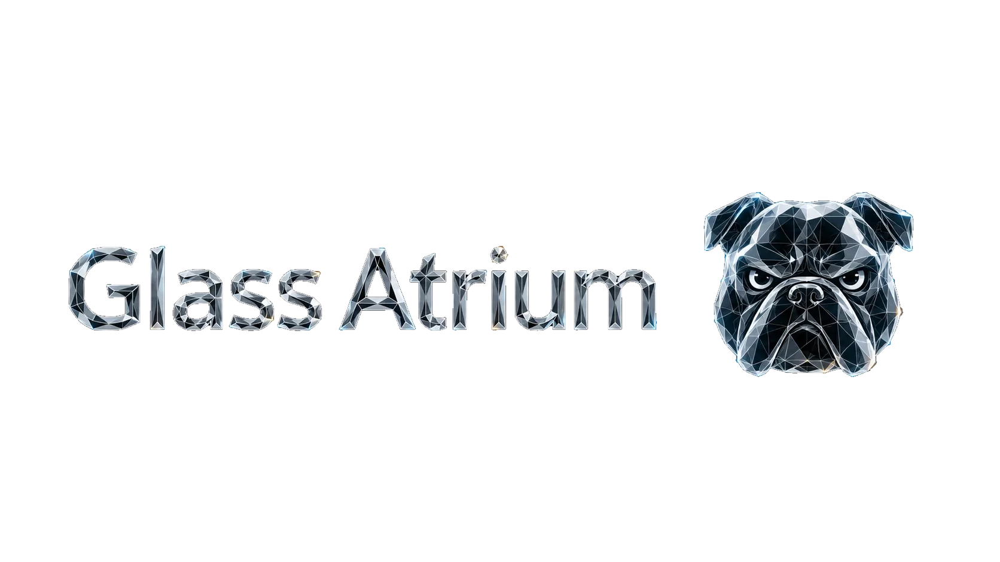
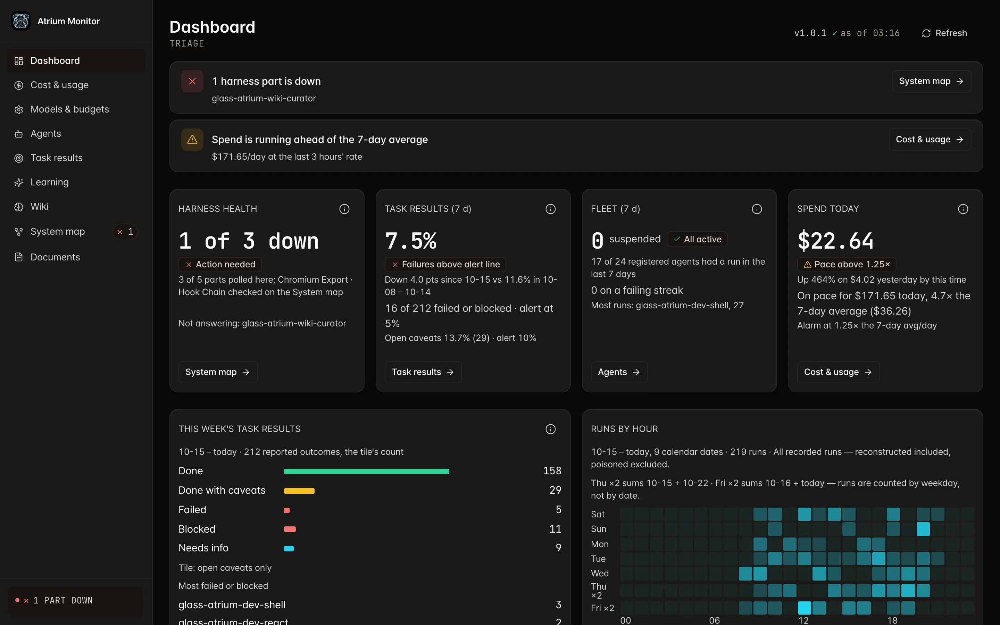
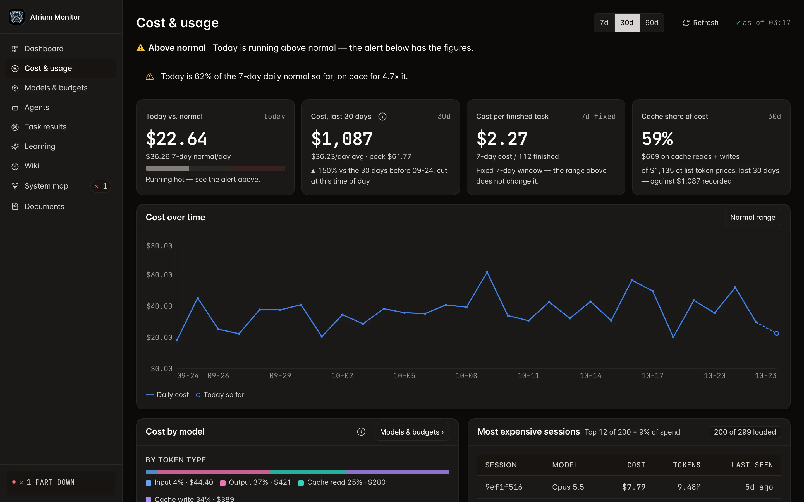
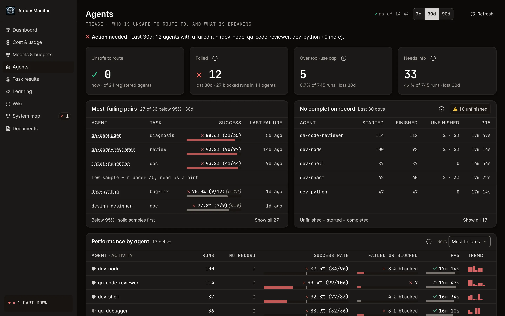
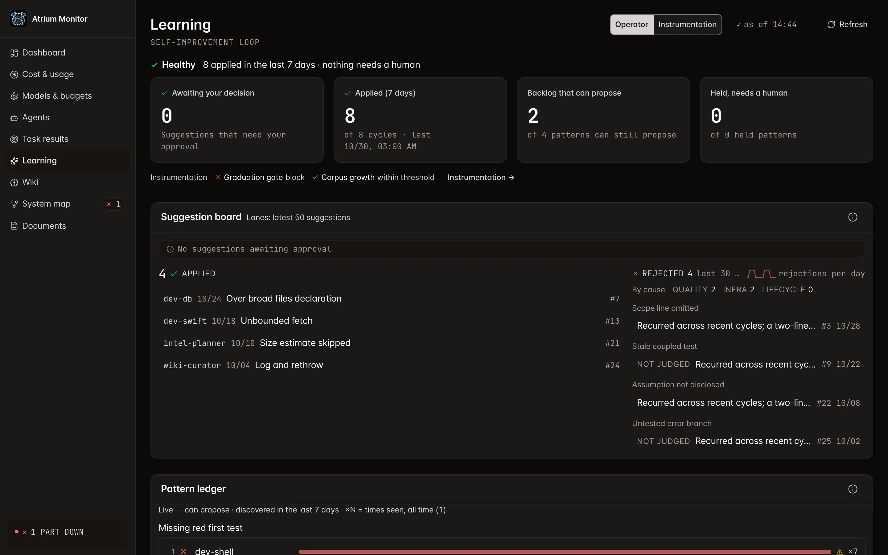
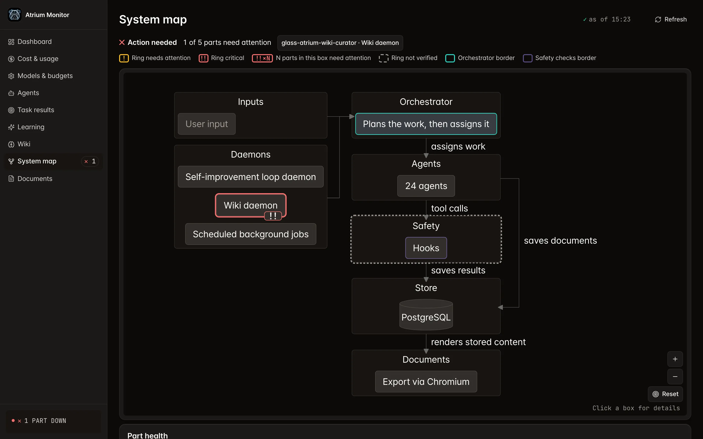

<!-- banner: https://github.com/bettep-dev/glass-atrium/raw/main/docs/assets/banner.webp -->
<p align="center">
  
</p>

**A self-improving, centrally-orchestrated multi-agent harness for Claude Code.**

[](LICENSE)
[](.github/workflows/ci.yml)


**English** · [한국어](README.ko.md) · [中文](README.zh.md) · [日本語](README.ja.md)

- A single orchestrator watches over and reins in a fleet of specialist agents.
  - It never allows a setup where agents pass work back and forth among themselves until it spirals out of control.
- The orchestrator takes a single request, breaks it into pieces for a team of specialist agents, and pulls the results back together.
- Every cost, outcome, and agent event surfaces on the real-time monitor dashboard, laid bare as if you were looking through a glass wall.
- The system is designed to revise its own instructions in response to recurring failures — no prompt tweaking on your part.
  - Automatic instruction patching stays closed until live trials confirm it works (step 8 of [How it works](#how-it-works-end-to-end)).

> [!WARNING]
> - Once installed, background daemons start running **automatically**.
>   - Some of them call Claude on a daily schedule, so tokens (and cost) are spent even if you never touch it.
> - This harness is a **high-token-usage system**.
>   - Because the orchestrator splits a single request across a team of specialist agents, one request fans out into many subagent calls, and token consumption can run to several times that of a single agent.
> - That said, these tokens are not billed per use through a direct Anthropic API connection.
>   - The harness runs **on top of the Claude Code CLI** you already subscribe to, so it draws on the tokens included in that subscription plan — no separate API key, no metered billing.

---

<details>
<summary>Contents</summary>

- [What it is](#what-it-is)
- [Why it was built](#why-it-was-built)
- [The core idea: one orchestrator, not a chain of handoffs](#the-core-idea-one-orchestrator-not-a-chain-of-handoffs)
- [How it works, end to end](#how-it-works-end-to-end)
- [Big tasks carefully, small tasks fast](#big-tasks-carefully-small-tasks-fast)
- [What's inside](#whats-inside)
- [Skills: the internal quality layer](#skills-the-internal-quality-layer)
- [Quickstart](#quickstart)
- [Monitor screens](#monitor-screens)
- [License](#license)

</details>

## What it is

- Glass Atrium is a configuration-and-tooling layer that turns the Claude Code CLI into a multi-agent system designed to be coordinated, observable, and self-improving.
  - It is **not** a new agent framework, and it does **not** replace Claude Code.
  - It installs into `~/.claude/` and runs on top of the CLI you already use.
- The "glass atrium" in the name is also a lens for seeing the system.
  - Rather than treat the AI as one clever individual, picture a single glass building, see-through even in the dead of night, running around the clock.
  - Inside it is a company where many specialists do the work, but every piece of it passes through one supervisor.
  - Transparent glass, and a central supervisor through whom every path runs — those two are the identity the name carries.
- On top of that, a default install alone adds five things that come together as one coherent system.
  - A **capability-routed fleet of specialist agents** in place of a single general-purpose prompt (developers per stack, plus QA, planning, research, reporting, design, security, wiki, and meta)
  - A **layered rule system** that defines, in a matrix, which agent loads which rules
  - A **lifecycle hook pipeline** that enforces those rules (secrets, dangerous commands, budgets, deliverables) *mechanically* at every tool boundary
  - A **real-time monitoring dashboard** (the Atrium Monitor) that gathers every cost, outcome, and agent event in one place
  - A **self-improvement loop** designed to turn recurring failures into agent-instruction patches
    - Automatic patch generation and application stay closed until live trials confirm they work.

## Why it was built

- A single `CLAUDE.md` prompt does not scale.
  - The moment you ask one model to be a React expert *and* a database expert *and* a security reviewer *and* a planner, the instructions start colliding.
  - The rules that actually matter get diluted in a vast wall of text, and under load the model quietly drifts away from them.
- So the work has to be divided.
  - A team of specialists beats a lone genius.
  - Once the work is split, each specialist gets a clean memory (context) of its own and can focus on its job.
- The obvious next step — letting agents hand work off to one another — only makes the problem bigger.
  - In an agent-to-agent **handoff** system, control passes from A to B, then from B on to C.
  - Each agent is left to enforce its own rules, and observability scatters.
  - A single misbehaving agent can propagate unchecked, with no one accountable to the end.
- Glass Atrium was built to reap the benefits of specialization without giving up control — and the answer is centralization.
  - What decides success or failure, in this view, is not the model's talent but the operating system around it: the harness.
  - Because every specialist runs under continuous central supervision, a slip on one floor does not spread through the whole building.

## The core idea: one orchestrator, not a chain of handoffs

- The foundation is the **Manager Pattern** (the centralized manager pattern).
- A single orchestrator, the main Claude Code session, is the **strategic control plane**.
  - It *decomposes* your intent into sub-tasks, *delegates* each one to a specialist, and *synthesizes* the results.
  - It holds the full context alone and keeps control at every delegation boundary.
- The only work it does itself is a tiny fix where handing it off would cost more than the work, and it first tells you why in one line.
  - Targets a hook blocks, so they are always delegated: harness paths · sensitive files such as `.env`, credentials, and keys · new document files · the target files of an in-progress (`implementing`) plan
  - If the plan list cannot be read, the edit is blocked (fail closed).
- The opposite model, the **Handoff Pattern** (agents transferring control directly among themselves), is **deliberately not supported** — and that is precisely the point.
- **Delegation and recovery**
  - Each sub-task is routed by capability rather than by keyword or alias matching, so it is always clear who is doing what.
  - Each agent returns a structured completion record, and the orchestrator verifies that intent and result line up.
  - A failed subagent is handled by the Failure Recovery Loop (retry → fallback → debugger escalation).
  - Independent, non-overlapping sub-tasks run in parallel by default, without your having to ask.
- **Limits**
  - Per-agent turn budget: the harness applies it as a hard cap at spawn time.
  - Concurrency cap: the workflow engine runtime enforces it.
  - Spawn depth: bounded structurally rather than by a policy number — no agent's frontmatter grants a re-spawn tool (Agent/Task/Workflow), and that tool list is frozen at spawn time.
- **Mechanical layer and discipline layer** — the repository's rule files describe themselves the same way.
  - Mechanical layer (real code): the PreToolUse hook pipeline · harness integrity detection that compares the install against the release manifest (`glass-atrium doctor` — it detects rather than blocks; `glass-atrium update` restores) · the spawn-time tool freeze
  - Discipline (honor-system) layer: delegation retry, fallback, and escalation · the `MAX_DEPTH=2` policy number and its depth counting
- **How it differs from an uncontrolled handoff system**
  - Lifecycle hooks intercept every tool call — hook-backed enforcement.
  - The monitor observes every event — full observability.
  - Outcome records keep every delegation traceable and auditable.
  - The learning loop is designed to feed those records and correction signals back into instruction patches. Recording and aggregation run today; automatic instruction patches apply only after they win a live trial, and risky changes apply only after user approval.

## How it works, end to end

1. **You ask the orchestrator** (the main session) for something — fix a bug, plan a feature, write a report.
2. **The orchestrator investigates and decomposes** the request, then consults the capability registry to assemble a team of specialist agents and an execution order.
3. **It delegates each sub-task** — every delegation clears the PreToolUse hooks (dangerous-command blocking, secret scanning, scope-drift flagging, plan-verification gate) *before* the action actually runs.
4. **The specialist agent does the work** — within its own scope rules, injected by the SubagentStart hook.
   - The turn budget is a hard cap applied at spawn time; the tool budget is an advisory meter that only warns.
   - A long task writing down its progress and stopping in a resumable state before it reaches the limit is designed discipline, not a mechanical guarantee.
   - Where the discipline does not hold, the hard cap cuts the work off mid-flight.
5. **Outcomes are recorded.**
   - Each agent emits a `[COMPLETION]` block, and the hook that fires when a subagent ends (SubagentStop) captures it as an Outcome Record.
6. **The orchestrator synthesizes** — folding the verified results into one answer, or running the recovery loop when something fails.
7. **Everything is observable.**
   - Every cost, outcome, and agent event streams into PostgreSQL and the Atrium Monitor in real time.
8. **The system is designed to improve itself.**
   - A background daemon gathers outcome records and correction signals, and flags recurring failure patterns as instruction-improvement candidates.
   - Automatic generation and application of instruction patches stay closed on every install until live trials confirm they work.

## Big tasks carefully, small tasks fast

- The system **decides for itself which steps to take, matched to the task's size and complexity.**
  - You never have to tell it, step by step, to "proceed carefully."
- **Big, complex tasks** — it walks through a careful flow on its own: plan → check that the plan holds up → build it → test that it works → confirm it is done and wrap up.
- **Small tasks** — it skips that procedure and handles them fast.
  - For a small task not tied to a plan (`simple-task`), the confirmation markers such as scope, size estimate, and team composition become optional, and the matching gates pass silently.
  - A task tied to a plan goes through every gate, whatever its size.
- **Workflow** — the way those steps are executed.
  - If you ask it to "proceed as a workflow," an automation engine bundles the steps and runs them in one pass, instead of a person triggering each one.
  - The steps are the same either way; only how they run changes.
- **In one line** — which steps a task goes through is set automatically by its size; only how they execute is optional.

## What's inside

- **Fleet of specialist agents** — routed by a capability registry (`agent-registry.json`) rather than by keyword (developers per stack, plus QA, planning · research · reporting, design, security, wiki, and meta).
- **Layered rule system** — a global charter (`agents/GLASS_ATRIUM_GLOBAL_RULES.md`), core cross-cutting rules (`rules/`), and per-scope rules (`scoped/`), bound together by an explicit compliance matrix.
  - The rules loaded in every session hold only the sentences every session needs; the detail lives in reference files read on demand.
    - Always-loaded set (the global charter + the `rules/glass-atrium/*.md` files without `paths:`, 8 files): 156,912 → 69,405 UTF-16 units
      - The largest share is the always-loaded rule `rules/glass-atrium/orchestrator-role.md` (66,061 → 775 units) — its body moved to the on-demand `skills/glass-atrium-ops-orchestrator-role.md`, leaving only a stub.
    - The main session additionally receives the orchestrator core (`scoped/orchestrator-core.md`, 7,492 units), added by the SessionStart hook.
    - The on-demand orchestrator skill (`skills/glass-atrium-ops-orchestrator.md`): 142,358 → 99,449 bytes
  - A CI test (`scripts/test/startup-budget.bats`) keeps the always-loaded set under 145,000 UTF-16 units.
- **Lifecycle hook pipeline** — a set of hook scripts (`hooks/`) that mechanically enforce secrets, dangerous commands, budgets, and outcome records at every tool boundary.
- **Self-improvement loop** — the autoagent daemon (`autoagent/`) is designed to turn accumulated outcome records and correction signals into agent-instruction patches.
  - It auto-applies only safe patches, keeps the original before each apply, and restores it if verification fails.
  - Risky changes (deletion, external calls, permissions, agent identity, and the like) go to a user-approval queue.
  - For now, automatic patch generation and application are closed on every install until live trials confirm they work; outcome-record and correction-signal aggregation keep running.
- **Atrium Monitor** — a 9-screen real-time dashboard built on Fastify 5 + Prisma 7 + React 18 (`http://127.0.0.1:16145`).
  - Every screen uses the same layout atoms: a 4px spacing ladder · a named page header · a single KPI tile structure · a shared table row height
  - Controls follow a shared size scale (32px for buttons, segments, inputs, and filter chips; 24px or more for inline targets), and their size and position do not change when their state does.
  - The default border of toggles and input fields is at least 3:1 against the background in both themes, so even an unselected chip reads as a box.
- **Direct model + budget assignment** — the monitor's **Models & budgets** screen assigns a per-domain model and a per-call USD hard cap without your having to edit the config file.
- **Live architecture map** — the monitor's System map screen renders the canonical architecture map (one Mermaid diagram) alongside live daemon status.
- **Wiki knowledge store** — an LLM-only store (`wiki/`) with a raw-source → curated-notes pipeline and a SQLite BM25 full-text search index.
  - The research agents' web findings accumulate here.
  - It is consulted first, ahead of any new research or analysis, to reuse existing knowledge.
- **Internal agent skills** — progressive-disclosure `SKILL.md` packages that the agents and orchestrator invoke automatically (see [Skills](#skills-the-internal-quality-layer)).
- **Per-file symlink farm install** — idempotently creates `~/.claude/<rel>` → `~/.glass-atrium/<rel>` symlinks at the file level, not the directory level, so they coexist with user-owned files without conflict.
- **5 background daemons** — `com.glass-atrium.*` launchd jobs, all declared in `config.toml`.
  - 1 resident (keepalive): monitor
  - 4 scheduled: monitor log rotation · PG backup · autoagent cycle · wiki compile
  - Like heating and ventilation left running through the night, they are the building's utility room — designed never to stop, with nobody's hand on the switch.
- **Trash purge command** — `~/.glass-atrium/scripts/ga-trash-purge.sh <entry>` permanently deletes only one named entry directly under the home Trash (`~/.Trash`), and writes a one-line log for each deletion.
  - Agents move files to the Trash instead of deleting them, so they can clean up the entries they moved without anyone emptying the Trash.
  - It refuses the Trash folder itself, any other path, and any path deeper than one level.
- **Zero secret material in the repository** — peer-auth-only PostgreSQL (no passwords), secret-scan hooks, and a release-gate PII scan.

## Skills: the internal quality layer

- Skills in Glass Atrium are **not** user-invoked commands — they are an internal quality and governance layer.
- They load globally at session start, and Claude activates them on its own to suit the task.
- They cover code and design conventions, ops and verification gates, and wiki and web tooling.
  - Some fire in response to monitor signals (an agent deletion result, and so on).
- You never need to know which skill is running — the harness picks and invokes them for you.

## Quickstart

- **Prerequisites**: macOS (Apple Silicon and Intel alike) · a **logged-in Claude subscription account**
  - Every other dependency, the Claude Code CLI included, is detected and installed by the install TUI with your consent.
  - Two steps are yours to take.
    - Approving the Xcode Command Line Tools install dialog
    - Logging in with `claude` (the install stops here if that does not go through)
- What a single consent can install: `postgresql@18` · `node@24` · `bun` · `sqlite` with FTS5 support · `tmux`/`jq`/`git`/`curl`/`lsof`/`rsync` · the `claude` CLI · Python libraries (`psycopg` · `psycopg2-binary` · `PyYAML`)
  - Anything already present is skipped.
  - Most of a first install's time goes to Homebrew downloads and the monitor build.

```sh
curl -fsSL https://github.com/bettep-dev/glass-atrium/raw/main/install.sh | bash
```

- When the interactive menu opens, choose **Install**.
  - Once it finishes, the dependencies and daemons are configured and started automatically.
  - The dashboard is reachable at `http://127.0.0.1:16145`.
- The install is not finished until it clears a health gate.
  - Afterwards you can re-check the state with `glass-atrium doctor` or the **System health** strip on the monitor's **System map** screen.
- **Leave the installed folder where it is.**
  - The installer downloads a release bundle, unpacks it into the `~/.glass-atrium` folder, and links it into your Claude config directory through a **per-file symlink farm** (the method described earlier).
  - The real files live here, so moving or deleting the folder breaks the links.

### Profile branches (`CLAUDE_CONFIG_DIR`)

- The Atrium installs into `~/.claude` only.
- Any other config directory you use through `CLAUDE_CONFIG_DIR` (for example `~/.claude-work`) must symlink `agents`, `rules`, `skills`, and `settings.json` to their `~/.claude` counterparts.
- To check that a branch session loads the Atrium rules, open a Claude session from a directory outside `$HOME` — inside `$HOME` a missing link can be masked.
- `glass-atrium doctor`, wherever you run it, reports the branches with missing links and a fix command you can run as-is.
  - What it checks: only the `~/.claude-*` directories next to `~/.claude` that have been run at least once (that have a `.claude.json`) — check branches at other paths yourself.

### Update

- When a new release lands, an **Update available** badge appears in the dashboard toolbar.
  - Clicking the badge applies the update on the spot.
  - `glass-atrium update` does the same from the terminal.
- Applying one pulls the GitHub release bundle and follows two rules.
  - **The bundle replaces every file carried in the manifest.**
  - `agents/*.md` are merged on their EDITABLE regions only, so the edits you made survive (where the wording collides, a model arbiter decides).
- The bundle **holds authority over deletion too**.
  - A file on the manifest's `retired` list is moved to the Trash.
  - A file whose hash the vendor never shipped is read as your own edit and left alone.

### Uninstall

- Choose **Uninstall** from the menu.
- It stops the daemons, then removes the following from the `~/.claude` side and drops the GA database.
  - The symlinks the Atrium laid down and the empty directory shells
  - The hook wiring in `settings.json` (the original is left beside it as `settings.json.ga-backup.<timestamp>`)
  - The PATH line in your shell rc
- Your own files are left untouched.
  - The `~/.glass-atrium` folder holding the real files also remains.
- `~/.claude` is **not** emptied completely.
  - The update baseline (`~/.claude/data/update/baseline-manifest.json`) and the base@install store of original agents (`~/.claude/data/update/base-agents/`) stay by default.
  - They are the reference points that let a reinstall carry your own agent edits forward through a 3-anchor merge.
- Passing `--purge-config` moves `config.toml` and the baseline file to the Trash as well (moved, not deleted).
  - The `base-agents/` store survives in every mode.
  - The menu's post-uninstall cleanup question covers `config.toml` only, so to clear the baseline too, run `glass-atrium uninstall --purge-config --yes` from the terminal.
- **The database is deleted only after a backup is left** (the dump is kept in `~/.glass-atrium/backups/postgres/`).
  - A reinstall creates a fresh one.
  - The backup is not restored automatically — if you need the old data, restore it yourself with `pg_restore`.

### How to write Atrium Monitor documents

- A request for a document, report, summary, or reference is delegated to **glass-atrium-intel-reporter**; a request for planning, requirements definition, or task decomposition goes to **glass-atrium-intel-planner**.
- Which format you get **comes down to how you word the request**.
  - The default is a **hidden "agent-only," token-optimized record** on the monitor.
    - It is chosen from md, yaml, json, or txt by the shape of the content, and is an internal record for later reference.
  - If you make your intent to share or read it plain — "**as HTML**," "**as a web document**," "**for the team to share**" — you get an **HTML document** a person can view and share (a single file with a dark theme, diagrams, and tables).
- Both formats show up on the Atrium Monitor's **Documents** screen.
  - A document can move between in-progress and done.
  - A new document on the same topic can replace an earlier one.
- Even when you do not ask for a document, an agent-only record may be left behind if it is judged worth keeping.

### Adding a dev agent

- When you ask something like "Add a development agent that does OOO," the orchestrator does not create a new agent right away — it first judges **whether to extend an existing agent or create a new one**.
  - **The default is to extend; creation is allowed only when it clears the gate.**
- For creation to be allowed, three conditions must **all be met independently**.
  - **A different artifact type** — the files it produces are structurally distinct.
  - **A different decision domain** — the expertise needed to judge correctly does not overlap.
  - **A non-transferable quality judgment** — one side's quality review cannot be stood in for by the other side's expertise alone.
- If the proposed agent's domain **overlaps an existing agent beyond a certain ratio, creation is blocked**.
  - Heavy overlap is a signal to extend, not to create.
- Along the way there are **two user-approval pauses**.
  - First, the orchestrator lays out its rationale and recommendation to settle create versus extend.
  - Then it checks once more just before it actually writes to the agent file and the registry.
- The body (the system prompt) is authored by **glass-atrium-meta-prompt-engineer**, and registration is handled by a dedicated CLI.
- All you have to do is ask to "add one" — the extend-versus-create judgment and the approval requests are the orchestrator's job.

## Monitor screens

- The screens below were captured from a separate monitor loaded with synthetic data only (no real install data).

<p align="center"></p>
<p align="center"><em>Dashboard — a top banner flags stopped harness parts and spend running ahead of the 7-day average; below the tiles for harness health, 7-day task results, the agent fleet, and today's spend come this week's task-result bars and an hourly run heatmap.</em></p>

<p align="center"></p>
<p align="center"><em>Cost & usage — first raises a "higher than usual" status line and a spend-rate warning, then shows KPIs for today versus usual, 30-day cost, cost per finished task, and cache share, a daily cost trend chart, cost by token type and model, and a table of the most expensive sessions, with a 7 · 30 · 90-day period switch.</em></p>

<p align="center"></p>
<p align="center"><em>Agents — points out in one line the agents that need action; below KPIs for agents unsafe to route to, failures, over-tool-use-cap runs, and needs-context results come the agent-task pairs that fail most often, runs with no completion record and P95, and a per-agent performance table.</em></p>

<p align="center"></p>
<p align="center"><em>Learning — shows a one-line state of the self-improvement loop, tiles for awaiting approval, applied in the last 7 days, proposable backlog, and held patterns that need a human call, and an instrumentation status line. As on today's installs, where automatic patch generation and application are closed, applied-in-the-last-7-days is 0; the suggestion board keeps the apply history from before the closure, rejections by cause, and proposals closed without a verdict (generation closed until live trials), then leads into the pattern ledger.</em></p>

<p align="center"></p>
<p align="center"><em>System map — puts the parts that need attention and the status-ring legend at the top, overlays per-part status rings on a diagram running through inputs, daemons, orchestrator, agents, safety hooks, the PostgreSQL store, and Chromium document export, and continues into the part-health list below.</em></p>

## License

[MIT](LICENSE) © 2026 Bettep
