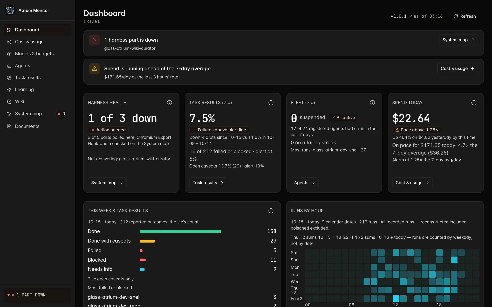
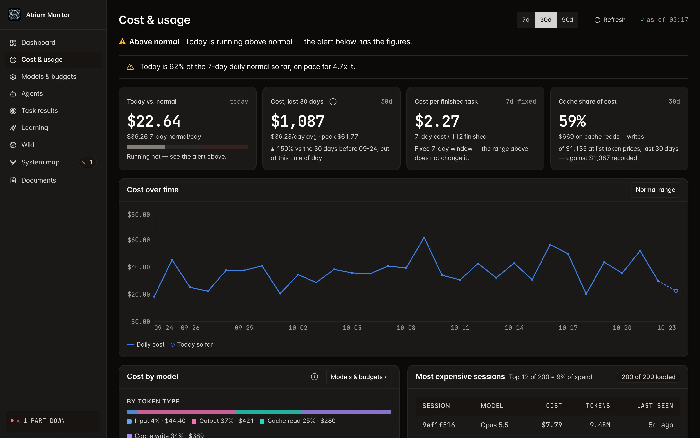
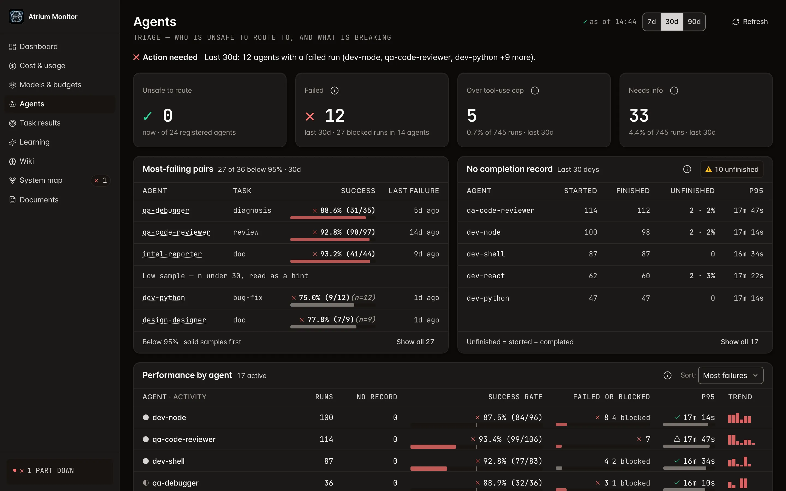
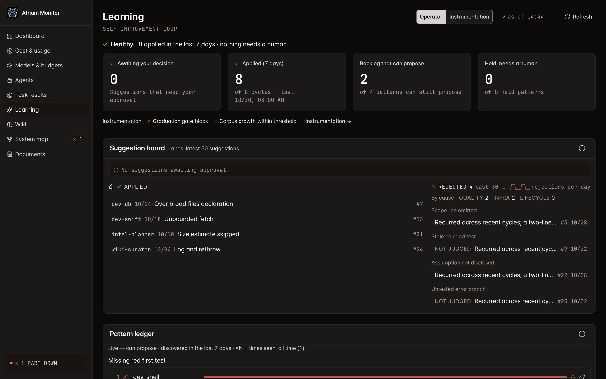
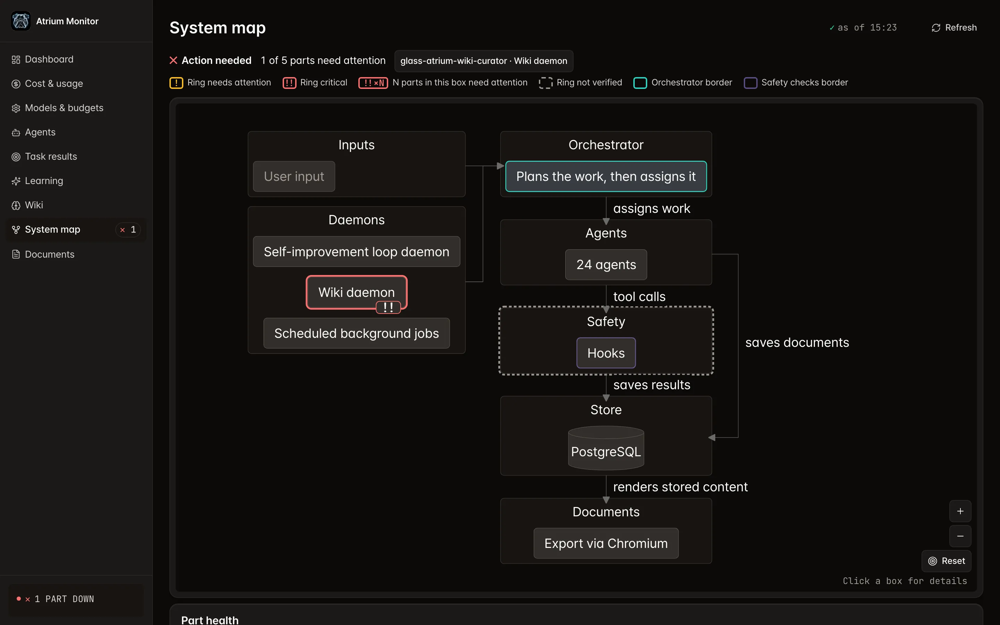

<!-- banner: https://github.com/bettep-dev/glass-atrium/raw/main/docs/assets/banner.webp -->
<p align="center">
  
</p>

**面向 Claude Code、由中心统一编排的自我改进型多智能体 harness。**

[](LICENSE)
[](.github/workflows/ci.yml)


[English](README.md) · [한국어](README.ko.md) · **中文** · [日本語](README.ja.md)

- 由单个编排器（orchestrator）统一监督和掌控一支专业智能体队伍。
  - 绝不允许智能体之间相互移交任务、最终陷入失控的结构。
- 编排器接到一次请求后，将其分解并委派给一支专业智能体团队，再汇总各方结果。
- 所有成本、结果与智能体事件都实时呈现在监控仪表盘上，如同隔着玻璃幕墙将内部尽收眼底。
- 系统被设计为能从反复出现的失败中自行修正指令——你无需改动提示词。
  - 自动指令补丁在真实环境试验确认其效果之前保持关闭（[运作方式](#运作方式从头到尾)第 8 步）。

> [!WARNING]
> - 一经安装，后台守护进程便会**自动运行**。
>   - 其中一部分每天都会自动调用 Claude，因此即便你不去管它，也会消耗 token（产生费用）。
> - 这套 harness 是一个**高 token 消耗的系统**。
>   - 编排器会把一次请求拆分给一支专业智能体团队，于是一次请求便会扩散成多次子智能体调用，token 消耗可能达到单个智能体的数倍。
> - 不过，这些 token 并不是通过直连 Anthropic API、按用量计费的方式使用的。
>   - 本 harness 运行在你已经订阅的 **Claude Code CLI 之上**，因此无需单独的 API 密钥，也没有按量计费，而是直接使用该订阅套餐所含的 token。

---

<details>
<summary>目录</summary>

- [是什么](#是什么)
- [为什么要做](#为什么要做)
- [核心理念：不是移交连锁，而是单一编排器](#核心理念不是移交连锁而是单一编排器)
- [运作方式，从头到尾](#运作方式从头到尾)
- [大事审慎处理，小事快速处理](#大事审慎处理小事快速处理)
- [内部构成要素](#内部构成要素)
- [技能：内部质量层](#技能内部质量层)
- [快速开始](#快速开始)
- [监控界面](#监控界面)
- [许可证](#许可证)

</details>

## 是什么

- Glass Atrium 是一个配置与工具层，能把 Claude Code CLI 变成一套被设计为受协调、可观测、可自我改进的多智能体系统。
  - 它**不是**新的智能体框架，也**不**取代 Claude Code。
  - 它安装在 `~/.claude/` 下，运行在你已经使用的 CLI 之上。
- 名字里的「玻璃中庭（Glass Atrium）」也是审视这套系统的一副镜片。
  - 与其把 AI 看作一个聪明的个体，不如把它看作一栋 24 小时运转、即便深夜也内部通透可见的玻璃建筑。
  - 这是一家众多专家在其中工作、但所有工作都要经过唯一一位总管的公司。
  - 通透无遮的玻璃，加上所有路径都汇聚而至的中央总管——这两点正是名字所承载的身份。
- 在此之上，它还增添了以下五样东西，仅凭默认安装，它们便会结合成一套统一一致的系统。
  - 一支**按能力进行路由的专业智能体队伍**，取代用单一的通用提示词包揽一切（按技术栈划分的开发者，外加 QA、企划、研究、报告、设计、安全、wiki、元层）
  - 一套**分层规则系统**，用一份矩阵定义哪个智能体加载哪些规则
  - 一条**生命周期钩子（hook）流水线**，在每一个工具边界上*机械地*强制执行这些规则（密钥、危险命令、预算、产出物）
  - 一块**实时监控仪表盘**（Atrium Monitor），把所有成本、结果与智能体事件集中呈现于一处
  - 一个**自我改进循环**，被设计为把反复出现的失败转化为智能体指令补丁
    - 自动生成与应用补丁，在真实环境试验确认其效果之前保持关闭。

## 为什么要做

- 单一的 `CLAUDE.md` 提示词无法扩展到大规模。
  - 一旦你要求同一个模型既当 React 专家，*同时*又当数据库专家，*同时*又当安全审查员，*同时*又当企划者，指令之间就会彼此冲突。
  - 真正重要的规则会淹没在庞大的文本里被稀释，而一旦负载过高，模型就会悄悄偏离那些规则。
- 所以工作必须拆分。
  - 与其依赖一位天才，不如让多位专家协作。
  - 一旦拆分，每位专家都能拥有各自干净的记忆空间（上下文），专注于自己的本职。
- 但顺理成章的下一步——让智能体彼此移交任务——只会把问题放得更大。
  - 在智能体之间的**移交**（handoff）系统里，控制权从 A 交给 B，再从 B 交给 C。
  - 每个智能体都得自己执行自己的规则，可观测性也随之支离破碎。
  - 即便某个出错的智能体在无人制衡的情况下把问题传播下去，也始终没有谁负起最终责任。
- Glass Atrium 正是为了在不放弃掌控的前提下享受专业化的红利而生——答案就是中心化。
  - 因为我们相信，决定成败的并非模型本身的天赋，而是环绕着它的运营体系，也就是这套 harness。
  - 所有专业智能体都在中央的常态监督下运行，因此某一层的失误不会蔓延到整栋建筑。

## 核心理念：不是移交连锁，而是单一编排器

- 其基础是 **Manager Pattern（中心化的管理者模式）**。
- 作为主 Claude Code 会话的单个编排器，就是**战略控制平面**。
  - 它把你的意图*分解*为子任务，*委派*给专业智能体，再*汇总*结果。
  - 它独自掌握全局上下文，并在每一个委派边界上保持控制权。
- 它亲自动手的只有那些移交成本比工作本身还大的极小修改，而且会先用一句话告诉你理由。
  - 因钩子拦截而始终委派的对象：harness 路径 · `.env`、凭据、密钥等敏感文件 · 新的文档文件 · 进行中（`implementing`）计划的目标文件
  - 若无法读取计划列表，则拦截修改（fail closed）。
- 与之相对的模型——**Handoff Pattern（智能体之间直接相互移交控制权的方式）**——则**刻意不予支持**，而这恰恰是关键所在。
- **委派与恢复**
  - 每个子任务都按能力而非关键字、别名匹配进行路由，因此谁负责什么都被精确掌握。
  - 每个智能体都会返回一份结构化的完成记录，由编排器核对意图与结果是否一致。
  - 失败的子智能体交由失败恢复循环处理（重试 → 回退 → 上报给调试器）。
  - 互不重叠的独立子任务，即使你不主动要求，也会默认并行执行。
- **上限**
  - 各智能体的轮次预算：由 harness 在派生（spawn）时刻作为硬上限施加。
  - 并发上限：由工作流引擎运行时施加。
  - 派生深度：不是靠一个策略数字，而是靠结构约束——没有任何智能体的 frontmatter 被授予再次派生的工具（Agent/Task/Workflow），而这份工具清单在派生时刻即被冻结。
- **机械层与自律层** — 仓库里的规则文件自己也是这样划分的。
  - 机械层（真实的代码）：PreToolUse 钩子流水线 · `enforce-harness-critical.sh` 对 harness 临界路径的拦截 · 派生时刻的工具冻结
  - 自律（honor-system）层：委派的重试、回退、上报 · `MAX_DEPTH=2` 这个策略数字及其深度计数
- **与失控移交系统的区别**
  - 生命周期钩子拦截每一次工具调用——由钩子支撑的强制执行。
  - 监控观测每一个事件——完整的可观测性。
  - 结果记录让每一次委派都可追踪、可审计。
  - 学习循环被设计为把这些记录与纠正信号转回为指令补丁。记录与汇总目前照常运行，而自动生成与应用补丁在真实环境试验之前保持关闭。

## 运作方式，从头到尾

1. **你向编排器（主会话）请求某件事**——修复 bug、企划功能、撰写报告。
2. **编排器进行调查与分解**之后，参照能力注册表，组建一支专业智能体团队并确定执行顺序。
3. **它逐一委派子任务**——每一次委派都会在实际执行*之前*先经过 PreToolUse 钩子（拦截危险命令、扫描密钥、标记越界范围、计划验证门）。
4. **专业智能体执行工作**——在 SubagentStart 钩子所注入的自身范围规则之内。
   - 轮次预算是派生时刻施加的硬上限，而工具预算只是发出告警的建议性计量。
   - 较长的任务在触及上限之前先记下进度、停在可恢复的状态，这是设计出来的自律，而非机械保证。
   - 一旦自律没有守住，硬上限就会在作业途中把它切断。
5. **结果被记录。**
   - 每个智能体都会发出一个 `[COMPLETION]` 块，子智能体结束时刻的钩子（SubagentStop）将其捕获为结果记录。
6. **编排器进行汇总**——把已验证的结果汇成单一答复；若出现失败，则运行恢复循环。
7. **一切皆可观测。**
   - 所有成本、结果与智能体事件都会实时流向 PostgreSQL 和 Atrium Monitor。
8. **系统被设计为能自我改进。**
   - 后台守护进程汇集结果记录与纠正信号，把反复出现的失败模式标记为指令改进候选。
   - 指令补丁的自动生成与应用，在真实环境试验确认其效果之前，在所有安装中都保持关闭。

## 大事审慎处理，小事快速处理

- 这套系统会**根据任务的大小与复杂度，自行决定要走哪些步骤。**
  - 你无需逐一叮嘱「请审慎地一步步来」。
- **又大又复杂的任务** — 会自动走一条先制定计划 → 检查计划是否合理 → 实际构建 → 测试能否正常运作 → 确认是否完成并收尾的审慎流程。
- **小任务** — 跳过这套流程，快速处理。
  - 对于不绑定计划的小任务（`simple-task`），范围、规模估算、团队组成等确认标注变为可选，相应的门禁会静默通过。
  - 绑定计划的任务，无论大小，都要照常经过所有门禁。
- **工作流（workflow）** — 执行上述步骤的方式。
  - 如果你指定「以工作流方式进行」，这些步骤便不再由人逐一触发，而是交给一个自动化引擎一次性打包处理。
  - 无论哪种方式，需要经过的步骤都一样，变的只是执行方式。
- **一句话概括** — 要走哪些步骤由任务大小自动决定，而如何执行则只是可选项。

## 内部构成要素

- **专业智能体队伍** — 按能力注册表（`agent-registry.json`）而非关键字进行路由（涵盖按技术栈划分的开发者、QA、企划/研究/报告、设计、安全、wiki、元层）。
- **分层规则系统** — 用一份明确的合规矩阵，把全局宪章（`agents/GLASS_ATRIUM_GLOBAL_RULES.md`）、核心横切规则（`rules/`）与按范围划分的规则（`scoped/`）绑在一起。
  - 每次会话都常驻加载的规则里只放每次会话都需要的语句，细节则放在按需读取的参考文件中。
    - 常驻加载集（全局宪章 + 不带 `paths:` 的 `rules/glass-atrium/*.md`，共 8 个文件）：156,912 → 69,405 UTF-16 单位
      - 占比最大的是常驻加载规则 `rules/glass-atrium/orchestrator-role.md`（66,061 → 775 单位）——其正文已移至按需读取的 `skills/glass-atrium-ops-orchestrator-role.md`，只留下一个存根。
    - 主会话还会额外收到由 SessionStart 钩子注入的编排器核心（`scoped/orchestrator-core.md`，7,492 单位）。
    - 按需读取的编排器技能（`skills/glass-atrium-ops-orchestrator.md`）：142,358 → 99,449 字节
  - CI 测试（`scripts/test/startup-budget.bats`）把常驻加载集守在 145,000 UTF-16 单位以下。
- **生命周期钩子流水线** — 一组钩子脚本（`hooks/`），在每一个工具边界上机械地强制执行密钥、危险命令、预算与结果记录。
- **自我改进循环** — autoagent 守护进程（`autoagent/`）被设计为把累积的结果记录与纠正信号转化为智能体指令补丁。
  - 只自动应用安全的补丁；应用前先保存原文，验证失败时便回滚。
  - 有风险的变更（删除、外部调用、权限、智能体身份等）会进入用户审批队列。
  - 目前在真实环境试验确认其效果之前，自动生成与应用补丁在所有安装中都保持关闭，而结果记录与纠正信号的汇总仍在持续运行。
- **Atrium Monitor** — 基于 Fastify 5 + Prisma 7 + React 18、共 9 个界面的实时仪表盘（`http://127.0.0.1:16145`）。
  - 所有界面都使用共同的布局原子：4px 间距阶梯 · 带名称的页面标题栏 · 单一的 KPI 卡片结构 · 统一的表格行高
  - 控件遵循共同的尺寸档位（按钮、分段控件、输入框、筛选标签为 32px，行内目标 24px 以上），状态改变时尺寸与位置都不会变化。
  - 开关与输入框的默认边框在两种主题下与背景的对比度均不低于 3:1，因此即便是未选中的标签也能被看作一个框。
- **模型与预算直接分配** — 在监控的 **Models & budgets** 界面，你无需改动配置文件，即可为各领域分配模型，并设定每次调用的 USD 硬上限。
- **实时架构图** — 监控的 System map 界面会把规范架构图（1 张 Mermaid 图）与实时守护进程状态一并渲染。
- **wiki 知识库** — 一个仅供 LLM 使用的存储库（`wiki/`），配有「原始素材 → 经整理笔记」的加工流水线，以及 SQLite BM25 全文检索索引。
  - 研究智能体的网络调查结果会在此积累。
  - 每次开始新的调查/分析之前会先行查询，以复用既有知识。
- **内部智能体技能** — 由智能体和编排器自动调用、采用渐进式披露的 `SKILL.md` 包（参见[技能](#技能内部质量层)）。
- **按文件的符号链接群安装** — 为与用户自有文件互不冲突地共存，以文件（而非目录）为单位，幂等地创建 `~/.claude/<rel>` → `~/.glass-atrium/<rel>` 符号链接。
- **5 个后台守护进程** — `com.glass-atrium.*` 的 launchd 作业，全部在 `config.toml` 中声明。
  - 常驻（keepalive）1 个：monitor
  - 定时 4 个：监控日志轮转 · PG 备份 · autoagent cycle · wiki compile
  - 就像整夜运转的供暖与通风，没有谁一直攥着开关，而是这栋建筑从设计之初就注定不会停歇的设备间。
- **废纸篓清理命令** — `~/.glass-atrium/scripts/ga-trash-purge.sh <条目>` 只会永久删除主目录废纸篓（`~/.Trash`）正下方的单个指定条目，并为每次删除留下一行日志。
  - 智能体不会删除文件，而是将其移入废纸篓，因此无需有人清空废纸篓，也能清理它们自己移入的条目。
  - 废纸篓文件夹本身、其他路径以及深于一层的路径都会被拒绝。
- **存储库中零密钥素材** — 仅用 peer-auth 的 PostgreSQL（无密码）、密钥扫描钩子、发布门 PII 扫描。

## 技能：内部质量层

- Glass Atrium 的技能**不是**由用户调用的命令，而是一个内部质量与治理层。
- 它们在会话开始时全局加载，由 Claude 根据当下的任务自动激活。
- 它们涵盖代码/设计规约、运维与验证门，以及 wiki 与 web 工具。
  - 其中一部分会响应监控信号（智能体删除结果等）而触发。
- 你无需知道哪个技能正在运行——harness 会自行挑选并调用。

## 快速开始

- **前置要求**：macOS（Apple Silicon 与 Intel 均支持） · **已登录的 Claude 订阅账号**
  - 包括 Claude Code CLI 在内的其余依赖，都由安装 TUI 征得同意后探测并安装。
  - 有两步需要你亲自完成。
    - 批准 Xcode Command Line Tools 的安装对话框
    - `claude` 登录（若未通过，安装就会停在这里）
- 一次同意即可安装的东西：`postgresql@18` · `node@24` · `bun` · 支持 FTS5 的 `sqlite` · `tmux`/`jq`/`git`/`curl`/`lsof`/`rsync` · `claude` CLI · Python 库（`psycopg`、`psycopg2-binary`、`PyYAML`）
  - 已经装好的会被跳过。
  - 首次安装的耗时大多取决于 Homebrew 的下载与监控端的构建。

```sh
curl -fsSL https://github.com/bettep-dev/glass-atrium/raw/main/install.sh | bash
```

- 交互式菜单打开后，请选择 **Install**。
  - 安装完成后，依赖与守护进程会自动配置并运行。
  - 仪表盘可在 `http://127.0.0.1:16145` 访问。
- 安装必须通过健康门（health gate）才算结束。
  - 之后你也可以用 `glass-atrium doctor` 或监控 **System map** 界面上的 **System health** 状态条再次确认状态。
- **请把安装好的文件夹留在原处。**
  - 安装程序会下载发布包、解压到 `~/.glass-atrium` 文件夹，再以**按文件的符号链接群**（前文所述的方式）与 Claude 配置目录相连。
  - 真实文件就存放在这里，因此一旦移动或删除该文件夹，这些链接便会失效。

### 配置档分支（`CLAUDE_CONFIG_DIR`）

- Atrium 只安装在 `~/.claude` 中。
- 你通过 `CLAUDE_CONFIG_DIR` 使用的其他配置目录（例如 `~/.claude-work`），必须把 `agents`、`rules`、`skills`、`settings.json` 符号链接到 `~/.claude` 一侧。
- 要确认分支会话是否加载了 Atrium 规则，请在 `$HOME` 之外的目录中打开 Claude 会话进行检查——在 `$HOME` 之内，缺失可能会被掩盖。
- `glass-atrium doctor` 无论在何处运行，都会指出缺少链接的分支，并给出可直接运行的修复命令。
  - 检查对象：仅限 `~/.claude` 旁边、至少运行过一次（存在 `.claude.json`）的 `~/.claude-*` 目录——其他路径下的分支请自行检查。

### 更新

- 有新版本发布时，仪表盘工具栏上会出现 **Update available** 徽章。
  - 点击徽章即可就地应用。
  - 在终端里用 `glass-atrium update` 也是同一件事。
- 应用时会取回 GitHub 发布包，并按两条规则进行。
  - **发布包会替换清单（manifest）中列出的所有文件。**
  - `agents/*.md` 只合并 EDITABLE 区域，从而保住你改动过的内容（措辞发生冲突时，由模型仲裁者裁定）。
- 发布包**对删除同样拥有权限**。
  - 清单 `retired` 名单上的文件会被移入废纸篓。
  - 若其哈希是厂商从未分发过的，就会被视为用户的编辑而原样保留。

### 卸载

- 在菜单中选择 **Uninstall**。
- 它会先停下守护进程，再从 `~/.claude` 一侧清除以下内容，然后删除 GA 数据库。
  - Atrium 铺设的符号链接与空目录外壳
  - `settings.json` 里的钩子接线（原文会以 `settings.json.ga-backup.<时间>` 留在旁边）
  - shell rc 中的 PATH 行
- 用户自有文件不会被改动。
  - 存放真实文件的 `~/.glass-atrium` 文件夹同样会保留。
- `~/.claude` 并**不会**被彻底清空。
  - 更新基线（`~/.claude/data/update/baseline-manifest.json`）与 base@install 的智能体原文保管处（`~/.claude/data/update/base-agents/`）默认会保留下来。
  - 因为重新安装时，正是靠这些基准点才能通过三锚点合并接续你对智能体所做的编辑。
- 加上 `--purge-config` 会连 `config.toml` 与基线文件一并移入废纸篓（是移动，而不是删除）。
  - `base-agents/` 保管处在任何模式下都会留存。
  - 菜单中卸载后的清理询问只涉及 `config.toml`，因此若想连基线一起清空，请在终端执行 `glass-atrium uninstall --purge-config --yes`。
- **数据库会先留下备份再删除**（转储保存在 `~/.glass-atrium/backups/postgres/`）。
  - 重新安装时会新建一个数据库。
  - 备份不会自动恢复，如需旧数据，请用 `pg_restore` 手动恢复。

### 如何撰写 Atrium Monitor 文档

- 请求文档、报告、摘要或参考资料时，会委派给 **glass-atrium-intel-reporter**；请求企划、需求定义或任务分解时，则委派给 **glass-atrium-intel-planner**。
- 以何种格式输出，**由请求的措辞决定**。
  - 默认是监控中**隐藏的「仅智能体可见」的 token 优化记录**。
    - 会根据内容形态在 md、yaml、json、txt 中挑选，是一份供日后参考的内部记录。
  - 当你明确表达共享或阅览的意图，比如「**做成 HTML**」「**做成网页文档**」「**用于团队共享**」，就会生成一份可供人阅读和共享的 **HTML 文档**（一个带暗色主题、图表与表格的单一文件）。
- 两种格式都会出现在 Atrium Monitor 的 **Documents**（文档）界面中。
  - 可在「进行中／已完成」状态之间切换。
  - 可以用同一主题的新文档替换旧文档。
- 即便你没有专门请求文档，只要系统判断值得留存，也可能留下一份仅智能体可见的记录。

### 添加开发智能体

- 当你像「添加一个做 OOO 的开发智能体」这样请求时，编排器不会立刻去创建新智能体，而是先判断**该扩展现有智能体，还是新建一个**。
  - **默认是扩展，创建只有在通过门禁时**才被允许。
- 要允许创建，以下三点必须**全部独立地**得到满足。
  - **不同的产出物类型** — 所生成的文件在结构上彼此有别。
  - **不同的决策领域** — 做出正确判断所需的专业能力互不重叠。
  - **不可转移的质量判断** — 一方的质量审查无法仅凭另一方的专业能力来替代。
- 如果所提议智能体的领域与**现有智能体重叠达到一定比例以上，创建就会被拦截**。
  - 因为大量重叠是扩展的信号，而不是新建的信号。
- 整个过程中会有**两次征求用户批准的暂停**。
  - 先由编排器给出判断依据与建议方案，敲定是创建还是扩展。
  - 随后在真正写入智能体文件与注册表之前，再确认一次。
- 正文（系统提示词）由 **glass-atrium-meta-prompt-engineer** 撰写，登记则交给专用的 CLI 处理。
- 你只需请求「添加一个」即可——扩展还是新建的判断以及审批请求，都由编排器负责。

## 监控界面

- 以下界面截取自一台只装入合成数据的独立监控（不含真实安装数据）。

<p align="center"></p>
<p align="center"><em>仪表盘 — 用顶部横幅提示已停止的 harness 部件和超出 7 天平均的支出，并在 harness 状态、7 天任务结果、智能体概况、今日支出卡片下方，展示本周任务结果柱状图和按时段的运行热力图。</em></p>

<p align="center"></p>
<p align="center"><em>成本·用量 — 先显示「高于平常」状态行和支出速度警告，再展示今日对比平常、30 天成本、每个完成任务的成本、缓存占比 KPI，每日成本趋势图，按 token 类型与模型的成本，以及成本最高的会话表，并可在 7·30·90 天之间切换周期。</em></p>

<p align="center"></p>
<p align="center"><em>智能体 — 用一行指出需要处理的智能体，并在不应路由的智能体、失败、超出工具调用上限、信息不足 KPI 下方，展示最常失败的智能体·任务组合、没有完成记录的运行与 P95，以及各智能体的性能表。</em></p>

<p align="center"></p>
<p align="center"><em>学习 — 展示自我改进循环的一行状态，以及待审批、最近 7 天应用、可提出建议的积压、需人工判断的搁置模式卡片和埋点状态行。正如当前自动生成与应用补丁处于关闭状态的安装那样，最近 7 天应用为 0 件；建议看板中留有关闭之前的应用历史、按原因分类的拒绝，以及未经判定即关闭（generation closed until live trials）的建议，之后接续到模式台账。</em></p>

<p align="center"></p>
<p align="center"><em>System map — 将需要关注的部件与状态环图例置于顶部，在从输入、守护进程、编排器、智能体、安全钩子、PostgreSQL 存储一直到 Chromium 文档导出的架构图上叠加各部件的状态环，再接续下方的部件状态列表。</em></p>

## 许可证

[MIT](LICENSE) © 2026 Bettep
