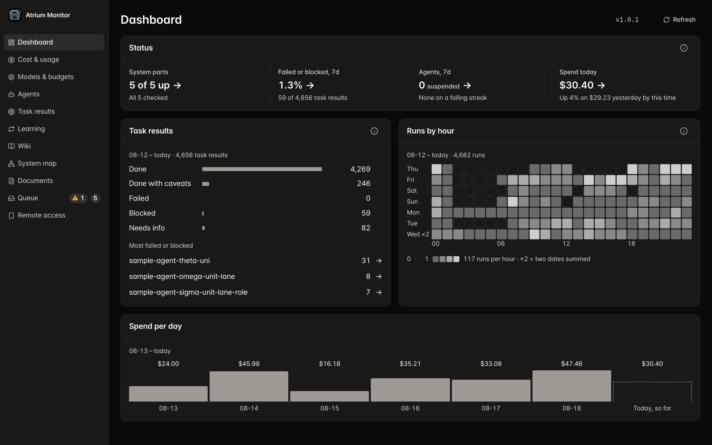
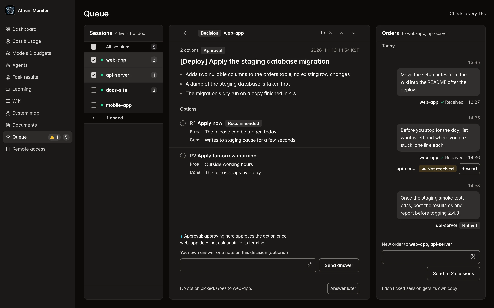
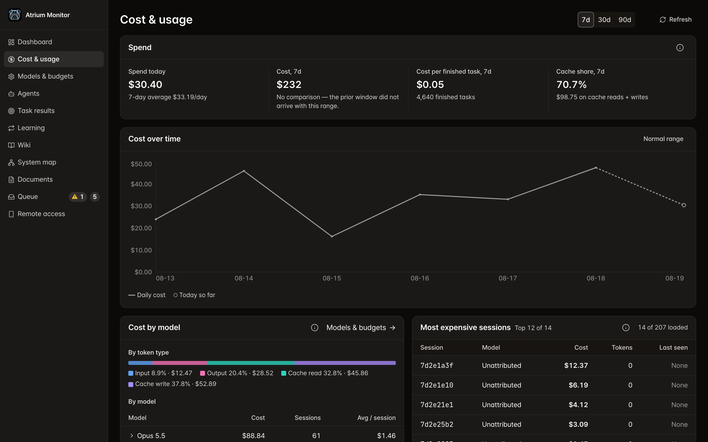
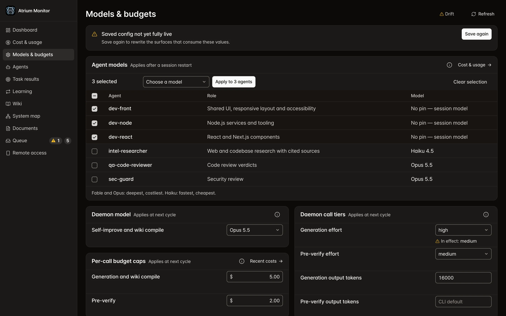
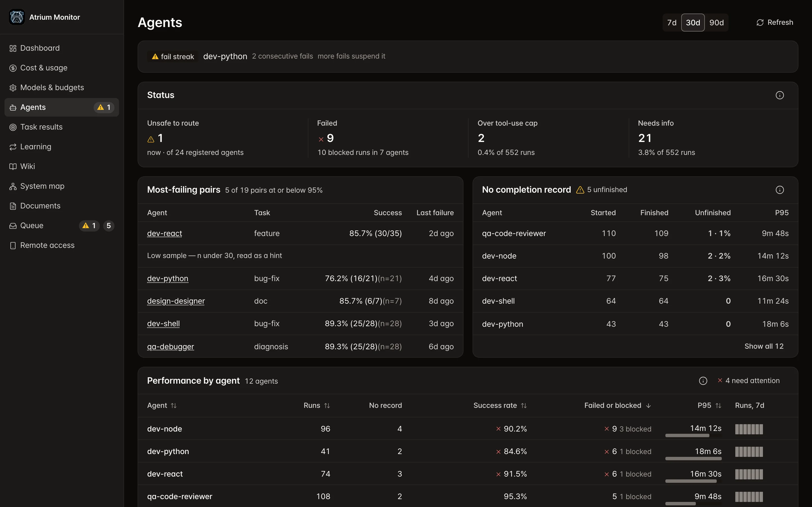
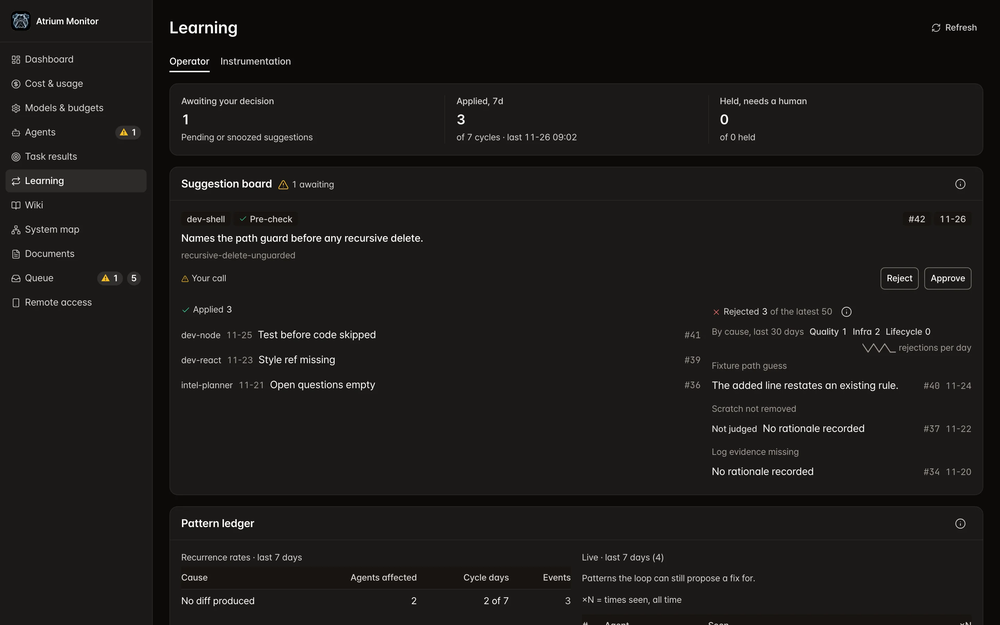
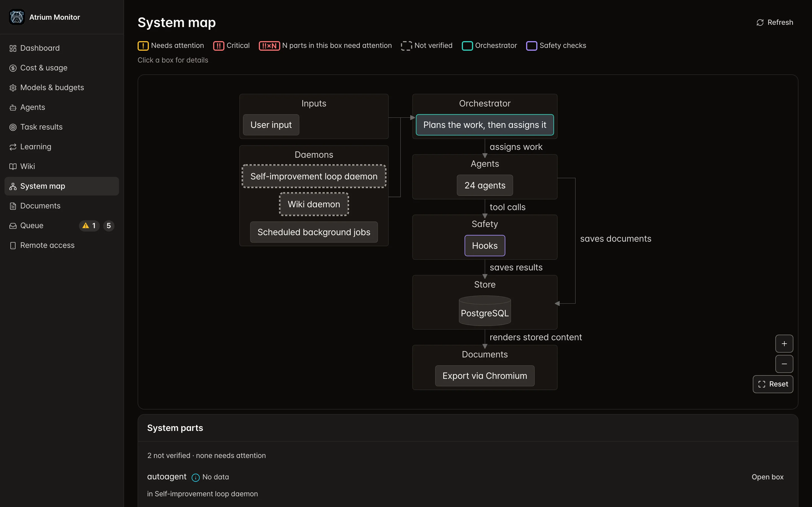
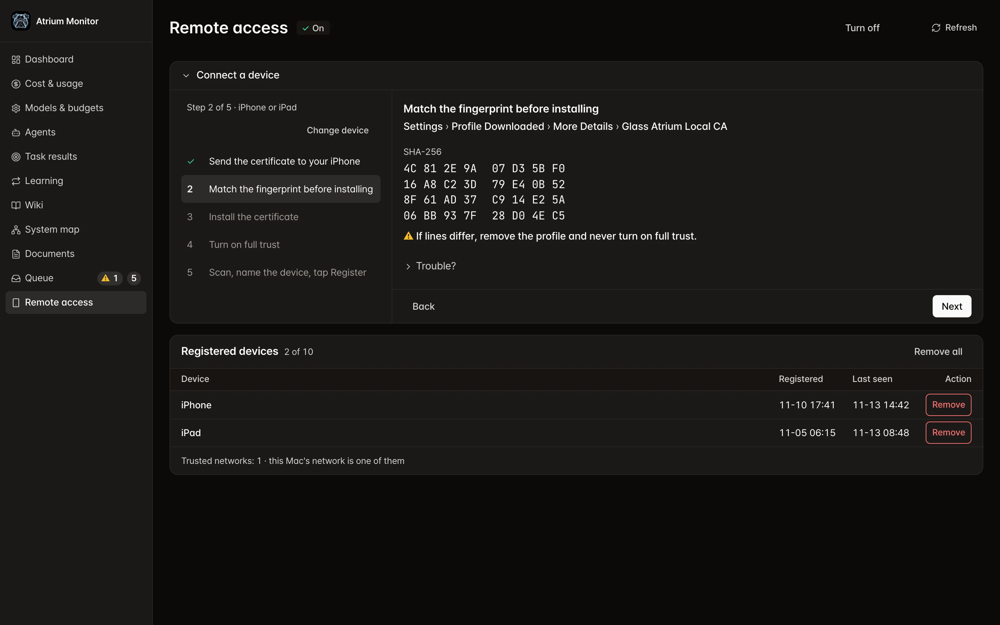

<!-- banner: https://github.com/bettep-dev/glass-atrium/raw/main/docs/assets/banner.webp -->
<p align="center">
  
</p>

**面向 Claude Code、由中心统一编排的自我改进型多智能体 harness。**

[](LICENSE)
[](.github/workflows/ci.yml)


[English](README.md) · [한국어](README.ko.md) · **中文** · [日本語](README.ja.md)

- 由单个编排器（orchestrator）统一监督和掌控一支专业智能体队伍。
  - 绝不允许智能体之间相互移交任务、最终陷入失控的结构。
- 编排器接到一次请求后，将其分解并委派给一支专业智能体团队，再汇总各方结果。
- 所有成本、结果与智能体事件都实时呈现在监控仪表盘上，如同隔着玻璃幕墙将内部尽收眼底。
- 系统被设计为能从反复出现的失败中自行修正指令——你无需改动提示词。
  - 自动指令补丁须通过试验关口：补丁只有在与未改动的指令对比的真实环境试验中胜出后，才会作用于智能体（[运作方式](#运作方式从头到尾)第 8 步）。

> [!WARNING]
> - 一经安装，后台守护进程便会**自动运行**。
>   - 其中一部分每天都会自动调用 Claude，因此即便你不去管它，也会消耗 token（产生费用）。
> - 这套 harness 是一个**高 token 消耗的系统**。
>   - 编排器会把一次请求拆分给一支专业智能体团队，于是一次请求便会扩散成多次子智能体调用，token 消耗可能达到单个智能体的数倍。
> - 不过，这些 token 并不是通过直连 Anthropic API、按用量计费的方式使用的。
>   - 本 harness 运行在你已经订阅的 **Claude Code CLI 之上**，因此无需单独的 API 密钥，也没有按量计费，而是直接使用该订阅套餐所含的 token。

---

<details>
<summary>目录</summary>

- [是什么](#是什么)
- [为什么要做](#为什么要做)
- [核心理念：不是移交连锁，而是单一编排器](#核心理念不是移交连锁而是单一编排器)
- [运作方式，从头到尾](#运作方式从头到尾)
- [大事审慎处理，小事快速处理](#大事审慎处理小事快速处理)
- [内部构成要素](#内部构成要素)
- [技能：内部质量层](#技能内部质量层)
- [快速开始](#快速开始)
- [监控界面](#监控界面)
- [许可证](#许可证)

</details>

## 是什么

- Glass Atrium 是一个配置与工具层，能把 Claude Code CLI 变成一套被设计为受协调、可观测、可自我改进的多智能体系统。
  - 它**不是**新的智能体框架，也**不**取代 Claude Code。
  - 它安装在 `~/.claude/` 下，运行在你已经使用的 CLI 之上。
- 名字里的「玻璃中庭（Glass Atrium）」也是审视这套系统的一副镜片。
  - 与其把 AI 看作一个聪明的个体，不如把它看作一栋 24 小时运转、即便深夜也内部通透可见的玻璃建筑。
  - 这是一家众多专家在其中工作、但所有工作都要经过唯一一位总管的公司。
  - 通透无遮的玻璃，加上所有路径都汇聚而至的中央总管——这两点正是名字所承载的身份。
- 在此之上，它还增添了以下五样东西，仅凭默认安装，它们便会结合成一套统一一致的系统。
  - 一支**按能力进行路由的专业智能体队伍**，取代用单一的通用提示词包揽一切（按技术栈划分的开发者，外加 QA、企划、研究、报告、设计、安全、wiki、元层）
  - 一套**分层规则系统**，用一份矩阵定义哪个智能体加载哪些规则
  - 一条**生命周期钩子（hook）流水线**，在每一个工具边界上*机械地*强制执行这些规则（密钥、危险命令、预算、产出物）
  - 一块**实时监控仪表盘**（Atrium Monitor），把所有成本、结果与智能体事件集中呈现于一处
  - 一个**自我改进循环**，被设计为把反复出现的失败转化为智能体指令补丁
    - 自动指令补丁只有在与未改动的指令对比的真实环境试验中胜出后才会应用，而高风险的变更须经用户批准后才会应用。

## 为什么要做

- 单一的 `CLAUDE.md` 提示词无法扩展到大规模。
  - 一旦你要求同一个模型既当 React 专家，*同时*又当数据库专家，*同时*又当安全审查员，*同时*又当企划者，指令之间就会彼此冲突。
  - 真正重要的规则会淹没在庞大的文本里被稀释，而一旦负载过高，模型就会悄悄偏离那些规则。
- 所以工作必须拆分。
  - 与其依赖一位天才，不如让多位专家协作。
  - 一旦拆分，每位专家都能拥有各自干净的记忆空间（上下文），专注于自己的本职。
- 但顺理成章的下一步——让智能体彼此移交任务——只会把问题放得更大。
  - 在智能体之间的**移交**（handoff）系统里，控制权从 A 交给 B，再从 B 交给 C。
  - 每个智能体都得自己执行自己的规则，可观测性也随之支离破碎。
  - 即便某个出错的智能体在无人制衡的情况下把问题传播下去，也始终没有谁负起最终责任。
- Glass Atrium 正是为了在不放弃掌控的前提下享受专业化的红利而生——答案就是中心化。
  - 因为我们相信，决定成败的并非模型本身的天赋，而是环绕着它的运营体系，也就是这套 harness。
  - 所有专业智能体都在中央的常态监督下运行，因此某一层的失误不会蔓延到整栋建筑。

## 核心理念：不是移交连锁，而是单一编排器

- 其基础是 **Manager Pattern（中心化的管理者模式）**。
- 作为主 Claude Code 会话的单个编排器，就是**战略控制平面**。
  - 它把你的意图*分解*为子任务，*委派*给专业智能体，再*汇总*结果。
  - 它独自掌握全局上下文，并在每一个委派边界上保持控制权。
- 它亲自动手的只有那些移交成本比工作本身还大的极小修改，而且会先用一句话告诉你理由。
  - 因钩子拦截而始终委派的对象：harness 路径 · `.env`、凭据、密钥等敏感文件 · 新的文档文件 · 进行中（`implementing`）计划的目标文件
  - 若无法读取计划列表，则拦截修改（fail closed）。
- 与之相对的模型——**Handoff Pattern（智能体之间直接相互移交控制权的方式）**——则**刻意不予支持**，而这恰恰是关键所在。
- **委派与恢复**
  - 每个子任务都按能力而非关键字、别名匹配进行路由，因此谁负责什么都被精确掌握。
  - 每个智能体都会返回一份结构化的完成记录，由编排器核对意图与结果是否一致。
  - 失败的子智能体交由失败恢复循环处理（重试 → 回退 → 上报给调试器）。
  - 互不重叠的独立子任务，即使你不主动要求，也会默认并行执行。
- **上限**
  - 各智能体的轮次预算：由 harness 在派生（spawn）时刻作为硬上限施加。
  - 并发上限：由工作流引擎运行时施加。
  - 派生深度：不是靠一个策略数字，而是靠结构约束——没有任何智能体的 frontmatter 被授予再次派生的工具（Agent/Task/Workflow），而这份工具清单在派生时刻即被冻结。
- **机械层与自律层** — 仓库里的规则文件自己也是这样划分的。
  - 机械层（真实的代码）：PreToolUse 钩子流水线 · 将安装版本与发布清单（manifest）比对的 harness 完整性检测（`glass-atrium doctor`——检测而非拦截，恢复用 `glass-atrium update`） · 派生时刻的工具冻结
  - 自律（honor-system）层：委派的重试、回退、上报 · `MAX_DEPTH=2` 这个策略数字及其深度计数
- **与失控移交系统的区别**
  - 生命周期钩子拦截每一次工具调用——由钩子支撑的强制执行。
  - 监控观测每一个事件——完整的可观测性。
  - 结果记录让每一次委派都可追踪、可审计。
  - 学习循环被设计为把这些记录与纠正信号转回为指令补丁。记录与汇总目前照常运行，自动指令补丁只有在真实环境试验中胜出后才会应用，而高风险的变更须经用户批准后才会应用。

## 运作方式，从头到尾

1. **你向编排器（主会话）请求某件事**——修复 bug、企划功能、撰写报告。
2. **编排器进行调查与分解**之后，参照能力注册表，组建一支专业智能体团队并确定执行顺序。
3. **它逐一委派子任务**——每一次委派都会在实际执行*之前*先经过 PreToolUse 钩子（拦截危险命令、扫描密钥、标记越界范围、计划验证门）。
4. **专业智能体执行工作**——在 SubagentStart 钩子所注入的自身范围规则之内。
   - 轮次预算是派生时刻施加的硬上限，而工具预算只是发出告警的建议性计量。
   - 较长的任务在触及上限之前先记下进度、停在可恢复的状态，这是设计出来的自律，而非机械保证。
   - 一旦自律没有守住，硬上限就会在作业途中把它切断。
5. **结果被记录。**
   - 每个智能体都会发出一个 `[COMPLETION]` 块，子智能体结束时刻的钩子（SubagentStop）将其捕获为结果记录。
6. **编排器进行汇总**——把已验证的结果汇成单一答复；若出现失败，则运行恢复循环。
7. **一切皆可观测。**
   - 所有成本、结果与智能体事件都会实时流向 PostgreSQL 和 Atrium Monitor。
8. **系统被设计为能自我改进。**
   - 后台守护进程汇集结果记录与纠正信号，把反复出现的失败模式标记为指令改进候选。
   - 反复出现的模式只有在安装中积累了可供试验的结果数据之后才会获得补丁。安全的补丁只有作为真实环境试验运行并胜出时才会自动应用，而高风险的变更会进入用户审批队列。

## 大事审慎处理，小事快速处理

- 这套系统会**根据任务的大小与复杂度，自行决定要走哪些步骤。**
  - 你无需逐一叮嘱「请审慎地一步步来」。
- **又大又复杂的任务** — 会自动走一条先制定计划 → 检查计划是否合理 → 实际构建 → 测试能否正常运作 → 确认是否完成并收尾的审慎流程。
- **小任务** — 跳过这套流程，快速处理。
  - 对于不绑定计划的小任务（`simple-task`），范围、规模估算、团队组成等确认标注变为可选，相应的门禁会静默通过。
  - 绑定计划的任务，无论大小，都要照常经过所有门禁。
- **工作流（workflow）** — 执行上述步骤的方式。
  - 如果你指定「以工作流方式进行」，这些步骤便不再由人逐一触发，而是交给一个自动化引擎一次性打包处理。
  - 无论哪种方式，需要经过的步骤都一样，变的只是执行方式。
- **一句话概括** — 要走哪些步骤由任务大小自动决定，而如何执行则只是可选项。

## 内部构成要素

- **专业智能体队伍** — 按能力注册表（`agent-registry.json`）而非关键字进行路由（涵盖按技术栈划分的开发者、QA、企划/研究/报告、设计、安全、wiki、元层）。
- **分层规则系统** — 用一份明确的合规矩阵，把全局宪章（`agents/GLASS_ATRIUM_GLOBAL_RULES.md`）、核心横切规则（`rules/`）与按范围划分的规则（`scoped/`）绑在一起。
  - 每次会话都常驻加载的规则里只放每次会话都需要的语句，细节则放在按需读取的参考文件中。
    - 常驻加载集（全局宪章 + 不带 `paths:` 的 `rules/glass-atrium/*.md`，共 8 个文件）：156,912 → 69,405 UTF-16 单位
      - 占比最大的是常驻加载规则 `rules/glass-atrium/orchestrator-role.md`（66,061 → 775 单位）——其正文已移至按需读取的 `skills/glass-atrium-ops-orchestrator-role.md`，只留下一个存根。
    - 主会话还会额外收到由 SessionStart 钩子注入的编排器核心（`scoped/orchestrator-core.md`，7,504 单位）。
    - 按需读取的编排器技能（`skills/glass-atrium-ops-orchestrator.md`）：142,358 → 99,449 字节
  - CI 测试（`scripts/test/startup-budget.bats`）把常驻加载集守在 145,000 UTF-16 单位以下。
- **生命周期钩子流水线** — 一组钩子脚本（`hooks/`），在每一个工具边界上机械地强制执行密钥、危险命令、预算与结果记录。
- **自我改进循环** — autoagent 守护进程（`autoagent/`）被设计为把累积的结果记录与纠正信号转化为智能体指令补丁。
  - 只自动应用安全的补丁；应用前先保存原文，验证失败时便回滚。
  - 有风险的变更（删除、外部调用、权限、智能体身份等）会进入用户审批队列。
  - 补丁生成须有一次通过的 A/A 试验（在不改动指令的情况下对比两个分组，以测量埋点与设计效应的试验）才会开启。
    - 没有通过的 A/A 结果就无法通过检验力（power）检查，因此一个补丁都不会生成。
    - 新安装的首次 A/A 会在第一个写入周期（不是 `--dry-run` 的周期）自动开启。
    - A/A 关闭之后，包括以失败告终的情形，只有亲自运行 `daemon_cycle.py --aa-start`，才会开启下一次 A/A。
      - 它运行的不是检出目录，而是安装版本（`~/.glass-atrium/autoagent/daemon_cycle.py`），并使用定时周期所用的 Python 解释器（`autoagent/daemon-cycle.sh` 的 `AUTOAGENT_PYTHON_BIN`）运行一次。
      - 该命令不会确认运行位置是否为安装版本。
      - 若被拒绝，它会说明原因，不记录任何内容，并以非 0 的退出码结束。
    - 处于开启状态的 A/A，在部署使安装指纹发生变化后，会在下一个写入周期自行重启测量窗口，因此无需你另外操作。
  - 安全的补丁只有在真实环境试验中胜出后才会自动应用，而结果记录与纠正信号的汇总仍在持续运行。
- **Atrium Monitor** — 基于 Fastify 5 + Prisma 7 + React 18、共 11 个界面的实时仪表盘（`http://127.0.0.1:16145`）。
  - 侧边栏界面
    - **Dashboard** — 只挑出此刻需要人来看的内容的首页：告警列表，harness 状态·任务结果·智能体概况·今日支出卡片，本周面板
    - **Cost & usage** — 按日·按模型·按会话的成本与支出速度警告
    - **Models & budgets** — 模型 pin，以及守护进程调用的模型与预算设置
    - **Agents** — 各智能体的性能、失败与不应路由状态
    - **Task results** — 任务结果分析与结果浏览表
    - **Learning** — 自我改进循环的建议·试验·模式状态
    - **Wiki** — wiki 编译周期与状态
    - **System map** — 7 张架构图与实时部件状态
    - **Documents** — 浏览智能体生成的文档，切换进行中/已完成，以及替换
    - **Queue** — 所有者队列（见下）
    - **Remote access** — 远程访问设置与设备注册（只在 Mac 上可打开，已注册设备的侧边栏中没有它）
  - 所有界面都使用共同的布局原子：4px 间距阶梯 · 带名称的页面标题栏 · 单一的 KPI 卡片结构 · 统一的表格行高
  - 控件遵循共同的尺寸档位（按钮、分段控件、输入框、筛选标签为 32px，行内目标 24px 以上），状态改变时尺寸与位置都不会变化。
  - 开关与输入框的默认边框与背景的对比度不低于 3:1，因此即便是未选中的标签也能被看作一个框。
- **模型与预算直接分配** — 在监控的 **Models & budgets** 界面，你无需改动配置文件，即可分配模型与每次调用的 USD 硬上限。
  - 智能体模型：一次性为多个智能体修改其智能体文件（`~/.glass-atrium/agents/*.md`）中的 model 行（pin）。
    - 会直接保存到文件，已在运行的会话重启后才会确定生效。更新会保留这一行。
    - 若派生时直接指定了模型，则以其为先；没有 pin 时，使用发起对话的会话所用的模型。
  - 守护进程卡片：自我改进·wiki 编译调用的模型 · 每次调用的预算上限 · 生成·预验证各阶段的 effort 与输出 token 上限
    - 预算不是月度账单上限，而是用来阻止单次调用失控的每次调用硬上限。
    - 守护进程每个周期读取一次 `daemon-config.json` 并加以应用，若保存的值与实际生效的值不同，就会出现 drift 警告。
- **所有者队列** — 在监控的 **Queue** 界面回复会话提交的决定与报告，并向各会话下达工作命令。
  - 界面是占满一屏电脑屏幕的工作台（手机见下方远程访问），三栏固定不动：左侧会话列表 · 中间条目列表 · 右侧 **Orders**。
    - 从列表中选中的决定·报告，会在中间一栏里取代列表、以单页报告的形式展开，并在页面下方的输入框中回复。
    - 在展开的报告里，用 `←` 按钮（Esc）回到列表，用 `J` / `K` 切换上一条·下一条。
  - 每个会话有一个复选框，勾选的会话既是列表与命令对话的范围，也是接收命令的会话。
    - **Orders** 始终展开，会把命令直接发给勾选的会话。输入框上方会显示接收会话的名称，什么都没勾选时不会发送。
    - 对话中只显示所有者发出的命令，并且只为每个接收会话显示接收状态（`Received` · `Not yet` · `Next turn` · `Not reachable` · `Not received`）。
  - 中间列表按决定 · 报告 · 投递中条目依次分组，会话发给其他会话的**中继（relay）**也会以只读方式出现在同一列表中。
    - 中继无需所有者批准即可送达，但对接收会话来说只是同伴会话提供的信息，既不是所有者的指示，也不是批准。
    - 所有中继和拒绝记录都会保留，所有者可以用 `Redact text` 不可恢复地抹去已保存的中继正文。
  - 高风险操作（删除·合并·部署等）由会话作为带有 **Approval** 标签的审批决定提交，只有选中批准选项的回复才会批准该操作，且仅限一次。
    - 只写了自由文本的回复不算批准；提交之后若事实发生变化，批准即告无效，会话会重新提交新的审批决定。
    - 宿主的权限确认窗口或被拦截的命令无法通过队列回复，它们会留在该会话的终端里。
  - 在命令与报告的回复中最多可附加 8 张图片（每张 10 MB）（按钮 · 拖放 · 粘贴）。
    - 图片保存在监控的数据文件夹里，接收会话通过 `scripts/atrium-queue.sh get` 在条目之后输出的本地文件路径来读取。
  - 界面会自行定期重新读取，无需刷新就能显示新到达的条目。
  - 无需登录或事先设置，像其他界面一样直接打开。
  - 来自其他网站的请求会被拒绝。
  - 经由监控的回复与命令会记录下何时·经由哪条路径进入，而监控没有记录的（在监控之外写入的）回复会在界面上显现出来。
  - 队列回复并不能证明就是所有者本人：同一台电脑上伪造界面请求标头的进程可以以所有者身份回复，与在界面上发出的回复无法区分——批准密钥扫描的回复也一样。
  - 监控不会向正在运行的会话推送任何东西。
    - 会话放在后台运行的等待命令（`scripts/atrium-queue.sh wait`）会取走属于自己的回复与命令。
    - 因此接收会话不需要批准命令。
    - 处于等待中的会话会显示在会话列表里，而发给不在等待的会话的回复，会附上要在该会话中运行的命令。
    - 挂载了 harness 监听器（`hooks/queue-listener.sh`）的交互式会话不用 `wait`，而是结束当前轮次后等待。回复到达时，监听器用一行文字唤醒闲着的会话，取走回复的工作由会话来做。
  - 发给已结束会话的回复与命令，会自动恢复该会话后送达。
  - 会话使用的工具，是主会话的 `atrium-queue` MCP 工具（`post` · `claim` · `record` · `sessions` · `relay`），或已安装的 CLI `~/.glass-atrium/scripts/atrium-queue.sh`（`help` 会显示命令列表）。
    - 子智能体不会直接使用队列，而是把要提交的内容交还给父会话。
    - 用过工具的轮次以 `record` 收尾，该轮次提交的条目由此被记录下来。
    - 工作完成的报告、需要所有者决定的事项、停止或失败的任务、高风险操作的审批请求，后台工作会话必须提交。
- **实时架构图** — 监控的 System map 界面会把 7 张规范架构图（Mermaid）与实时守护进程状态一并渲染。
- **wiki 知识库** — 一个仅供 LLM 使用的存储库（`wiki/`），配有「原始素材 → 经整理笔记」的加工流水线，以及 SQLite BM25 全文检索索引。
  - 研究智能体的网络调查结果会在此积累。
  - 每次开始新的调查/分析之前会先行查询，以复用既有知识。
- **内部智能体技能** — 由智能体和编排器自动调用、采用渐进式披露的 `SKILL.md` 包（参见[技能](#技能内部质量层)）。
- **按文件的符号链接群安装** — 为与用户自有文件互不冲突地共存，以文件（而非目录）为单位，幂等地创建 `~/.claude/<rel>` → `~/.glass-atrium/<rel>` 符号链接。
- **5 个后台守护进程** — `com.glass-atrium.*` 的 launchd 作业，全部在 `config.toml` 中声明。
  - 常驻（keepalive）1 个：monitor
  - 定时 4 个：监控日志轮转 · PG 备份 · autoagent cycle · wiki compile
  - 就像整夜运转的供暖与通风，没有谁一直攥着开关，而是这栋建筑从设计之初就注定不会停歇的设备间。
- **废纸篓清理命令** — `~/.glass-atrium/scripts/ga-trash-purge.sh <条目>` 只会永久删除主目录废纸篓（`~/.Trash`）正下方的单个指定条目，并为每次删除留下一行日志。
  - 智能体不会删除文件，而是将其移入废纸篓，因此无需有人清空废纸篓，也能清理它们自己移入的条目。
  - 废纸篓文件夹本身、其他路径以及深于一层的路径都会被拒绝。
- **工作树清理命令** — `~/.glass-atrium/scripts/prune-worktrees.sh [--apply] [--deployed <sha>] <工作树>...` 用来清理已结束委派的工作文件夹（git 工作树，worktree）。
  - 默认只做检查（空跑，dry-run），必须加上 `--apply` 才会删除。`--list-all` 只列出仓库中所有已关联的工作树。
  - 四项全部通过才会删除：分支已包含在 main（或 `--deployed` 提交）中 · 没有未提交的改动或未跟踪的文件 · 没有写锁 · 文件夹内没有正在运行的进程
    - 无主进程用终止信号（TERM）清理，若存在其他会话的进程，则该工作树原样保留。
  - 不使用强制删除，也不删除分支。git 若拒绝，那就是结论。
- **存储库中零密钥素材** — 仅用 peer-auth 的 PostgreSQL（无密码）、密钥扫描钩子、发布门 PII 扫描。
  - 密钥扫描钩子拦截写入后，就此保持被拦截的状态。
    - 只有一个例外：仅触发通用凭据赋值规则（`SEC-013`）的写入，所有者可以在 Queue 界面上，仅针对这几行批准一次。
      - 钩子把被拦截的行作为请求登记到监控后，会话只提交不含行内容的请求编号，作为审批决定。
      - 所有者在 Queue 界面的卡片上查看这些行，再批准或拒绝。卡片上还会显示一条警告：若里面有真正的密码或密钥，请拒绝。
      - 批准后须在 10 分钟内重新尝试完全相同的写入才能通过，哪怕只有一行不同也无法通过。这些行只存在于监控内存中，重启后就会消失。
      - 触发令牌·密钥·连接字符串形态的写入无法批准。
    - 这项批准是为遵守规则的智能体准备的通道。队列回复不能证明就是所有者本人，这一点写在上面的 **所有者队列** 里。

## 技能：内部质量层

- Glass Atrium 的技能**不是**由用户调用的命令，而是一个内部质量与治理层。
- 它们在会话开始时全局加载，由 Claude 根据当下的任务自动激活。
- 它们涵盖代码/设计规约、运维与验证门，以及 wiki 与 web 工具。
  - 其中一部分会响应监控信号（智能体删除结果等）而触发。
- 你无需知道哪个技能正在运行——harness 会自行挑选并调用。

## 快速开始

- **前置要求**：macOS（Apple Silicon 与 Intel 均支持） · **已登录的 Claude 订阅账号**
  - 包括 Claude Code CLI 在内的其余依赖，都由安装 TUI 征得同意后探测并安装。
  - 有两步需要你亲自完成。
    - 批准 Xcode Command Line Tools 的安装对话框
    - `claude` 登录（若未通过，安装就会停在这里）
- 一次同意即可安装的东西：`postgresql@18` · `node@24` · `bun` · 支持 FTS5 的 `sqlite` · `tmux`/`jq`/`git`/`curl`/`lsof`/`rsync` · `claude` CLI · Python 库（`psycopg`、`psycopg2-binary`、`PyYAML`）
  - 已经装好的会被跳过。
  - 首次安装的耗时大多取决于 Homebrew 的下载与监控端的构建。

```sh
curl -fsSL https://github.com/bettep-dev/glass-atrium/raw/main/install.sh | bash
```

- 交互式菜单打开后，请选择 **Install**。
  - 菜单项有 Install · Token Setup（只签发供守护进程使用的无头 OAuth 令牌） · Monitor（用浏览器打开仪表盘） · Uninstall · Quit。
  - 安装完成后，依赖与守护进程会自动配置并运行。
  - 仪表盘可在 `http://127.0.0.1:16145` 访问。
- 安装必须通过健康门（health gate）才算结束。
  - 之后你也可以用 `glass-atrium doctor` 或监控 **System map** 界面上的 **System health** 状态条再次确认状态。
- **请把安装好的文件夹留在原处。**
  - 安装程序会下载发布包、解压到 `~/.glass-atrium` 文件夹，再以**按文件的符号链接群**（前文所述的方式）与 Claude 配置目录相连。
  - 真实文件就存放在这里，因此一旦移动或删除该文件夹，这些链接便会失效。

### 配置档分支（`CLAUDE_CONFIG_DIR`）

- Atrium 只安装在 `~/.claude` 中。
- 你通过 `CLAUDE_CONFIG_DIR` 使用的其他配置目录（例如 `~/.claude-work`），必须把 `agents`、`rules`、`skills`、`settings.json` 符号链接到 `~/.claude` 一侧。
- 要确认分支会话是否加载了 Atrium 规则，请在 `$HOME` 之外的目录中打开 Claude 会话进行检查——在 `$HOME` 之内，缺失可能会被掩盖。
- `glass-atrium doctor` 无论在何处运行，都会指出缺少链接的分支，并给出可直接运行的修复命令。
  - 检查对象：仅限 `~/.claude` 旁边、至少运行过一次（存在 `.claude.json`）的 `~/.claude-*` 目录——其他路径下的分支请自行检查。

### 更新

- 有新版本发布时，仪表盘工具栏上会出现 **Update available** 徽章。
  - 点击徽章即可就地应用。
  - 在终端里用 `glass-atrium update` 也是同一件事。
- 应用时会取回 GitHub 发布包，并按两条规则进行。
  - **发布包会替换清单（manifest）中列出的所有文件。**
  - `agents/*.md` 只合并 EDITABLE 区域，从而保住你改动过的内容（措辞发生冲突时，由模型仲裁者裁定）。
- 发布包**对删除同样拥有权限**。
  - 清单 `retired` 名单上的文件会被移入废纸篓。
  - 若其哈希是厂商从未分发过的，就会被视为用户的编辑而原样保留。
- 在应用发布包之前，若这次安装最近用过的模型，或模型设置中的模型不在该版本的价格表（`hooks/pricing.json`）里，就不会应用任何内容并停下。
- 应用之后，会把钩子接线调整到新版本，并应用积压的 DB 迁移。
  - 迁移失败时会以具名退出码停下，并提示使用 `glass-atrium db-setup`。
  - 通过仪表盘徽章应用时，会重新构建并重启监控，同时刷新守护进程作业。终端里的 `glass-atrium update` 会在发布版本改动了监控时重新构建监控，但不会重启。若要重新渲染并加载守护进程作业，请用 `glass-atrium reload-launchd`（更新运行期间会被拒绝）。
  - 更新前后都会把 harness 完整性检查结果写入日志（只检测、不拦截，当前状态用 `glass-atrium doctor` 查看）。
- 监控的 `package-lock.json` 或 `package.json` 有变化的版本，会**从 npm 注册表安装依赖**，重新生成 Prisma 客户端后再构建。
  - 只有 Prisma 模式（`schema.prisma`）或 `prisma.config.ts` 有变化的版本，不会访问注册表，只重新生成 Prisma 客户端。
  - 离线时会在这一步以具名退出码停下，并告知恢复顺序（`glass-atrium db-setup` → 监控 `npm run build` → 重启）。
  - 构建失败时同样以非 0 的退出码停下，若是类型错误，则原样保留之前的构建结果。

### 远程访问（同一 Wi-Fi 下的已注册设备）

- 在家中 Wi-Fi 这类受信任的网络里，用一次性注册过的手机·平板浏览器，即可像在 Mac 上一样使用监控的功能。
  - 竖持手机（屏幕宽度不足 640px）时，只有 **Queue** 界面会以简单的单栏布局打开（列表 · Sessions · Orders，一次显示一个），其他界面仍是原样的电脑界面。在 Queue 里回复、向会话下达命令也都可以。
  - 不过 **Remote access** 界面只在 Mac 上可打开，已注册的设备上不会出现。
  - 在 Mac 本机上，仍像现在这样无需登录即可使用。
- **默认是关闭的**。
  - 安装时会问一次（默认值为否）。不在终端里运行的安装，仍保持仅限回环（loopback）。
  - 更新既不会把它打开，也不会改动这项设置。
- 开启后，会在 Mac 上创建本地证书颁发机构（CA）与服务器证书，并询问是否把当前 Wi-Fi 登记为受信任网络。
  - 受信任网络通过路由器地址与硬件地址来区分。在其他 Wi-Fi 上，远程监听器不会打开。
  - 端口遵循 `config.toml` 中的 `[remote_access].port`。
- 每台设备只需做一次，Mac 监控的 **Remote access** 界面会在你选择设备类型（**iPhone or iPad** · **Galaxy phone**）后，依序加以引导。
  - 该界面还负责远程访问的开启·关闭、把当前 Wi-Fi 登记为受信任、已注册设备列表（每台设备的 `Remove`，以及全部的 `Remove all devices`）。
  - iPhone·iPad：用 AirDrop 发送 Mac 的 CA 证书（绝不是密钥文件），安装之前先确认界面上的 SHA-256 指纹与设备上显示的指纹一致，然后安装并开启完全信任。
    - 接着扫描 Mac 界面上的二维码（不行的话，就手动输入地址和注册码），给设备起个名字完成注册。
  - Galaxy 手机：把证书发到手机，在安装界面中作为 CA 证书安装，安装后立即比对指纹，再在 Samsung Internet 中输入地址并填入注册码。
    - 这份引导已在一台 Galaxy 手机上确认（安装 CA 证书、界面上的菜单名称、指纹比对、同一界面上的删除按钮）。One UI 版本和 DeX 模式未被报告，因此其他 Android 版本与模式尚未验证。
  - 注册码只有在 Mac 界面上打开时才会生成，5 分钟后过期。
  - 此后在你断开该设备之前，都不会再询问。
- 终端命令（`glass-atrium remote …`）
  - `on` · `off` — 开启·关闭
  - `list` — 已注册设备列表
  - `revoke <id>` · `revoke-all` — 断开单台·全部设备
  - `trust` — 把当前 Wi-Fi 加入受信任网络
  - `reissue` — 立即重新签发服务器证书
    - 平时，监控与更新会在到期前 30 天、Wi-Fi 地址或 Mac 名称变化时自动重新签发。设备信任的是 CA，因此不会再次询问。
  - 设备注册无法在终端里完成，只能在 Mac 的监控页面上进行。
- `glass-atrium doctor` 会检查密钥权限、Time Machine 排除、证书的主机名·地址·临近到期、监听器绑定的地址与受信任网络，以及防火墙状态（只读）。
- 残余风险（所有者决定承担的部分）
  - 已注册设备若丢失、被夺走或被感染，在断开之前，都可以用它使用全部功能——包括无需权限确认即可运行的会话指示、设置变更、自我更新，直到查看所有文档与会话。这种情形在设计上并不阻止。
  - 在队列回复被当作批准处理的流程里，可以用这样的设备批准部署·合并·删除。队列记录里目前不会留下回复是否来自手机，只会留在远程审计记录中。
  - 被复制的会话 cookie，在断开设备之前，都与所有者等同。
  - 在这台 Mac 上以所有者权限运行的进程，可以伪造页面来源标头来打开注册、读取注册码并注册设备。设备列表与审计记录里能看到，但无法阻止。
  - 注册页面，受信任 Wi-Fi 上的任何人都可以打开。
  - 若设备无视 CA 的名称约束，持有 CA 密钥的一方就能向该设备冒充其他私有网络站点。CA 密钥不会离开这台 Mac。
  - 详情请见 [SECURITY.md](SECURITY.md#remote-access-opt-in)。

### 卸载

- 在菜单中选择 **Uninstall**。
- 它会先停下守护进程，再从 `~/.claude` 一侧清除以下内容，然后删除 GA 数据库。
  - Atrium 铺设的符号链接与空目录外壳
  - `settings.json` 里的钩子接线（原文会以 `settings.json.ga-backup.<时间>` 留在旁边）
  - shell rc 中的 PATH 行
  - 远程访问密钥与已注册设备记录（各设备上已信任的 CA 需自行删除）
- 用户自有文件不会被改动。
  - 存放真实文件的 `~/.glass-atrium` 文件夹同样会保留。
- `~/.claude` 并**不会**被彻底清空。
  - 更新基线（`~/.claude/data/update/baseline-manifest.json`）与 base@install 的智能体原文保管处（`~/.claude/data/update/base-agents/`）默认会保留下来。
  - 因为重新安装时，正是靠这些基准点才能通过三锚点合并接续你对智能体所做的编辑。
- 加上 `--purge-config` 会连 `config.toml` 与基线文件一并移入废纸篓（是移动，而不是删除）。
  - `base-agents/` 保管处在任何模式下都会留存。
  - 菜单中卸载后的清理询问只涉及 `config.toml`，因此若想连基线一起清空，请在终端执行 `glass-atrium uninstall --purge-config --yes`。
- **数据库会先留下备份再删除**（转储保存在 `~/.glass-atrium/backups/postgres/`）。
  - 重新安装时会新建一个数据库。
  - 备份不会自动恢复，如需旧数据，请用 `pg_restore` 手动恢复。

### 如何撰写 Atrium Monitor 文档

- 请求文档、报告、摘要或参考资料时，会委派给 **glass-atrium-intel-reporter**；请求企划、需求定义或任务分解时，则委派给 **glass-atrium-intel-planner**。
- 以何种格式输出，**由请求的措辞决定**。
  - 默认是监控中**隐藏的「仅智能体可见」的 token 优化记录**。
    - 会根据内容形态在 md、yaml、json、txt 中挑选，是一份供日后参考的内部记录。
  - 当你明确表达共享或阅览的意图，比如「**做成 HTML**」「**做成网页文档**」「**用于团队共享**」，就会生成一份可供人阅读和共享的 **HTML 文档**（一个带暗色主题、图表与表格的单一文件）。
- 两种格式都会出现在 Atrium Monitor 的 **Documents**（文档）界面中。
  - 可在「进行中／已完成」状态之间切换。
  - 可以用同一主题的新文档替换旧文档。
- 即便你没有专门请求文档，只要系统判断值得留存，也可能留下一份仅智能体可见的记录。

### 添加开发智能体

- 当你像「添加一个做 OOO 的开发智能体」这样请求时，编排器不会立刻去创建新智能体，而是先判断**该扩展现有智能体，还是新建一个**。
  - **默认是扩展，创建只有在通过门禁时**才被允许。
- 要允许创建，以下三点必须**全部独立地**得到满足。
  - **不同的产出物类型** — 所生成的文件在结构上彼此有别。
  - **不同的决策领域** — 做出正确判断所需的专业能力互不重叠。
  - **不可转移的质量判断** — 一方的质量审查无法仅凭另一方的专业能力来替代。
- 如果所提议智能体的领域与**现有智能体重叠达到一定比例以上，创建就会被拦截**。
  - 因为大量重叠是扩展的信号，而不是新建的信号。
- 整个过程中会有**两次征求用户批准的暂停**。
  - 先由编排器给出判断依据与建议方案，敲定是创建还是扩展。
  - 随后在真正写入智能体文件与注册表之前，再确认一次。
- 正文（系统提示词）由 **glass-atrium-meta-prompt-engineer** 撰写，登记则交给专用的 CLI 处理。
- 你只需请求「添加一个」即可——扩展还是新建的判断以及审批请求，都由编排器负责。

## 监控界面

- 以下界面截取自一台只装入合成数据的独立监控（不含真实安装数据）。

<p align="center"></p>
<p align="center"><em>仪表盘 — 展示 harness 状态行（5 个部件中 5 个正常、7 天失败·拦截占比、被暂停的智能体数、今日支出相对昨日的变化），以及 7 天任务结果、失败·拦截最多的智能体、按时段的运行热力图和每日支出柱状图。若有已停止的部件或超出 7 天平均的支出，会用顶部横幅提示。</em></p>

<p align="center"></p>
<p align="center"><em>Queue — 左侧是会话列表（勾选的会话即列表与命令的范围），中间一列展开某个会话的一个审批决定，显示选项及各选项的利弊（没有展开任何条目时，这一列是决定·报告·投递中条目的列表）；右侧的 Orders 显示发给勾选会话的命令与各会话的接收状态。</em></p>

<p align="center"></p>
<p align="center"><em>成本·用量 — 展示今日、7 天成本（缺少可比较的上一周期数据时显示「无对比」）、每个完成任务的成本、缓存占比 KPI，标出平常范围的 7 天成本趋势折线图，按 token 类型与模型的成本，以及成本最高的会话表，并可在 7·30·90 天之间切换周期。支出高于平常或速度偏快时，会先显示状态行和警告。</em></p>

<p align="center"></p>
<p align="center"><em>Models & budgets — 展示各智能体的模型 pin 表与一次性修改多个所选智能体的操作栏，以及自我改进·wiki 编译调用的守护进程模型、每次调用的预算上限、生成·预验证各阶段的 effort 与输出 token 上限，并标出保存值与实际生效值的差异。</em></p>

<p align="center"></p>
<p align="center"><em>智能体 — 用顶部一行指出处于连续失败的智能体，并在不应路由的智能体、失败、超出工具调用上限、信息不足 KPI 下方，展示最常失败的智能体·任务组合、没有完成记录的运行与 P95，以及各智能体的性能表。</em></p>

<p align="center"></p>
<p align="center"><em>学习 — 展示待审批 1 项、最近 7 天应用 3 项、需人工判断的搁置 0 项卡片；其下的建议看板展开一条待审批建议并附 Reject · Approve 按钮，并排列出 3 项已应用的建议和按原因分类的拒绝及未经判定即关闭的建议，之后接续到模式台账。</em></p>

<p align="center"></p>
<p align="center"><em>System map — 将状态环图例置于顶部，在从输入、守护进程、编排器、智能体、安全钩子、PostgreSQL 存储一直到 Chromium 文档导出的架构图上，用虚线标出两个尚未验证的守护进程，再接续下方的部件状态列表。</em></p>

<p align="center"></p>
<p align="center"><em>Remote access — 展示已开启的远程访问状态与受信任的 Wi-Fi、选择设备类型后依序跟随的连接指引（传送证书 · 比对指纹 · 注册码与二维码），以及已注册设备列表与断开按钮。</em></p>

## 许可证

[MIT](LICENSE) © 2026 Bettep
